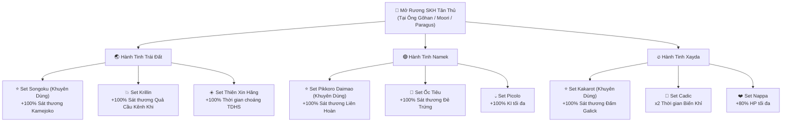
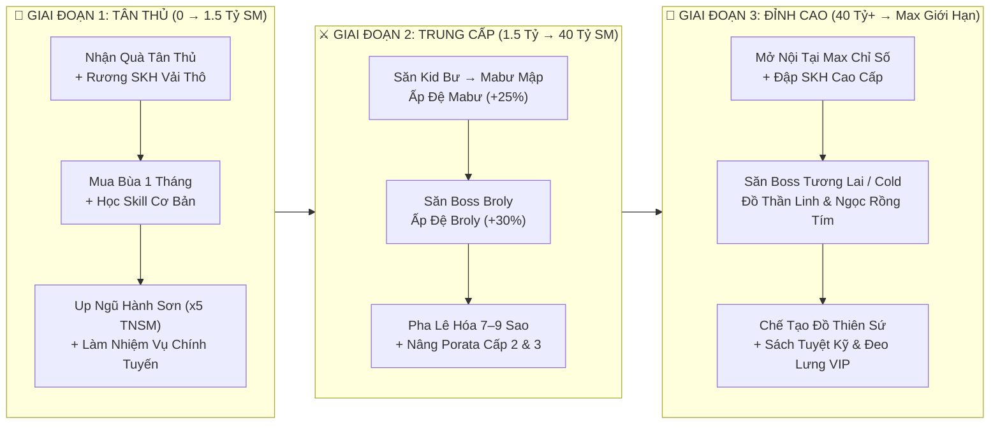
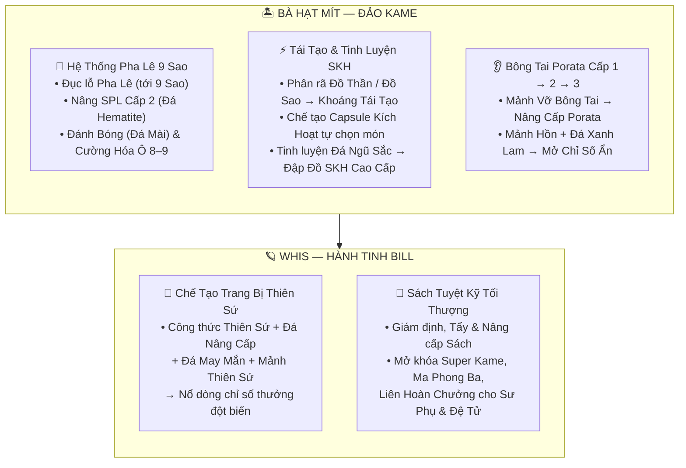



# 🐉 NGỌC RỒNG VIAM — BÁCH KHOA TOÀN THƯ & KIẾN TRÚC LỘ TRÌNH

**Tài liệu hướng dẫn toàn diện từ Tân Thủ đến Cao Thủ • Trừu tượng hóa hệ sinh thái sức mạnh, cơ chế Đệ Tử 3 Cấp, Hành Trang Đa Tab (200–500 Ô), Dịch Chuyển Chiến Thuật & Chế Tạo Đỉnh Cao**

[-0284c7?style=for-the-badge)](#3-kiến-trúc-hành-trang-đa-tab-200-ô--500-ô)

[-7e22ce?style=for-the-badge)](#7-ma-trận-tiến-hóa-đệ-tử--hợp-thể-porata-cấp-13)

---

## 🧭 MỤC LỤC ĐIỀU HƯỚNG

1. [Mô Hình Trừu Tượng Hóa Hệ Sinh Thái Sức Mạnh](#1-mô-hình-trừu-tượng-hóa-hệ-sinh-thái-sức-mạnh)
2. [Khởi Nguyên Tân Thủ & Ma Trận Set Kích Hoạt (SKH)](#2-khởi-nguyên-tân-thủ--ma-trận-set-kích-hoạt-skh)
3. [Kiến Trúc Hành Trang Đa Tab (200 Ô → 500 Ô)](#3-kiến-trúc-hành-trang-đa-tab-200-ô--500-ô)
4. [Không Gian Dịch Chuyển: Boss Khu 0 & Capsule Khứ Hồi](#4-không-gian-dịch-chuyển-boss-khu-0--capsule-khứ-hồi)
5. [Trung Tâm Tự Động Hóa & Hệ Thống Lệnh Tắt](#5-trung-tâm-tự-động-hóa--hệ-thống-lệnh-tắt)
6. [Lộ Trình Cày Cuốc 3 Giai Đoạn (Tân Thủ → Trung Cấp → Đỉnh Cao)](#6-lộ-trình-cày-cuốc-3-giai-đoạn-tân-thủ--trung-cấp--đỉnh-cao)
7. [Ma Trận Tiến Hóa Đệ Tử & Hợp Thể Porata Cấp 1–3](#7-ma-trận-tiến-hóa-đệ-tử--hợp-thể-porata-cấp-13)
8. [Lò Luyện Chỉ Số Chuyên Sâu (Đảo Kame & Hành Tinh Bill)](#8-lò-luyện-chỉ-số-chuyên-sâu-đảo-kame--hành-tinh-bill)
9. [Sinh Thái Săn Boss, Quy Luật Hồi Sinh & Ma Trận Rơi Đồ](#9-sinh-thái-săn-boss-quy-luật-hồi-sinh--ma-trận-rơi-đồ)
10. [Rồng Thần Trái Đất & Rồng Thần Tím (Ngọc Rồng Tím)](#10-rồng-thần-trái-đất--rồng-thần-tím-ngọc-rồng-tím)

---

## 1. MÔ HÌNH TRỪU TƯỢNG HÓA HỆ SINH THÁI SỨC MẠNH

Toàn bộ quá trình phát triển nhân vật trong **Ngọc Rồng VIAM** vận hành theo **Kiến Trúc 3 Tầng Chuyển Hóa** (*Thu Thập Tài Nguyên → Tinh Luyện Cơ Chế → Đột Phá Bản Thể*):

### 📐 Công Thức Trừu Tượng Hóa Sát Thương Đầu Ra (Damage Scaling Formula)

Sức mạnh tổng hợp của một chiến binh không chỉ nằm ở chỉ số gốc, mà là **tích số cộng hưởng** giữa 6 trụ cột độc lập:

$$\text{Sát Thương Cuối} = \Big(\text{SĐ Gốc} + \text{SĐ Đệ Tử} \times K_{\text{Porata}}\Big) \times \Big(1 + \sum \%\,\text{Sao Pha Lê}\Big) \times \Big(1 + \%\,\text{Nội Tại}\Big) \times \Big(1 + \%\,\text{Set Kích Hoạt}\Big) \times K_{\text{Chí Mạng}}$$

Trong đó:
- $K_{\text{Porata}}$: Hệ số cộng hưởng hợp thể (**+20%** Đệ Thường $\rightarrow$ **+25%** Đệ Mabư $\rightarrow$ **+30%** Đệ Broly, cộng thêm chỉ số ẩn từ **Bông Tai Porata Cấp 2 / Cấp 3**).
- $\sum \%\text{Sao Pha Lê}$: Tổng % Sức đánh khảm trên **6 món trang bị × 9 lỗ Sao Pha Lê Cấp 2**.
- $\%\text{Nội Tại}$ & $\%\text{Set Kích Hoạt}$: Hai hệ số **nhân trực tiếp** vào kỹ năng chủ lực (*Kamejoko, Liên Hoàn, Galick, Quả Cầu Kênh Khi, Đẻ Trứng, Biến Khỉ*).

---

## 2. KHỞI NGUYÊN TÂN THỦ & MA TRẬN SET KÍCH HOẠT (SKH)

Ngay khi tạo nhân vật và bước vào **Nhà** (`Nhà Gôhan` / `Nhà Moori` / `Nhà Broly`), hãy đối thoại với **Ông Gôhan / Ông Moori / Ông Paragus** để kích hoạt gói khởi nguyên hoàn toàn miễn phí:

| Biểu Tượng | Hạng Mục Phúc Lợi | Phần Thưởng Nhận Được | Cơ Chế Giới Hạn |
| :---: | :--- | :--- | :--- |
|  | **Nhận Quà Tân Thủ** | **99 Thỏi Vàng** + **1.000.000 Ngọc Xanh** | Nhận 1 lần duy nhất / Tài khoản |
|  | **Rương SKH Tân Thủ** | Trọn bộ **5 món Đồ Vải Thô (Áo, Quần, Găng, Giày, Rada cấp 1)** kèm **Set Kích Hoạt tự chọn (+100% sát thương)** | Tự chọn 1 trong 3 Set của hành tinh (1 lần / Tài khoản) |
|  | **Nhận 200k Ngọc** | **+200.000 Ngọc Xanh** mỗi lượt nhận | **Không giới hạn** số lần nhận |
|  | **Nhận Đậu 10 x99** | **x99 Đậu Thần Cấp 10** phục hồi tức thì HP/KI | **Không giới hạn** số lần nhận |

### 🧭 Ma Trận Quyết Định Chọn Set Kích Hoạt (SKH) Tân Thủ

> [!TIP]
> **Mẹo Tối Ưu Bộ Đồ Vải Thô SKH Tân Thủ**: Bộ 5 món Vải Thô SKH bạn nhận từ Ông Gôhan có thể đem trực tiếp ra **Bà Hạt Mít (Đảo Kame)** để **Pha Lê Hóa lên 7–9 lỗ Sao Pha Lê** và ép **Sao Pha Lê +% Sức Đánh**. Nhờ hiệu ứng **+100% sát thương kỹ năng**, bộ đồ này mạnh vượt trội so với mọi trang bị thường cho tới tận khi bạn săn được đồ SKH Thần Linh!

---

## 3. KIẾN TRÚC HÀNH TRANG ĐA TAB (200 Ô → 500 Ô)

Hệ thống hành trang của **Ngọc Rồng VIAM** sử dụng kiến trúc **Cửa Sổ Trượt Đa Phân Vùng (Sliding-Window Multi-Tab Architecture)**, cho phép chứa tới **500 vật phẩm** mà giao diện Client vẫn mượt mà tuyệt đối ở chuẩn **50 ô / Tab**:

### ⚙️ Nguyên Lý Vận Hành & Cách Sử Dụng
1. **Khởi tạo mặc định**: Mọi nhân vật có sẵn **200 ô Hành Trang**, chia làm **4 Tab (`Tab 1` → `Tab 4`, mỗi Tab 50 ô)**.
2. **Mở rộng tối đa**: Lên đến **500 ô Hành Trang** (**10 Tab × 50 ô**). Mở thêm từng Tab (`+50 ô`) ngay trong **Menu Tiện Ích -> Tab Túi Đồ** (hoặc dùng Túi Mở Rộng Hành Trang).
3. **2 Cách Chuyển Tab Tức Thì**:
   - **Lệnh Chat Siêu Tốc**: Gõ `t1`, `t2`, `t3` ... `t10` (hoặc `tab 1` .. `tab 10`) vào khung chat để ánh xạ ngay Tab đó lên cửa sổ chính.
   - **Menu Trực Quan**: Bấm nút **Lá Cờ (Đổi Cờ)** góc màn hình (hoặc chat `tab` / `tui`) để xem số lượng ô đã dùng của từng Tab (`[32/50 ô]`) và bấm chuyển Tab.
4. **Cơ Chế Tự Động Tràn Tab & Sắp Xếp Độc Lập**:
   - Khi bạn đang mở `Tab 1` để treo quái mà `Tab 1` đã đầy `50/50 ô`, vật phẩm nhặt mới sẽ **tự động điền vào các ô trống của `Tab 2`, `Tab 3`, `Tab 4`...** mà không bao giờ báo đầy hành trang sớm.
   - Khi bấm **Sắp xếp**, hệ thống chỉ sắp xếp gọn gàng trong phạm vi 50 ô của từng Tab, giữ nguyên cách phân loại đồ của bạn giữa các Tab!

---

## 4. KHÔNG GIAN DỊCH CHUYỂN: BOSS KHU 0 & CAPSULE KHỨ HỒI

Để đảm bảo tính cạnh tranh công bằng khi săn Boss nhưng vẫn tiết kiệm tối đa thời gian di chuyển, hệ thống dịch chuyển được thiết kế theo mô hình **Bán Tự Động Chiến Thuật**:

| Tính Năng Di Chuyển | Cơ Chế Hoạt Động Mới Nhất | Lợi Ích Chiến Thuật |
| :--- | :--- | :--- |
| **Dịch Chuyển Tới Boss** *(Gõ lệnh `boss` hoặc mở Menu Tiện Ích)* | Khi bấm chọn 1 Boss đang sống trong **Danh Sách Boss**, hệ thống sẽ dịch chuyển bạn tới **đúng Bản Đồ của Boss nhưng mặc định hạ cánh tại `Khu 0`** *(không bay thẳng vào khu của Boss)*. | Vì Boss chỉ xuất hiện từ **Khu 1 trở đi**, mọi thợ săn sau khi đáp xuống **Khu 0** sẽ tự mở bảng Đổi Khu (`Khu 1..N`) để đua tốc độ dò tìm Boss công bằng! |
|  **Capsule "Về Chỗ Cũ"** *(Kể cả khi vừa chết về Nhà)* | • Tự động ghi nhớ chính xác **Bản Đồ + Số Khu (`Khu X`)** trước khi bạn dùng Capsule hoặc khi bị hạ gục phải hồi sinh về Nhà. • **Mở khóa hoàn toàn Map Tương Lai**: Bạn có thể dùng Capsule bay từ Nhà quay thẳng lại **Map Tương Lai (Map 92–103)** và đúng khu đang săn Boss! | Khi đang săn Boss ở *Tương Lai Khu 7* mà hết Đậu hoặc lỡ tử trận về Nhà, chỉ cần bật **Capsule -> Về chỗ cũ** là lập tức quay lại đúng *Khu 7* để chiến tiếp! |

---

## 5. TRUNG TÂM TỰ ĐỘNG HÓA & HỆ THỐNG LỆNH TẮT

Bạn có thể điều khiển toàn bộ tính năng hỗ trợ thông qua **Nút Lá Cờ (Đổi Cờ)** trên màn hình hoặc gõ lệnh trực tiếp vào khung chat:

| Nhóm Chức Năng | Cú Pháp Lệnh Chat | Mô Tả Cơ Chế Tự Động |
| :--- | :--- | :--- |
| **Bảng Điều Khiển** | `auto` hoặc `menu` | Mở **Menu Tiện Ích Tổng Hợp** (Hành trang đa Tab, Auto Đậu, Auto Treo Quái, Đệ Tử, Danh Sách Boss). |
| **Hành Trang Đa Tab** | `tab`, `tui`, `t1` .. `t10` | Mở bảng quản lý 10 Tab túi đồ hoặc chuyển tức thì sang **Tab 1 → Tab 10**. |
| **Tự Động Bơm Đậu** | `autodau` hoặc `ad` | Tự động ăn **Đậu Thần** khi HP/KI của Sư Phụ hoặc Đệ Tử xuống thấp (cho phép Đệ Tử treo quái 24/24 không bao giờ đói). |
| **Auto Treo Quái & Lọc Đồ** | `treoquai` hoặc `tq` | Tự động đánh quái và **tự động bán đồ rác lấy Vàng** khi túi đầy. Hệ thống **bảo vệ tuyệt đối 100%** các vật phẩm quý: *Đồ có dòng SKH, Đồ Thần Linh, Đồ Thiên Sứ, Đồ có lỗ Sao Pha Lê*. |
| **Rađa Săn Boss** | `boss` hoặc `sanboss` | Mở bảng **Danh Sách Boss Toàn Máy Chủ** và bấm để dịch chuyển nhanh tới **Khu 0** của bản đồ Boss. |
| **Điều Khiển Đệ Tử** | `di theo` / `tan cong` / `bao ve` / `ve nha` / `bien hinh` | Thay đổi trạng thái chiến đấu và kích hoạt biến hình tăng chỉ số cho Đệ Tử ngay lập tức. |

---

## 6. LỘ TRÌNH CÀY CUỐC 3 GIAI ĐOẠN (TÂN THỦ → TRUNG CẤP → ĐỈNH CAO)

### 📌 Chi Tiết Từng Bước Triển Khai
1. **Giai Đoạn 1 — Tăng Tốc Khởi Đầu (0 → 1.5 Tỷ SM)**:
   - Nhận **99 Thỏi Vàng**, **Đậu 10 x99** và mở **Rương SKH Tân Thủ** tại Ông Gôhan / Moori / Paragus.
   - Đổi Thỏi Vàng lấy vàng, mua trọn bộ **Bùa 1 Tháng** (*Trí Tuệ x2 TNSM, Mạnh Mẽ, Da Trâu, Thu Hút, Đệ Tử*) tại **Bà Hạt Mít**.
   - Chọn dòng **"Đi Ngũ Hành Sơn"** tại Ông Gôhan: Bản đồ **Ngũ Hành Sơn (Map 122–124)** nhân **x5 Tiềm Năng Sức Mạnh**, giúp bạn cán mốc hàng tỷ sức mạnh chỉ trong thời gian ngắn.
   - Song song hoàn thành chuỗi **Nhiệm Vụ Chính Tuyến** (*Kuku → Mập Đầu Đinh → Rambo → Tiểu Đội Sát Thủ → Fide → Android → Xên Bọ Hung → Tương Lai*) để mở khóa toàn bộ bản đồ săn Boss.
2. **Giai Đoạn 2 — Xây Dựng Trụ Cột Đệ Tử & Pha Lê (1.5 Tỷ → 40 Tỷ SM)**:
   - Săn **Kid Bư → Mabư Mập** lấy **Quả Trứng Mabư**, sau đó săn **Broly** lấy **Quả Trứng Broly** để tiến hóa lên **Đệ Tử Broly (+30% chỉ số hợp thể)**.
   - Đem bộ trang bị SKH ra **Bà Hạt Mít (Đảo Kame)** đục lên **7 – 9 lỗ Sao Pha Lê** và khảm full Sao Pha Lê Sức Đánh.
3. **Giai Đoạn 3 — Chinh Phục Đỉnh Cao (40 Tỷ SM → Đồ Thiên Sứ)**:
   - Mở **Nội Tại** đúng chiêu thức chủ lực của hành tinh.
   - Săn dàn Boss lớn (*Black Goku, Zamasu, Cumber, Cooler, Siêu Bọ Hung*) thu thập **Đồ Thần Linh (15%)**, **Ngọc Rồng 1–4 Sao**, **Ngọc Rồng Tím**, **Hồng Ngọc**, **Điểm Săn Boss** để chế tạo **Trang Bị Thiên Sứ**, **Sách Tuyệt Kỹ** và đổi **Đeo Lưng Vĩnh Viễn**.

---

## 7. MA TRẬN TIẾN HÓA ĐỆ TỬ & HỢP THỂ PORATA CẤP 1–3

Đệ tử là nguồn cộng hưởng sức mạnh lớn nhất khi **Hợp Thể** cùng Sư phụ. Máy chủ thiết kế chuỗi tiến hóa **3 cấp độ tuần tự**:

### 🥚 Quy Trình Săn Trứng & Tiến Hóa Đệ Tử

| Cấp Bậc Đệ Tử | Biểu Tượng | Chỉ Số Cộng Thêm Khi Hợp Thể | Điều Kiện & Cách Sở Hữu |
| :--- | :---: | :---: | :--- |
| **1. Đệ Tử Thường** |  | **+20% HP / KI / Sức Đánh** | Nhận miễn phí tại **Menu Tiện Ích (`auto`) -> Quản lý Đệ tử** hoặc hạ gục Boss **Super Broly**. |
| **2. Đệ Tử Mabư** |  | **+25% HP / KI / Sức Đánh** *(Kèm khả năng Biến Sôcôla)* | • **Săn trứng**: Hạ Boss **Kid Bư** (xuất hiện 5 con ở 3 hành tinh) $\rightarrow$ Boss **Mabư Mập** lập tức xuất hiện tại khu đó. Hạ **Mabư Mập** có **50% rơi Quả Trứng Mabư**. • **Ấp trứng**: Yêu cầu đang có **Đệ Tử Thường**. Bấm dùng Quả Trứng Mabư trong túi $\rightarrow$ Về **Nhà** bấm vào Quả Trứng để nở ngay. |
| **3. Đệ Tử Broly** *(Cấp Cao Nhất)* |  | **+30% HP / KI / Sức Đánh** *(Đỉnh cao hợp thể)* | • **Săn trứng**: Hạ Boss **Broly** (xuất hiện 5 con ở 3 hành tinh) để nhặt **Quả Trứng Đệ Tử Broly**. • **Ấp trứng**: **Bắt buộc đang sở hữu Đệ Tử Mabư**. Bấm dùng Quả Trứng Broly $\rightarrow$ Về **Nhà** ấp nở thành **Đệ Tử Broly**! |

### ⚡ Bí Quyết Up Đệ Tử Thần Tốc & Mở Khóa 5 Kỹ Năng
- **Mặc trang bị cho Đệ Tử**: Mở khóa ngay khi Đệ Tử đạt **1.500.000 Sức Mạnh**.
- **Combo Up Đệ Tử Nhanh Nhất**: Mua **Bùa Đệ Tử** + Bật **Auto Đậu (`autodau`)** + Mặc đồ ép **Sao Pha Lê +% TNSM** + Bật chế độ **`tan cong`** tại **Ngũ Hành Sơn (x5 TNSM)**.
- **Các Mốc Đột Phá Kỹ Năng**:
  - `150 Triệu SM`: Mở **Chiêu 2** (*Kamejoko / Masenko / Antomic*).
  - `1.5 Tỷ SM`: Mở **Chiêu 3** (*Thái Dương Hạ San / Khiên Năng Lượng / Tái Tạo Năng Lượng*).
  - `20 Tỷ SM`: Mở **Chiêu 4** (*Biến Khỉ / Đẻ Trứng / Khiên Năng Lượng*).
  - `40 Tỷ SM`: Mở **Chiêu 5** (*Kỹ năng tối thượng*).

---

## 8. LÒ LUYỆN CHỈ SỐ CHUYÊN SÂU (ĐẢO KAME & HÀNH TINH BILL)

Toàn bộ các cơ chế nâng cấp trang bị và đột phá giới hạn chỉ số được tập trung tại **Bà Hạt Mít (Đảo Kame)** và **Whis (Hành Tinh Bill)**:

### 🔍 Bảng Tổng Hợp Các Cơ Chế Gia Tăng Chỉ Số Nhân Vật

| Cơ Chế Nâng Cấp | NPC / Vị Trí | Nguyên Liệu Cốt Lõi | Tác Động Gia Tăng Chỉ Số |
| :--- | :--- | :--- | :--- |
| **Pha Lê Hóa & Cường Hóa 9 Sao** | Bà Hạt Mít *(Đảo Kame)* | Vàng, Ngọc, Sao Pha Lê, Đá Hematite, Dùi Đục, Đá Mài | Mở tối đa **9 lỗ Sao Pha Lê / món** (hỗ trợ đập nhanh x10, x100 lần) và nâng Sao Pha Lê lên **Cấp 2**. |
| **Tinh Luyện SKH & Đá Ngũ Sắc** | Bà Hạt Mít *(Đảo Kame)* | Đồ Thần Linh / Đồ Sao phân rã, Khoáng Tái Tạo, Đá Ngũ Sắc | Chế tạo **Capsule Kích Hoạt** hoặc nâng cấp trực tiếp trang bị cấp cao thành **Trang Bị Kích Hoạt (+100% sát thương)**. |
| **Bông Tai Porata Cấp 2 & Cấp 3** | Bà Hạt Mít *(Đảo Kame)* | Mảnh Vỡ Bông Tai, Mảnh Hồn Bông Tai, Đá Xanh Lam | Gia tăng hệ số hợp thể và mở thêm dòng **+% Sức Đánh / HP / KI / Chí Mạng** vĩnh viễn khi hợp thể. |
| **Chế Tạo Đồ Thiên Sứ** | Whis *(Hành Tinh Bill)* | Công thức Thiên Sứ, Mảnh Thiên Sứ, Đá Nâng Cấp, Đá May Mắn | Trang bị cấp cuối với chỉ số gốc vượt xa Đồ Thần Linh và cơ hội nổ dòng thưởng cực đại. |
| **Sách Tuyệt Kỹ** | Whis *(Hành Tinh Bill)* | Sách Tuyệt Kỹ, Bìa Sách, Kìm Bấm | Cộng thêm chỉ số trực tiếp và kích hoạt tuyệt kỹ tối thượng (**Super Kame, Ma Phong Ba, Liên Hoàn Chưởng**). |
| **Nội Tại & Thẻ Sưu Tầm (Radar)** | Menu Bản Thân | Vàng / Ngọc (Nội Tại) & Thẻ Quái/Boss (Bách Khoa Toàn Thư) | Nhân sát thương kỹ năng chủ lực và cộng thẳng Sức Đánh / HP / KI gốc vĩnh viễn khi sưu tầm đủ bộ thẻ. |

---

## 9. SINH THÁI SĂN BOSS, QUY LUẬT HỒI SINH & MA TRẬN RƠI ĐỒ

### 🎯 4 Quy Luật Săn Boss Chiến Thuật Cần Nhớ
1. **Không bao giờ xuất hiện ở Khu 0**: Toàn bộ Boss trên máy chủ được lập trình sinh ra ngẫu nhiên từ **Khu 1 trở đi (`Khu 1 .. Khu N`)**.
2. **Dịch chuyển Boss đưa tới Khu 0**: Khi bấm vào Boss trong **Danh Sách Boss (`boss`)**, bạn sẽ được đưa tới **Khu 0** của bản đồ đó để tự chuyển khu dò tìm.
3. **Thông báo Kênh Thế Giới trễ 1 phút (60 giây)**: Những người chơi chủ động tuần tra tại các bản đồ săn Boss sẽ có **60 giây lợi thế** phát hiện Boss trước khi tên bản đồ được phát thông báo toàn máy chủ.
4. **Cơ chế tự biến mất sau 15 phút & Canh giờ hồi sinh**:
   - Nếu Boss đứng trên bản đồ quá **15 phút** mà **chưa từng bị ai tấn công**, ngay khoảnh khắc có một người chơi bước vào khu vực đó, Boss sẽ **tự động biến mất ngay trước mặt người chơi** và bắt đầu chu kỳ đếm ngược hồi sinh mới (**10 – 15 phút** với Boss lớn).
   - Cơ chế này giúp bạn **biết chính xác thời điểm Boss biến mất** để căn chuẩn giờ Boss xuất hiện lại ở lượt kế tiếp!

### 💎 Ma Trận Phân Tầng Vật Phẩm Rơi Từ Boss
Mỗi con Boss bị hạ gục đều cộng trực tiếp **+1 Điểm Săn Boss** và **+1 Điểm Sự Kiện** vào nhân vật, đồng thời rơi vật phẩm theo phân tầng:

| Phân Tầng Boss | Danh Sách Boss Tiêu Biểu | Ngọc Rồng Thường & Ngọc Rồng Tím | Trang Bị & Vật Phẩm Giá Trị |
| :--- | :--- | :--- | :--- |
| **Tầng 1: Boss Nhiệm Vụ Đầu** *(3 con / loại cùng lúc)* | Kuku, Mập Đầu Đinh, Rambo | Rơi **Ngọc Rồng 4 – 7 Sao** | Vàng, Hồng Ngọc, Đậu Thần *(Không rơi trang bị)* |
| **Tầng 2: Boss Đệ Tử Đặc Biệt** *(5 con / loại ở 3 hành tinh)* | **Kid Bư → Mabư Mập**, **Broly**, Super Broly | Vàng, Hồng Ngọc | • **Mabư Mập**: **50% rơi Quả Trứng Mabư** • **Broly**: Rơi **Quả Trứng Đệ Tử Broly** |
| **Tầng 3: Boss Tiểu Đội & Hằng Ngày** | Tiểu Đội Sát Thủ Namek, Bojack, Kogu, Zangya... | Rơi **Ngọc Rồng Thường** (có tỷ lệ 1–2 Sao) **HOẶC** **Ngọc Rồng Tím 6–7 Sao** | Chuyên cày Ngọc Rồng, Vàng & Hồng Ngọc *(Không rơi đồ)* |
| **Tầng 4: Boss Trung Cấp** *(Từ Nappa trở đi)* | Nappa, Vegeta, Fide Đại Ca, Android 13/14/15/19/20, Pic, Poc, King Kong, Pui Pui, Yacon, Drabura | Rơi **Ngọc Rồng 1 – 4 Sao** *(không rơi 5–7 sao)* **HOẶC** **Ngọc Rồng Tím 6–7 Sao** | **2% rơi Trang Bị Kích Hoạt (SKH)** + Vàng + Hồng Ngọc |
| **Tầng 5: Boss Đại Ca & Tương Lai** *(Hồi sinh 10–15 phút)* | **Xên Bọ Hung, Xên Hoàn Thiện, Siêu Bọ Hung, Black Goku, Super Black Goku, Zamasu, Cooler, Cumber** | Rơi **Ngọc Rồng 1 – 4 Sao** *(tỷ lệ 1–2 Sao cao)* **HOẶC** **Ngọc Rồng Tím 6–7 Sao** | **15% rơi Đồ Thần Linh** + **2% rơi Trang Bị Kích Hoạt (SKH)** + Thỏi Vàng + Sao Pha Lê |

> [!NOTE]
> **Quy tắc loại trừ Ngọc Rồng**: Trong mỗi lượt hạ Boss, hệ thống xét độc lập giữa **Ngọc Rồng Tím** và **Ngọc Rồng Thường** (nếu đã rơi Ngọc Rồng Tím thì lượt đó sẽ không rơi thêm Ngọc Rồng Thường và ngược lại).

### 🛒 Cửa Hàng Quy Lão Kame (Đảo Kame) — Đổi Đeo Lưng & Cải Trang VIP
Tích lũy **Điểm Sự Kiện**, **Điểm Săn Boss** và **Hồng Ngọc** khi săn Boss để đổi vật phẩm tại **Quy Lão Kame (Đảo Kame)**:
- **Shop Đeo Lưng Sự Kiện**:
  - Mua bằng **Điểm Sự Kiện**: Nhận Đeo Lưng chỉ số cao với **Hạn sử dụng 5 Ngày**.
  - Mua bằng **Hồng Ngọc**: Nhận Đeo Lưng tương ứng với hạn sử dụng **VĨNH VIỄN**!
- **Shop Cải Trang Tối Ưu**:
  - Dùng **Điểm Săn Boss + Thỏi Vàng** để đổi các Cải trang tối ưu hóa sát thương chuyên biệt cho từng hệ phái.

---

## 10. RỒNG THẦN TRÁI ĐẤT & RỒNG THẦN TÍM (NGỌC RỒNG TÍM)

| Loại Rồng Thần | Biểu Tượng | Cách Thu Thập & Ghép Ngọc | Điều Ước Tiêu Biểu |
| :--- | :---: | :--- | :--- |
| **Rồng Thần Trái Đất** *(Ngọc Rồng 1 – 7 Sao)* |    | Săn Boss nhặt trực tiếp **Ngọc Rồng 1 – 4 Sao** (hoặc dùng tính năng **Nhập Ngọc Rồng** tại Bà Hạt Mít: 7 viên cấp dưới ghép thành 1 viên cấp trên). | • Tăng **+2% Chí Mạng** vĩnh viễn • Nâng cấp **Găng Tay** đang mang • Đổi kỹ năng **Chiêu 2 & 3 của Đệ Tử** • Nhận Ngọc Xanh / Cải trang |
| **Rồng Thần Tím** *(Ngọc Rồng Tím 1 – 7 Sao)* |  | Săn các Boss từ Tiểu Đội trở lên để nhặt **Ngọc Rồng Tím 6 Sao & 7 Sao**, sau đó đến **Bà Hạt Mít (Đảo Kame) -> Nhập Ngọc Rồng** để ghép dần lên đủ bộ **1 – 7 Sao Ngọc Rồng Tím**. | Triệu hồi **Rồng Thần Sự Kiện (Rồng Tím)** để nhận các phần thưởng và phúc lợi gia tăng chỉ số đặc biệt giá trị! |

---

**🔥 Chúc các chiến binh bùng nổ sức mạnh và làm chủ vũ trụ tại NGỌC RỒNG VIAM! 🔥**

