<div align="center">

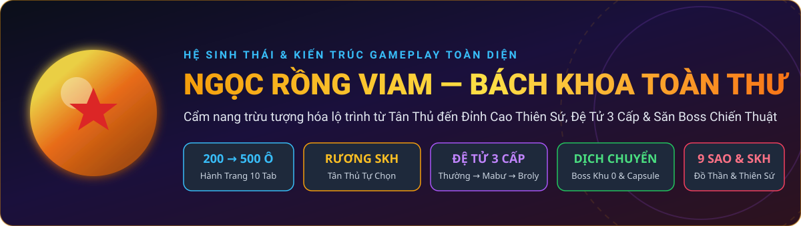

# 🐉 NGỌC RỒNG VIAM — CẨM NANG TÂN THỦ & BÁCH KHOA TOÀN THƯ

**Hướng dẫn cầm tay chỉ việc từ Phút Đầu Tiên Vào Game cho Người Mới • Định hướng Build 3 Hành Tinh • Đập Đồ 9 Sao & Chuyển Hóa SKH • Hệ Thống Đệ Tử, Săn Boss & Sự Kiện**

[](#-00-lộ-trình-tân-thủ-10-bước-chơi-từ-con-số-0-dành-cho-người-mới-100)
[-0284c7?style=for-the-badge)](#-26-các-tính-năng-hỗ-trợ-vật-phẩm-hành-trang-đa-tab-200500-ô--auto-lọc-đồ)
[](#-13-định-hướng-lối-chơi-build--chọn-set-kích-hoạt-theo-từng-hành-tinh)
[-7e22ce?style=for-the-badge)](#-32-hệ-thống-tiến-hóa-đệ-tử-3-cấp-thường--mabư--broly)
[](#-05-hệ-thống-boss-quy-luật-hồi-sinh--ma-trận-vật-phẩm-rơi)

</div>

---

## 📁 MỤC LỤC NHANH (BẤM ĐỂ NHẢY TỚI CHUYÊN ĐỀ)

```text
📦 NGOC-RONG-VIAM-HANDBOOK/
├── 🌟 00-Lo-Trinh-Tan-Thu-Cam-Tay-Chi-Viec/          <-- NGƯỜI MỚI CHƠI ĐỌC PHẦN NÀY TRƯỚC!
│   ├── 📄 0.1. Giải thích giao diện, di chuyển W A S D & các nút bấm quan trọng
│   ├── 📄 0.2. 10 Bước làm chủ game từ Phút Đầu Tiên (0 SM → 120 Tỷ SM)
│   └── 📄 0.3. Bảng tra cứu NPC: "Muốn làm việc này thì gặp ai, ở đâu?"
├── 📂 01-Tong-Quan-Suc-Manh-Va-Dinh-Huong-Hanh-Tinh/
│   ├── 📄 1.1. Kiến trúc 3 tầng sức mạnh & Công thức tính sát thương
│   ├── 📄 1.2. Cách cộng điểm Tiềm năng (HP, KI, Sức Đánh, Chí Mạng)
│   └── 📄 1.3. Chọn Set Kích Hoạt (SKH), Chiêu Xuyên Giáp & Lối chơi 3 Hành Tinh
├── 📂 02-He-Thong-Vat-Pham-Trang-Bi-Va-Dap-Do-Sao/
│   ├── 📄 2.1. Quà Tân Thủ miễn phí tại Nhà & 5 cấp bậc Trang bị
│   ├── 📄 2.2. Đập Đồ Sao Pha Lê (1 → 9 Sao), SPL Cấp 2 & Đập Cấp [+1..+16]
│   ├── 📄 2.3. Đập Đồ SKH, Chuyển Hóa (Giữ SKH & SPL), Xóa SKH & Tái Chế Đồ Thần
│   ├── 📄 2.4. Học Chiêu Đặc Biệt (Skill 9 Xuyên %HP Boss), Sách Tuyệt Kỹ & Đồ Thiên Sứ
│   ├── 📄 2.5. Quy luật Vật phẩm Hồng Ngọc (100% Random chỉ số), Cải trang & Đeo Lưng
│   └── 📄 2.6. Hành Trang Đa Tab (200–500 Ô), Auto Săn Boss & Auto Dọn Túi Đồ
├── 📂 03-He-Thong-Tang-Truong-Suc-Manh/
│   ├── 📄 3.1. Lộ trình cày Sức Mạnh & Mở Giới Hạn SM (Đệ Tử miễn giảm TNSM sau 40 Tỷ)
│   ├── 📄 3.2. Tiến Hóa Đệ Tử 3 Cấp (Thường → Mabư → Broly +30%) & Mở Skill 5
│   ├── 📄 3.3. Nâng cấp Bông Tai Porata Cấp 1 → Cấp 2 → Cấp 3
│   └── 📄 3.4. Nội Tại, Hào Quang Săn Boss 3 Cấp, Thẻ Sưu Tầm & Danh Hiệu
├── 📂 04-He-Thong-Ban-Do-Pho-Ban-Va-Di-Chuyen/
│   ├── 📄 4.1. Phân khu Bản Đồ (Ngũ Hành Sơn x5 TNSM, Tương Lai, Cold, Bill)
│   ├── 📄 4.2. Hệ thống Phó Bản (Doanh Trại, Kho Báu, Khí Gas, Rắn Độc)
│   └── 📄 4.3. Khu Tự Động, Dịch Chuyển Boss (Khu 0), Capsule & Hồi Sinh Tại Chỗ (5 Lần Free)
├── 📂 05-He-Thong-Boss-Va-Vat-Pham-Roi/
│   ├── 📄 5.1. Cơ chế Sát Thương Boss (100% ST Thật) & Quy luật hồi sinh
│   └── 📄 5.2. Ma trận 5 tầng Boss & Phân tầng rơi Đồ (<400Tr HP vs >=400Tr HP), Trứng Broly 100%
├── 📂 06-He-Thong-Rong-Than-Va-Ngoc-Rong-Tim/
│   ├── 📄 6.1. Nhập Ngọc Rồng nhanh tại Bà Hạt Mít
│   └── 📄 6.2. Điều ước Rồng Thần (+1 Cấp Găng/Quần, 20 Tỷ Vàng, +2% Chí mạng) & Rồng Thần Tím
└── 📂 07-He-Thong-Kinh-Te-Su-Kien-Va-Lenh-Auto/
    ├── 📄 7.1. Cách kiếm Vàng nhanh (Nhiệm vụ & Thành tích Bò Mộng 515 Thỏi Vàng)
    ├── 📄 7.2. Chuỗi Nhiệm vụ KOL & Hệ thống 12 Sự Kiện Lễ Hội
    └── 📄 7.3. Bảng tổng hợp Lệnh Chat Nhanh, Phím W A S D & Lịch Bảo Trì 08:00 Sáng
```

- [🌟 00. Lộ Trình Tân Thủ: 10 Bước Chơi Từ Con Số 0](#-00-lộ-trình-tân-thủ-10-bước-chơi-từ-con-số-0-dành-cho-người-mới-100)
- [📂 01. Tổng Quan Sức Mạnh, Cách Nâng Chỉ Số & Định Hướng 3 Hành Tinh](#-01-tổng-quan-sức-mạnh-cách-nâng-chỉ-số--định-hướng-lối-chơi-3-hành-tinh)
- [📂 02. Vật Phẩm, Đồ Mặc, Set Kích Hoạt & Đập Đồ Sao Tăng Cấp](#-02-hệ-thống-vật-phẩm-trang-bị-mặc-set-kích-hoạt--đập-đồ-sao-tăng-cấp)
- [📂 03. Hệ Thống Tăng Trưởng Sức Mạnh Đa Tầng](#-03-hệ-thống-tăng-trưởng-sức-mạnh-đa-tầng)
- [📂 04. Hệ Thống Bản Đồ (Map), Phó Bản & Cơ Chế Dịch Chuyển](#-04-hệ-thống-bản-đồ-map-phó-bản--cơ-chế-dịch-chuyển)
- [📂 05. Hệ Thống Boss, Quy Luật Hồi Sinh & Ma Trận Vật Phẩm Rơi](#-05-hệ-thống-boss-quy-luật-hồi-sinh--ma-trận-vật-phẩm-rơi)
- [📂 06. Hệ Thống Rồng Thần Trái Đất & Rồng Thần Tím](#-06-hệ-thống-rồng-thần-trái-đất--rồng-thần-tím-ngọc-rồng-tím)
- [📂 07. Hệ Thống Kinh Tế, Sự Kiện & Bảng Lệnh Auto](#-07-hệ-thống-kinh-tế-nhiệm-vụ-hàng-ngày--bảng-lệnh-auto)

---

# 🌟 00. LỘ TRÌNH TÂN THỦ: 10 BƯỚC CHƠI TỪ CON SỐ 0 (DÀNH CHO NGƯỜI MỚI 100%)

Nếu bạn là người mới hoàn toàn, chưa từng chơi hoặc vừa mới tạo tài khoản tại **Ngọc Rồng VIAM**, hãy làm chính xác theo **10 bước tuần tự** dưới đây để nắm trọn toàn bộ cách chơi chỉ trong **15 phút đầu tiên**:

---

## 🎮 0.1. Giải Thích Nhanh Giao Diện & Các Nút Bấm Quan Trọng

| Thao Tác Trong Game | Cách Mở Nhanh Nhất | Dùng Để Làm Gì? |
| :--- | :--- | :--- |
| **1. Mở Menu Tiện Ích (`Auto`)** | • **Cách 1**: Bấm vào **biểu tượng Lá Cờ (Đổi Cờ PK)** ở góc trên bên trái màn hình (cạnh thanh Máu/KI).<br>• **Cách 2**: Bấm nút Chat và gõ chữ `auto` rồi Enter. | Mở bảng điều khiển trung tâm: **Đổi Tab Hành Trang (`1–5`), Bật Auto Buff Đậu, Auto Treo Quái, Auto Săn Boss, Auto Dọn Túi Đồ, Nhận & Quản lý Đệ Tử, Xem Danh Sách Boss & Dịch chuyển tới Boss**. |
| **2. Chỉnh Kích Thước Màn Hình PC** | • Tại màn hình Đăng nhập, bấm vào chữ **`DragonBoy v2.4.0 (x2)` ở góc trên bên phải** để đổi độ phân giải (`x1`, `x2`, `x3`, `x4`) rồi tắt mở lại game.<br>• Hoặc kéo trực tiếp viền/góc cửa sổ game để phóng to tùy ý! | Khắc phục ngay tình trạng cửa sổ game bị nhỏ trên màn hình máy tính độ phân giải cao. |
| **3. Di Chuyển Bằng Phím `W A S D` Trên PC** | • Khởi động game bằng file **`Chay_Game_WASD.bat`** (hoặc chạy **`Bat_Phim_WASD.bat`** trong thư mục game). | Điều khiển nhân vật bay/chạy mượt mà bằng các phím **`W` (Lên), `A` (Trái), `S` (Xuống), `D` (Phải)** song song với cụm phím mũi tên. Khi bấm `Enter` mở khung Chat để gõ chữ, bộ phím tự động nhường phím và tự tắt khi đóng game! |
| **4. Đổi Tab Hành Trang (`Tab 1 → 5`)** | • Gõ chat `t1`, `t2`, `t3`, `t4`, `t5` (hoặc bấm **Nút Lá Cờ -> Quản lý Túi đồ**). | Nhân vật của bạn có **nhiều ngăn túi đồ (mỗi Tab 100 ô, mặc định 2 Tab = 200 ô, mở tối đa 5 Tab = 500 ô)**. Khi Tab 1 đầy 100 ô, đồ mới nhặt sẽ tự chảy sang Tab 2! |
| **5. Mở Danh Sách Boss & Bay Tới Boss** | • Gõ chat `boss` (hoặc bấm **Nút Lá Cờ -> Danh sách Boss**). | Xem toàn bộ Boss đang sống trên Server đang ở bản đồ nào và **bấm vào tên Boss để bay thẳng tới `Khu 0`** của bản đồ đó! |
| **6. Dùng Viên Capsule Bay Nhanh** | • Mở Hành trang, bấm Sử dụng **Viên Capsule Đặc Biệt**. | Di chuyển tức thời giữa **Nhà, Đảo Kame, Siêu Thị, các Map đang có Boss xuất hiện**, hoặc chọn **"Về chỗ cũ (Khu X)"** để quay lại đúng khu vừa đứng! |
| **7. Hồi Sinh Tại Chỗ (`5 Lần Miễn Phí`)** | • Khi bị hạ gục, bấm chọn **"Hồi sinh tại chỗ"** ngay trên màn hình. | Mỗi người chơi được **miễn phí 5 lần hồi sinh tại chỗ đầu tiên** (`0 Vàng, 0 Ngọc`). Từ lần thứ 6 trở đi tiêu tốn **`1.000.000 Vàng / lần`**. Chỉ cần **Về Nhà** (bấm Về nhà, bay Capsule hoặc đi bộ về nhà) là hệ thống **reset lại đủ 5 lượt miễn phí**! |

---

## 🪜 0.2. 10 Bước Cầm Tay Chỉ Việc Từ Lúc Mới Tạo Nhân Vật

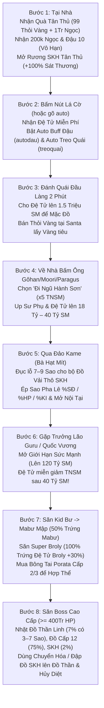

### 🔹 Bước 1: Nhận Toàn Bộ Quà Tân Thủ Miễn Phí Tại Nhà (0 Giây Đầu Tiên)
Ngay khi tạo nhân vật xong, bạn đang đứng trong **Nhà** (*Nhà Gôhan* ở Trái Đất, *Nhà Moori* ở Namek, hoặc *Nhà Broly* ở Xayda). Hãy bấm vào **NPC Ông Gôhan / Ông Moori / Ông Paragus** trong nhà và bấm lần lượt:
1. **Nhận Quà Tân Thủ**: Nhận ngay **99 Thỏi Vàng (`49.5 Tỷ Vàng`)** + **1.000.000 Ngọc Xanh**.
2. **Nhận 200k Ngọc** & **Nhận Đậu 10 x99**: Bấm nhận **không giới hạn số lần** bất cứ khi nào bạn hết Ngọc Xanh hoặc Đậu Thần!
3. **Nhận Rương SKH Tân Thủ**: Mỗi tài khoản có sẵn **5 Rương SKH**. Bấm nhận rồi mở Hành trang sử dụng Rương để tự chọn **1 bộ 5 món Đồ Vải Thô (Áo, Quần, Găng, Giày, Rada) có sẵn dòng Set Kích Hoạt (+100% sát thương kỹ năng)**!
   - *Gợi ý chọn nhanh cho người mới*:
     - **Trái Đất**: Chọn **Set Songoku** (`+100% Kamejoko`) hoặc **Set Thần Vũ Trụ Kaio** (`+60% HP/SĐ/Giáp, +20% Chí mạng, +25% SĐCM, +100% Kaioken`).
     - **Namek**: Chọn **Set Ốc Tiêu** (`+100% Liên Hoàn`) hoặc **Set Chiến Binh Nail** (`+80% HP/KI/Giáp, +50% SĐ, +30% SĐCM, +100% Masenko & -50% hồi chiêu`).
     - **Xayda**: Chọn **Set Kakarot** (`+100% Galick`) hoặc **Set Cadic M** (`+60% Sức Đánh, +50% HP/Giáp, +25% SĐCM, +30% HP nổ & +30% ST Tự Phát Nổ`).

### 🔹 Bước 2: Nhận Đệ Tử Miễn Phí & Bật Chế Độ Tự Động (`Auto`)
1. Bấm vào **Nút Lá Cờ (Đổi Cờ PK)** ở góc trái trên màn hình (hoặc gõ chat `auto`):
   - Chọn **Quản lý Đệ tử -> Nhận Đệ tử Miễn phí** để có ngay 1 Đệ tử đi theo.
   - Bấm bật **Auto Buff Đậu** (hoặc gõ chat `autodau`) để hệ thống tự động hồi đầy Máu/KI cho cả bạn và Đệ tử.
2. Mở bảng **Chức Năng -> Nội Tại** của nhân vật: Mở khóa Nội tại trùng với chiêu thức của bạn (VD: *Kamejoko / Dịch Chuyển Tức Thời* cho Trái Đất; *Liên Hoàn / Masenko* cho Namek; *Đấm Galick / Biến Khỉ / Tự Phát Nổ* cho Xayda).

### 🔹 Bước 3: Học Chiêu Thức, Đổi Vàng & Cho Đệ Tử Mặc Đồ (`1.5 Triệu SM`)
1. **Học kỹ năng**: Tại **Ông Gôhan / Moori / Paragus** ở Nhà (hoặc **Quy Lão Kame / Trưởng Lão Guru / Vua Vegeta**), bấm **Học Kỹ Năng** để học đầy đủ các chiêu thức của hành tinh.
2. **Đổi Thỏi Vàng ra Vàng tiền mặt**: Bay qua **Đảo Kame (Map 5)** gặp **Santa**, bán 1 vài **Thỏi Vàng** trong túi (mỗi Thỏi Vàng bán được **`500.000.000 Vàng`**) để lấy tiền mặt học skill và đập đồ.
3. **Mua Bùa & Cải trang Up Đệ**:
   - Tại **Bà Hạt Mít (Đảo Kame)**: Mua trọn bộ **Bùa 1 Tháng** (*Bùa Trí Tuệ x2/x3/x4 TNSM, Bùa Mạnh Mẽ, Bùa Da Trâu, Bùa Đệ Tử, Bùa Thu Hút*).
   - Tại **Santa (Đảo Kame -> Cửa hàng)**: Mua **Cải trang Thầy Giáo** (`+40% TNSM Sư phụ, +30% TNSM Đệ tử`) và **Cải trang Tôn Ngộ Không / Bát Giới / Sa Tăng Đệ Tử** (`+30% TNSM Đệ`) với giá chỉ **50 Ngọc Xanh**.
4. Cho Đệ tử đánh quái đầu làng khoảng 1–2 phút để Đệ tử đạt **1.5 Triệu Sức Mạnh** $\rightarrow$ Lúc này Đệ tử đã có thể **mặc toàn bộ Trang bị, Cải trang, Đeo lưng và Sách Tuyệt Kỹ**!

### 🔹 Bước 4: Bay Lên Bản Đồ Ngũ Hành Sơn (`x5 TNSM`) Để Up Sức Mạnh Thần Tốc
1. Về **Nhà**, bấm vào **Ông Gôhan / Moori / Paragus** $\rightarrow$ Chọn **"Đi Ngũ Hành Sơn"** (*Map 122, 123, 124*).
2. Toàn bộ quái trên **Ngũ Hành Sơn** được nhân **x5 Tiềm Năng & Sức Mạnh**.
3. Gõ chat `tan cong` (cho Đệ tử đánh quái) và gõ `treoquai` (bật Auto tự đánh quái + tự bán đồ rác lấy Vàng).
4. **Cách cộng điểm Tiềm năng khi mới chơi**: Dồn **70% điểm vào Sức Đánh**, giữ HP và KI ở mức `50.000 – 200.000` để đánh quái nhanh nhất.

### 🔹 Bước 5: Đập Đồ 7–9 Sao Pha Lê Ngay Trên Bộ Đồ Vải Thô SKH Tân Thủ
Đừng vội bỏ bộ **Đồ Vải Thô SKH Tân Thủ**! Vì dòng Set Kích Hoạt cộng tới **+100% sát thương**, bạn hãy đem 5 món Vải Thô SKH này + Cải trang ra **Bà Hạt Mít (Đảo Kame)**:
1. Chọn **Pha Lê Hóa Trang Bị** $\rightarrow$ Chọn **Đập x100 lần** để đục lên **7 Sao** (sau đó dùng *Đá Hematite + Dùi Đục* mở tiếp **lỗ Sao thứ 8 & 9**).
2. Chọn **Ép Sao Pha Lê**: Mua hoặc nhặt Sao Pha Lê **+% Sức Đánh** (hoặc **+% HP / +% KI** tùy hệ) ép kín 7–9 lỗ trên cả 6 món đồ $\rightarrow$ Sức đánh và máu của bạn sẽ tăng vọt gấp nhiều lần!

### 🔹 Bước 6: Mở Giới Hạn Sức Mạnh (`18 Tỷ → 120 Tỷ SM`) & Hợp Thể Đệ Tử
1. Khi bạn hoặc Đệ tử cày chạm mốc giới hạn (`17.99 Tỷ SM`, `40 Tỷ SM`, `60 Tỷ SM`... không tăng thêm được nữa), hãy bay đến **Đảo Guru (Hành tinh Namek)** gặp **Trưởng Lão Guru** (hoặc **Quốc Vương**) chọn **Mở Giới Hạn Sức Mạnh** cho Sư phụ và Đệ tử bằng Ngọc Xanh (tối đa lên **120 Tỷ SM**).
   - *Đặc quyền Đệ Tử*: Sau mốc **40 Tỷ SM**, **Đệ tử hoàn toàn KHÔNG bị giảm tốc độ nhận Tiềm Năng & Sức Mạnh** (miễn trừ 100% cơ chế giảm TNSM Endgame của Sư phụ), giúp cày Đệ tử lên `100 Tỷ SM` và `120 Tỷ SM` cực nhanh!
2. Khi Đệ tử đạt các mốc **150 Triệu SM (Skill 2)** $\rightarrow$ **1.5 Tỷ SM (Skill 3)** $\rightarrow$ **20 Tỷ SM (Skill 4)** $\rightarrow$ **100 Tỷ SM (Skill 5: Super Kame / Ma Phong Ba / Liên Hoàn Chưởng)**, Đệ tử sẽ tự động mở khóa thêm kỹ năng mới! Mua sách **Nâng kỹ năng 4 đệ tử (`ID 759` tại Santa)** để nâng cấp Skill 4 & Skill 5 của Đệ tử lên tối đa **Cấp 7**.

### 🔹 Bước 7: Làm Nhiệm Vụ Chính Tuyến Để Mở Khóa Map Tương Lai & Cold
Để qua được các bản đồ cao cấp (**Tương Lai**, **Hành Tinh Cold**), bạn cần hoàn thành chuỗi nhiệm vụ chính tuyến (*Hạ Kuku $\rightarrow$ Mập Đầu Đinh $\rightarrow$ Rambo $\rightarrow$ Tiểu Đội Sát Thủ $\rightarrow$ Fide Đại Ca $\rightarrow$ Android 19/20/13/14/15 $\rightarrow$ Pic/Poc/King Kong $\rightarrow$ Xên Bọ Hung*):
- **Mẹo làm nhiệm vụ cực nhanh**: Gõ chat `boss` $\rightarrow$ Tìm tên con Boss nhiệm vụ đang sống $\rightarrow$ Bấm vào tên nó để bay thẳng tới **Khu 0** của bản đồ đó $\rightarrow$ Mở bảng **Đổi Khu** dò từ Khu 1 trở đi để tiêu diệt (hoặc bật **Auto Săn Boss** trong menu `auto`)!

### 🔹 Bước 8: Nâng Cấp Đệ Tử Lên Đệ Mabư $\rightarrow$ Đệ Broly (`+30% Chỉ Số Hợp Thể`)
1. **Săn Đệ Tử Mabư (`+25% chỉ số`)**: Gõ `boss` tìm **Kid Bư** $\rightarrow$ Hạ Kid Bư sẽ gọi ra **Mabư Mập** ngay tại khu đó $\rightarrow$ Hạ Mabư Mập có **50% rơi Quả Trứng Mabư**. Bấm dùng Trứng rồi về **Nhà** bấm vào Quả Trứng chọn **Nở ngay (1 Tỷ Vàng)**.
2. **Săn Đệ Tử Broly (`+30% chỉ số` — Cấp cao nhất, `100%` Rơi Trứng)**:
   - **Cách gọi Super Broly (`SSJ Broly`)**: Cứ **mỗi 50 con Broly thường bị tiêu diệt** sẽ chắc chắn xuất hiện **1 Super Broly**, **HOẶC** khi bạn nuôi và hạ gục 1 con Broly thường đạt mốc máu **`> 1.000.000 HP`** sẽ lập tức biến hình thành **Super Broly** ngay tại chỗ! *(Mẹo: Mặc **Cải trang Android 19 / Android 20** vừa hấp thụ chưởng của Broly hồi KI vừa **phản sát thương `PST`** giúp nuôi máu Broly lên trên 1 Triệu HP cực dễ).*
   - **Tỷ lệ rơi Trứng**: Khi đang có **Đệ Tử Mabư**, tiêu diệt **Super Broly (`SSJ Broly`)** có tỷ lệ **`100%` rơi Quả Trứng Đệ Tử Broly (`ID 1826`)** $\rightarrow$ Dùng Trứng rồi về **Nhà** ấp nở thành **Đệ Tử Broly**!
3. **Nâng Bông Tai Porata Cấp 2 & Cấp 3**: Tại **Bà Hạt Mít (Đảo Kame)**, nâng cấp Bông Tai Porata lên Cấp 2 và Cấp 3 rồi Mở chỉ số ẩn để khi **Hợp Thể** cùng Đệ Tử Broly, toàn bộ HP/KI/Sức Đánh của bạn tăng vọt cực đại!

### 🔹 Bước 9: Học Chiêu Đặc Biệt (`Skill 9` — Đánh Xuyên %HP Boss) Tại Hành Tinh Bill
1. Gặp **Thần Vũ Trụ** hoặc dùng Capsule bay tới **Hành Tinh Bill (Map 154)** gặp **NPC Whis**:
   - Đổi **Sách Tuyệt Kỹ 1**, mặc Sách lên người và đánh quái tại Hành Tinh Bill để rơi **Bí Kíp Tuyệt Kỹ (`ID 1229`)**.
   - Đem `x999 Bí Kíp Tuyệt Kỹ` gặp **Whis -> Tuyệt kỹ** để học **Chiêu Đặc Biệt (Skill 9)**:  **Super Kamejoko** (Trái Đất),  **Ma Phong Ba** (Namek),  **Ca Đíc Liên Hoàn Chưởng** (Xayda).
2. **Điểm đặc biệt cực mạnh**: Toàn bộ 3 chiêu đặc biệt này (`1000% → 1600% Sức Đánh` ở Cấp 1 $\rightarrow$ 7, cùng 3 chiêu tất sát gồng năng lượng  **Tự Phát Nổ**, 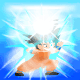 **Quả Cầu Kênh Khí**,  **Laze Makankosappo**) đều **gây sát thương XUYÊN GIÁP 100% & BỎ QUA NÉ ĐÒN**. Đặc biệt, **Skill 9 còn BỎ QUA GIỚI HẠN % MÁU** của Boss **Broly / Super Broly** — giúp bạn kết liễu Super Broly chỉ trong nháy mắt!

### 🔹 Bước 10: Săn Đồ Thần Linh (Boss `>= 400Tr HP`) & Chuyển Hóa Giữ Nguyên SKH + Sao Pha Lê
1. Khi săn các Boss cao cấp có máu **`>= 400.000.000 HP`** ở **Tương Lai**, **Cold**, **Ngục Tù** (*Xên Bọ Hung, Siêu Bọ Hung, Black Goku, Zamasu, Cooler, Cumber...*), bạn có **7% nhặt được Đồ Thần Linh (luôn kèm sẵn 3–7 Sao Pha Lê)**, **50% nhặt trang bị thường (75% là đồ Cấp 12 có sẵn 3–7 Sao Pha Lê)** và **2% nhặt được Đồ SKH**. *(Các Boss cấp thấp `< 400Tr HP` đã giảm tỷ lệ rơi đồ cao cấp xuống 5% để ưu tiên giá trị săn Boss lớn).*
2. Đem Đồ Thần Linh về gặp **Bill (Hành Tinh Bill)** kèm `x99 Thức ăn` để đổi lên **Đồ Hủy Diệt (Level 14)**, hoặc gặp **Whis** chế tạo **Đồ Thiên Sứ (Level 15)**.
3. **Cách chuyển dòng Set Kích Hoạt (SKH) và Sao Pha Lê lên Đồ Thần Linh / Hủy Diệt**:
   - **Cách 1 — Chuyển Hóa Trang Bị (Tại Bà Hạt Mít)**: Bỏ trang bị gốc (đã đập cấp `[+1..+16]`, đã ép `7–9 Sao Pha Lê` và có dòng `SKH`) cùng trang bị mới vào mục **Chuyển Hóa Trang Bị (bằng Vàng hoặc Ngọc)** $\rightarrow$ Chuyển trọn vẹn **Cấp `[+]` + Toàn bộ lỗ & chỉ số Sao Pha Lê + Dòng Set Kích Hoạt (SKH)** sang trang bị mới!
   - **Cách 2 — Đập Đồ Kích Hoạt Theo Phôi (Tại Bà Hạt Mít)**: Bỏ `3 món Đồ SKH bất kỳ + 1 Đồ Phôi (VD: Găng Thần Linh, Áo Hủy Diệt) + Vàng (200Tr ~ 2 Tỷ tùy bậc Phôi)` $\rightarrow$ Tỷ lệ **`40%`** ra Đồ SKH đúng theo món Đồ Phôi (**Thất bại bảo toàn 100% Đồ Phôi**, chỉ mất 3 món đồ KH phụ và vàng)!
   - **Tiện ích mới tại Bà Hạt Mít**: Có thêm mục **Xóa dòng SKH (`200 Triệu Vàng`)** để làm sạch phôi (giữ nguyên cấp `[+]` và Sao Pha Lê) và **Tái chế Đồ Thần Linh** dư thừa ra Vàng, Hồng Ngọc, Đá Ngũ Sắc, Khoáng Tái Chế & Thức ăn Hủy Diệt!

---

## 🗺️ 0.3. Bảng Tra Cứu NPC: "Muốn Làm Việc Này Thì Gặp Ai, Ở Đâu?"

| Bạn Muốn Làm Gì? | Gặp NPC Nào? | Đứng Ở Bản Đồ Nào? |
| :--- | :--- | :--- |
| Nhận **Quà Tân Thủ (99 Thỏi Vàng, 1Tr Ngọc)**, **200k Ngọc**, **Đậu 10**, **5 Rương SKH**, **Đi Ngũ Hành Sơn (x5 TNSM)**, **Ấp Trứng Đệ Mabư / Broly** | **Ông Gôhan / Ông Moori / Ông Paragus** | **Nhà Gôhan / Nhà Moori / Nhà Broly** *(Về Nhà bằng Capsule)* |
| **Đục lỗ Sao Pha Lê (1–9 Sao)**, **Ép Sao**, **Đập cấp `[+1..+16]`**, **Chuyển Hóa Đồ (chuyển cả SKH & SPL)**, **Đập Đồ SKH theo phôi**, **Xóa dòng SKH**, **Tái chế Đồ Thần**, **Phân rã Đồ Sao**, **Nâng Bông Tai Porata Cấp 2 & 3**, **Nhập Ngọc Rồng**, **Mua Bùa 1 Tháng** | **Bà Hạt Mít** | **Đảo Kame (Map 5)** *(Và Đảo Hạt Mít)* |
| Mua/Bán **Thỏi Vàng (`500Tr Vàng/thỏi`)**, Mua **Cải trang Hồng Ngọc Vĩnh Viễn**, **Cải trang Up Đệ / Kháng Lạnh (`50 Ngọc`)**, **Sách nâng Skill 4 & 5 Đệ tử (`ID 759`)**, **Mở rộng Hành trang / Rương đồ (`+10 ô`)** | **Santa** | **Đảo Kame (Map 5)** |
| Đổi **Hào Quang Săn Boss 3 Cấp**, Mua **Đeo Lưng Sự Kiện / Đeo Lưng Hồng Ngọc Vĩnh Viễn**, Nhận **Nhiệm Vụ KOL & KOL VIP**, Đi **Bản Đồ Kho Báu**, Giải tán/Lập Bang | **Quy Lão Kame** | **Đảo Kame (Map 5)** |
| Nhận **20 Nhiệm vụ hàng ngày (5 độ khó)** & Nhận thưởng **Thành Tích (`515 Thỏi Vàng` = `257.5 Tỷ Vàng`)** | **Bò Mộng** | **Đảo Kame (Map 5)** hoặc **Thần Điện** |
| **Mở Giới Hạn Sức Mạnh** cho Sư Phụ & Đệ Tử (từ `18 Tỷ` lên `120 Tỷ SM`) | **Trưởng Lão Guru** *(hoặc Quốc Vương)* | **Đảo Guru (Hành Tinh Namek)** |
| Đổi **Đồ Thần Linh $\rightarrow$ Đồ Hủy Diệt (Level 14)** | **Thần Hủy Diệt Bill** | **Hành Tinh Bill (Map 154)** |
| Học **Chiêu Đặc Biệt (Skill 9: Super Kame / Ma Phong Ba / Liên Hoàn Chưởng)**, Đổi & Nâng cấp **Sách Tuyệt Kỹ 1 & 2**, Chế tạo **Đồ Thiên Sứ (Level 15)** | **Thiên Sứ Whis** | **Hành Tinh Bill (Map 154)** |
| Qua **Bản Đồ Tương Lai (Map 92–103)** săn Black Goku, Zamasu, Siêu Bọ Hung | **Calích** | **Vách Núi Kakarot / Trạm Tàu Vũ Trụ** *(Sau khi xong NV Xên)* |
| Đi phó bản **Doanh Trại Độc Nhãn** | **Lính Nhãn Cầu** | **Rừng Bamboo (Map 27 - Trái Đất)** |
| Đi phó bản **Khí Gas Hủy Diệt** & **Con Đường Rắn Độc** | **Mr. Pôpô** & **Thần Vũ Trụ** | **Thần Điện** & **Thần Điện Vũ Trụ (Map 48)** |

---

# 📂 01. TỔNG QUAN SỨC MẠNH, CÁCH NÂNG CHỈ SỐ & ĐỊNH HƯỚNG LỐI CHƠI 3 HÀNH TINH

## 📐 1.1. Kiến Trúc 3 Tầng Sức Mạnh & Công Thức Sát Thương Tổng Quát

Toàn bộ sự phát triển của nhân vật trong **Ngọc Rồng VIAM** tuân theo mô hình chuyển hóa 3 tầng: **Thu Thập Tài Nguyên (Tầng 1) $\rightarrow$ Lò Luyện Cơ Chế (Tầng 2) $\rightarrow$ Đột Phá Bản Thể (Tầng 3)**:

<div align="center">

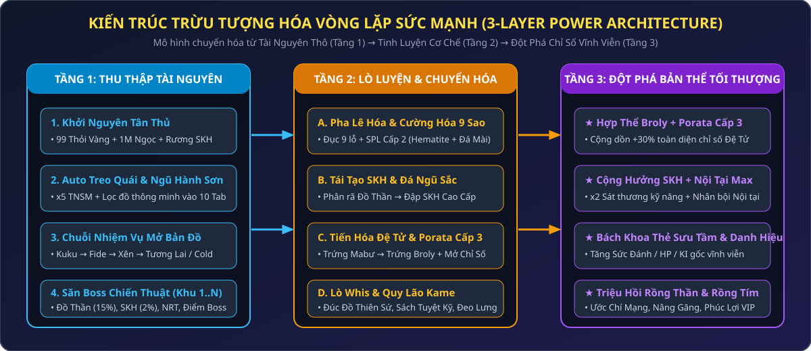

</div>

Sát thương thực tế gây ra của nhân vật không chỉ phụ thuộc vào điểm Tiềm năng gốc, mà là **tích số nhân bội** giữa 6 hệ thống độc lập:

$$\text{Sát Thương Cuối} = \Big(\text{SĐ Gốc} + \text{SĐ Đệ Tử} \times K_{\text{Porata}}\Big) \times \Big(1 + \sum \%\,\text{Sao Pha Lê}\Big) \times \Big(1 + \%\,\text{Nội Tại}\Big) \times \Big(1 + \%\,\text{Set Kích Hoạt}\Big) \times \Big(1 + \%\,\text{Cải Trang Kỹ Năng}\Big) \times K_{\text{Chí Mạng}}$$

---

## 📊 1.2. Cách Nâng Chỉ Số Tiềm Năng Theo Từng Giai Đoạn

| Chỉ Số Gốc | Vai Trò Cốt Lõi | Cách Nâng Theo Giai Đoạn |
| :--- | :--- | :--- |
| **Sức Đánh (SĐ)** | Quyết định tốc độ farm quái, tốc độ ăn Boss và lượng HP/KI hút được mỗi đòn. | • **Tân thủ (0 – 15 Tỷ SM)**: Ưu tiên dồn **70% điểm Tiềm năng vào Sức Đánh** để tối ưu hóa tốc độ đánh quái tại Ngũ Hành Sơn và làm nhiệm vụ.<br>• **Trung & Cao cấp**: Nâng chạm mốc giới hạn của từng bậc Mở Giới Hạn Sức Mạnh. |
| **HP (Máu)** | Quyết định khả năng chống chịu trước Boss lớn và là **nguồn sát thương trực tiếp** của chiêu **Tự Phát Nổ (Xayda)** & **Kaioken (Trái Đất)**. | • **Tân thủ**: Giữ ở mức `20.000 – 100.000 HP` (đủ để Auto Đậu kịp hồi máu).<br>• **Khi chơi Xayda hệ Bom (HP)**: Dồn tối đa Tiềm năng vào **HP gốc** kết hợp Set Nappa (`+100% HP`) hoặc Set Cadic M và Sao Pha Lê `% HP`. |
| **KI (Năng Lượng)** | Dùng để duy trì kỹ năng và là **nguồn sát thương trực tiếp** của chiêu **Makankosappo / Laze (Namek)** & **Quả Cầu Kênh Khi (Trái Đất)**. | • **Tân thủ**: Nâng khoảng `20.000 – 100.000 KI` để bắn chưởng không bị ngắt quãng.<br>• **Khi chơi Namek hệ Laze (KI)**: Dồn tối đa Tiềm năng vào **KI gốc** kết hợp Set Picolo (`+100% KI, +50% Laze`) và Sao Pha Lê `% KI`. |
| **Chí Mạng & Giáp** | Chí mạng giúp **nhân đôi (x2) sát thương** đòn đánh thường & chưởng; Giáp giảm sát thương quái. | • **Chí mạng**: Nâng vừa đủ kết hợp Găng tay/Rada/Cải trang/Ước Rồng Thần (+2%) để đạt ngưỡng chí mạng ổn định.<br>• **Giáp**: Chỉ nâng 1 lượng nhỏ giai đoạn đầu, về sau dùng trang bị cấp cao. |

---

## 🧭 1.3. Định Hướng Lối Chơi (Build), Chọn Set Kích Hoạt & Công Thức Sát Thương Chiêu Thức 3 Hành Tinh

Mỗi hành tinh trong **Ngọc Rồng VIAM** đều sở hữu **4 Set Kích Hoạt (SKH)** tương ứng với **4 nhánh lối chơi (Build) chuyên biệt** (gồm **3 Set Cổ Điển** kích hoạt khi mặc đủ 5 món và **1 Set Cao Cấp Cộng Dồn từng món từ 1 đến 5 món**: **Set Thần Vũ Trụ Kaio**, **Set Chiến Binh Nail**, **Set Cadic M**). Hãy phối hợp đúng **Set Kích Hoạt + Cải Trang Hồng Ngọc + Sao Pha Lê + Nội Tại** theo sơ đồ và bảng phân tích dưới đây:

<div align="center">

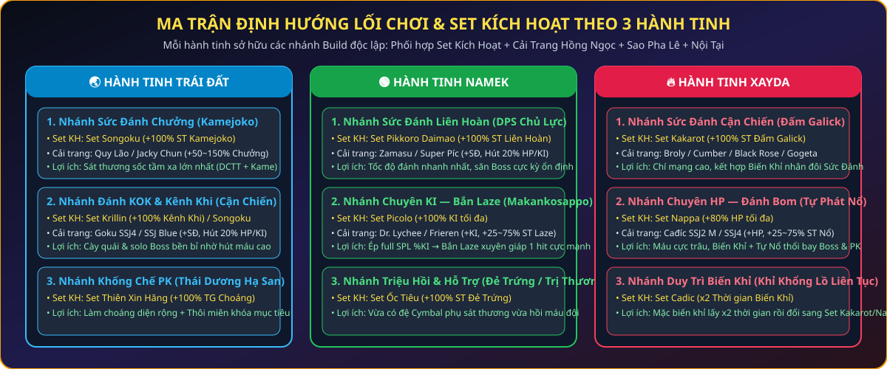

</div>

### 🔥 A. HÀNH TINH XAYDA — 4 Nhánh Định Hướng Cách Chơi & Lợi Ích

| Nhánh Lối Chơi (Build) | Mặc Set Kích Hoạt Gì? & Cơ Chế Cộng Dồn | Cải Trang & Ép Sao Pha Lê Gì? | Nội Tại Ưu Tiên | Phân Tích Lợi Ích Thực Chiến |
| :--- | :--- | :--- | :--- | :--- |
| **1. Xayda Chơi Sức Đánh Cận Chiến**<br>*( Đấm Galick +  Biến Khỉ)* | **Set Kakarot**<br>• **Đủ 5 món**: **`+100% sát thương Đấm Galick`**. | • **Cải trang**: *CT Broly, Cumber SSJ, Super Black Goku Rose, CT Gogeta* (`+32–33% SĐ`, `+45–55% HP`, `Hút 15–20% HP/KI`).<br>• **Sao Pha Lê**: Ép full 9 lỗ **+% Sức Đánh** (kèm 1–2 viên Hút HP/KI). | **Đấm Galick** hoặc **Biến Khỉ** | • **Sát thương cận chiến đơn mục tiêu tốc độ cao**: Khi bật **Biến Khỉ** (`Chí mạng 110%` — luôn chí mạng `x2`), Sức Đánh tăng vọt kết hợp **+100% Galick** và **Hút máu/KI** giúp Xayda đứng đối kháng solo mọi Boss lớn cực nhanh! |
| **2. Xayda Sát Thủ Bom & Chí Mạng**<br>*(Set Cộng Dồn 1–5 Món)* | **Set Cadic M** *(Cộng dồn từ 1–5 món)*:<br>• **1–4 món**: Mỗi món `+8% HP`, `+10% SĐ`, `+8% Giáp` (*2 món*: `+10% SĐ Chí Mạng` & `+100 tầm nổ`; *4 món*: `+15% SĐ Chí Mạng`, `+15% HP nổ` & `+15% ST Tự Phát Nổ`).<br>• **Đủ 5 món**: **`+60% Sức Đánh`**, **`+50% HP`**, **`+50% Giáp`**, **`+25% SĐ Chí Mạng`**, **`+30% HP tối đa vào sát thương nổ`** & **`+30% ST Tự Phát Nổ`**. | • **Cải trang**: *Cađíc SSJ2 M* hoặc *Cađíc SSJ4* (**`+45% – 75% HP`** + **Random `25% – 75%` Sát thương Nổ** + 2 dòng bí ẩn) hoặc *Broly / Gogeta*.<br>• **Sao Pha Lê**: Ép **+% HP** hoặc **+% Sức Đánh**. | **Tự Phát Nổ** hoặc **Đấm Galick** | • **Set SKH toàn diện công-thủ của Xayda**: Vừa tăng mạnh Sức Đánh (`+60% SĐ`) kèm `+25% SĐ Chí Mạng` để đánh tay cực rát, vừa cường hóa  **Tự Phát Nổ** thêm `+100 tầm nổ`, cộng thẳng `+30% HP tối đa` và `+30% ST nổ`! |
| **3. Xayda Chơi Siêu Máu (Tank / Bom HP)**<br>*(Thuần HP Tối Đa)* | **Set Nappa**<br>• **Đủ 5 món**: **`+100% HP tối đa`**. | • **Cải trang**: *Cađíc SSJ2 M / SSJ4* (**`+45% – 75% HP`**, `+25–75% ST Nổ`).<br>• **Sao Pha Lê**: Ép full 9 lỗ **+% HP** trên cả 6 món đồ + Đeo Lưng `% HP`. | **Tự Phát Nổ** hoặc **Biến Khỉ** | • **Nhân đôi lượng HP tối đa (`+100% HP`)**: Phối hợp  **Biến Khỉ (`+100% HP`)** +  **Huýt Sáo (`+100% HP`)** + **Set Nappa (`+100% HP`)** + **Full SPL %HP** giúp bạn có lượng máu khổng lồ để chống chịu hoặc ôm bom cảm tử. |
| **4. Xayda Duy Trì Khỉ Khổng Lồ**<br>*(Chiến thuật Swap Đồ Tab 2)* | **Set Cadic**<br>• **Đủ 5 món**: **`x5 thời gian Biến Khỉ`** (`300s → 600s`). | • Cất sẵn bộ **Set Cadic** ở **Tab 2 Hành Trang (`t2`)**.<br>• Khi cần biến khỉ: Bấm `t2` mặc Set Cadic $\rightarrow$ Bật  **Biến Khỉ** $\rightarrow$ Bấm `t1` mặc lại **Set Kakarot / Set Cadic M / Set Nappa**. | **Biến Khỉ** | • Tận dụng được **thời gian hóa Khỉ gấp 5 lần (lên tới 10 phút)** mà vẫn hưởng trọn vẹn sức mạnh của **Set Kakarot**, **Set Cadic M** hoặc **Set Nappa** trong suốt thời gian giao tranh! |

---

### 🌏 B. HÀNH TINH TRÁI ĐẤT — 4 Nhánh Định Hướng Cách Chơi & Lợi Ích

| Nhánh Lối Chơi (Build) | Mặc Set Kích Hoạt Gì? & Cơ Chế Cộng Dồn | Cải Trang & Ép Sao Pha Lê Gì? | Nội Tại Ưu Tiên | Phân Tích Lợi Ích Thực Chiến |
| :--- | :--- | :--- | :--- | :--- |
| **1. Trái Đất Chơi Sức Đánh Chưởng**<br>*(Sốc Sát Thương  Kamejoko)* | **Set Songoku**<br>• **Đủ 5 món**: **`+100% sát thương Kamejoko`**. | • **Cải trang**: *Quy Lão Kamê* hoặc *Jacky Chun* (**Random `50% – 150%` Sát thương Chưởng** + Kháng TDHS + 2 dòng bí ẩn).<br>• **Sao Pha Lê**: Ép full 9 lỗ **+% Sức Đánh**. | **Dịch Chuyển Tức Thời (DCTT)** hoặc **Kamejoko** | • **Đỉnh cao sốc sát thương tầm xa (Burst Damage)**: Combo  **Dịch Chuyển Tức Thời** (chí mạng 100% cho cả đòn DCTT lẫn đòn kế tiếp + làm choáng) kết hợp  **Kamejoko** cộng hưởng từ **Set Songoku (+100%) + Cải trang Quy Lão (+50~150%)** kết liễu mục tiêu chỉ trong 1 chưởng! |
| **2. Trái Đất Đánh Tay  Kaioken**<br>*(Set Cộng Dồn 1–5 Món)* | **Set Thần Vũ Trụ Kaio** *(Cộng dồn từ 1–5 món)*:<br>• **1–4 món**: Mỗi món `+10% HP`, `+10% SĐ`, `+10% Giáp`, `+4% Chí mạng` (*2 món*: `+10% SĐCM`; *4 món*: `+15% SĐCM`, `+50% ST Kaioken` & giảm hao máu Kaioken từ `10%` xuống `5% HP`).<br>• **Đủ 5 món**: **`+60% HP`**, **`+60% Sức Đánh`**, **`+60% Giáp`**, **`+20% Chí mạng`**, **`+25% SĐ Chí Mạng`**, **Giảm `20%` sát thương nhận vào**, **Kaioken chỉ tốn `3% HP`** & **`+100% sát thương Kaioken`**. | • **Cải trang**: *CT Goku SSJ4* hoặc *CT Goku SSJ Blue* (`+32–33% SĐ`, **Hút `15% – 20%` HP/KI**, Xuyên giáp + 3 dòng bí ẩn).<br>• **Sao Pha Lê**: Ép full 9 lỗ **+% Sức Đánh** (hoặc pha **+% HP**). | **Kaioken** hoặc **Dịch Chuyển Tức Thời** | • **Set SKH trấn phái cận chiến của Trái Đất**: Xóa bỏ hoàn toàn nhược điểm tự tụt `10% HP` của  **Kaioken** (xuống chỉ còn `3% HP/đòn`), đồng thời tăng toàn diện `+60% HP/SĐ/Giáp`, `+20% Chí mạng`, `+25% SĐCM`, giảm `20%` sát thương nhận và nhân đôi sát thương Kaioken! |
| **3. Trái Đất Sát Thương Diện Rộng**<br>*( Quả Cầu Kênh Khi)* | **Set Krillin (`Kirin`)**<br>• **Đủ 5 món**: **`+100% sát thương Quả Cầu Kênh Khi (x2)`**. | • **Cải trang**: *CT Goku SSJ4 / SSJ Blue* hoặc *Quy Lão Kamê*.<br>• **Sao Pha Lê**: Ép **+% Sức Đánh**. | **Quả Cầu Kênh Khi** | • Sát thương  **Quả Cầu Kênh Khi** tính theo **`10x Sức Đánh + 10% tổng HP hiện tại của toàn bộ quái & người chơi/Boss xung quanh`**, nhân đôi (`x2`) nhờ Set Krillin và **Xuyên Giáp 100%** giúp cấu máu Boss máu trâu và dọn quái diện rộng cực mạnh. |
| **4. Trái Đất Chơi Khống Chế PK**<br>*( TDHS &  Thôi Miên)* | **Set Thiên Xin Hăng**<br>• **Đủ 5 món**: **`x2 thời gian làm choáng Thái Dương Hạ San`** (`6s → 18s`). | • **Cải trang**: *Jacky Chun / Thỏ Đại Ca* (Kháng TDHS) hoặc *Xinbatô* (+Né đòn).<br>• **Sao Pha Lê**: Ép **+% HP** và **+% KI / Né đòn**. | **Thái Dương Hạ San** | • Làm mù đối phương và Boss với **thời gian choáng gấp đôi (`6s – 18s`)**, nối chuỗi cùng  **Thôi Miên (`5s – 11s`)** và  **Dịch Chuyển Tức Thời (`1s – 4s`)** khiến đối thủ không thể tung chiêu. |

---

### 🟢 C. HÀNH TINH NAMEK — 4 Nhánh Định Hướng Cách Chơi & Lợi Ích

| Nhánh Lối Chơi (Build) | Mặc Set Kích Hoạt Gì? & Cơ Chế Cộng Dồn | Cải Trang & Ép Sao Pha Lê Gì? | Nội Tại Ưu Tiên | Phân Tích Lợi Ích Thực Chiến |
| :--- | :--- | :--- | :--- | :--- |
| **1. Namek Chơi Sức Đánh  Liên Hoàn**<br>*(DPS Cận Chiến Chủ Lực)* | **Set Ốc Tiêu**<br>• **Đủ 5 món**: **`+100% sát thương Liên Hoàn`**. | • **Cải trang**: *Cải trang Zamasu* hoặc *Cải trang Super Píc* (`+32–33% SĐ`, **`+45% – 50% KI`**, **Hút `15% – 20%` HP/KI**, Xuyên giáp + 3 dòng bí ẩn).<br>• **Sao Pha Lê**: Ép full 9 lỗ **+% Sức Đánh**. | **Liên Hoàn** | • Chiêu  **Liên Hoàn** có tốc độ ra đòn nhanh nhất trò chơi và hồi chiêu cực ngắn.<br>• Khi kết hợp **Set Ốc Tiêu (+100% ST Liên Hoàn)** + **Nội tại Liên Hoàn** + **Hút 20% HP/KI**, Namek trở thành cỗ máy bào máu Boss liên tục không bao giờ ngã xuống! |
| **2. Namek Pháo Đài Chưởng  Masenko**<br>*(Set Cộng Dồn 1–5 Món)* | **Set Chiến Binh Nail** *(Cộng dồn từ 1–5 món)*:<br>• **1–4 món**: Mỗi món `+12% HP`, `+12% KI`, `+8% SĐ`, `+12% Giáp` (*2 món*: `+15% SĐCM`; *4 món*: `+20% SĐCM`, `+50% ST Masenko` & `-25% hồi chiêu Masenko`).<br>• **Đủ 5 món**: **`+80% HP`**, **`+80% KI`**, **`+50% Sức Đánh`**, **`+80% Giáp`**, **`+30% SĐ Chí Mạng`**, **Giảm `30%` sát thương nhận vào**, **`+100% sát thương Masenko`** & **giảm `50%` hồi chiêu Masenko**. | • **Cải trang**: *Super Píc / Zamasu* hoặc Cải trang cộng `% Sát thương Chưởng`.<br>• **Sao Pha Lê**: Ép **+% HP** kết hợp **+% Sức Đánh**. | **Masenko** | • **Pháo đài công-thủ toàn diện của Namek**: Tăng `+80% HP/KI/Giáp`, `+50% SĐ`, `+30% SĐCM`, giảm trực tiếp `30%` sát thương nhận vào sau khi trừ giáp, đồng thời bắn  **Masenko (+100% ST, giảm 50% hồi chiêu)** liên thanh không độ trễ! |
| **3. Namek Chơi Chuyên KI**<br>*(Bắn Laze  Makankosappo)* | **Set Picolo**<br>• **Đủ 5 món**: **`+100% KI tối đa`** & **`+50% sát thương Laze (Makankosappo)`**. | • **Cải trang**: *Dr. Lychee* hoặc *CT Frieren* (**`+45% – 75% KI`** + **Random `25% – 75%` Sát thương Laze** + Xuyên giáp chưởng + 2 dòng bí ẩn).<br>• **Sao Pha Lê**: Ép full 9 lỗ **+% KI** trên toàn bộ trang bị. | **Makankosappo (Laze)** | • **Biến toàn bộ thanh KI thành sát thương xuyên giáp**: Set Picolo vừa nhân đôi thanh KI (`+100% KI`), vừa nhân thêm **`+50%` ST Laze** (tổng cộng **x3 sát thương Laze**), cộng hưởng thêm **`+25~75%` từ Cải trang Frieren/Lychee** và **Xuyên Giáp 100%**! |
| **4. Namek Triệu Hồi Cymbal Vĩnh Viễn**<br>*( Đẻ Trứng &  Trị Thương)* | **Set Pikkoro Daimao**<br>• **Đủ 5 món**: **`x4 sát thương Đẻ Trứng (Cymbal)`**, **Cymbal tồn tại vĩnh viễn (không hết giờ)** & **có thể kết liễu mục tiêu**. | • **Cải trang**: *Super Píc* hoặc *Đôrêmon* (Hồi HP/KI đồng đội).<br>• **Sao Pha Lê**: Ép **+% Sức Đánh** & **+% HP**. | **Đẻ Trứng** | • Đệ Cymbal () được nhân **gấp 4 lần sát thương**, đi theo chủ nhân vĩnh viễn không tự biến mất và có thể đánh chết đối thủ PK/quái, cực kỳ nhàn khi treo máy hoặc đi săn cùng bang hội! |

---

### ⚔️ D. Bảng Tổng Hợp Sát Thương, Thông Số Cấp 1 → 7 & Hình Ảnh Minh Họa Chiêu Thức Của 3 Hành Tinh

Dưới đây là bảng thông số chi tiết kèm **biểu tượng kỹ năng thực tế trong game** của toàn bộ **22 kỹ năng** thuộc 3 hành tinh (**Trái Đất**, **Namek**, **Xayda**) và **Tuyệt Kỹ Đặc Biệt (Skill 9)**:

| Hành Tinh | Icon | Tên Chiêu Thức | Sát Thương / Hiệu Ứng Gốc (`Cấp 1 → Cấp 7`) | Công Thức Sát Thương & Hệ Số Nhân Cộng Hưởng | Cơ Chế Xuyên Giáp, Chí Mạng & Đặc Quyền |
| :---: | :---: | :--- | :--- | :--- | :--- |
| **🌏 Trái Đất** | 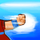 | **Đấm Dragon** | • **Sát thương**: **`100% → 160% SĐ`** *(+10% mỗi cấp)*<br>• **Hồi chiêu**: `0.5s` | `SĐ × (100%~160%) × (1 + % Nội tại Dragon) × (1 + % Xuyên giáp cận chiến)` | • Có Chí mạng (`x2 + % SĐCM`).<br>• Trừ Giáp theo `% Xuyên giáp cận chiến (tlxgcc)`. |
| **🌏 Trái Đất** |  | **Kamejoko** | • **Sát thương**: **`100% → 170% SĐ`**<br>• **Hồi chiêu**: `2.5s → 1.9s` | `SĐ × (100%~170%) × (1 + % Nội tại Kamejoko) × (1 + 100% Set Songoku + 50%~150% CT Quy Lão/Jacky Chun + % Xuyên giáp chưởng)` | • Có Chí mạng (`x2 + % SĐCM`).<br>• Cộng hưởng cực đại với  **DCTT** (chắc chắn chí mạng `x2` + cộng `% ST sau DCTT`). |
| **🌏 Trái Đất** |  | **Kaioken** | • **Sát thương**: **`110% → 180% SĐ`**<br>• **Hồi chiêu**: `0.5s` *(Đánh liên hoàn)* | `SĐ × (110%~180%) × (1 + % Nội tại Kaioken) × (1 + 50%/100% Set Kaio 4/5 món + % Xuyên giáp cận chiến)` | • Có Chí mạng (`x2 + % SĐCM`).<br>• Mặc định tốn `10% HP/đòn`; khi mặc **Set Thần Vũ Trụ Kaio** giảm còn **`5% HP` (4 món)** và **`3% HP` (5 món)**. |
| **🌏 Trái Đất** |  | **Quả Cầu Kênh Khí (`QCKK`)** | • **Sát thương gốc**: **`1000% SĐ + 10% Tổng HP Quái + 10% Tổng HP Người/Boss`**<br>• **Tầm nổ**: `380 → 560` | `(10 × SĐ + 10% Tổng HP Quái xung quanh + 10% Tổng HP Người/Boss xung quanh) × (x2 khi mặc đủ 5 món Set Krillin) × (1 + % Nội tại Kênh Khí + % ST sau DCTT/Thôi miên)` | • **Xuyên Giáp 100% (`Piercing`) & Không Thể Bị Né Đòn**.<br>• Nổ diện rộng toàn bộ mục tiêu trong vùng quét (vẫn nổ lan đầy đủ kể cả khi mục tiêu chính chết lúc đang gồng). |
| **🌏 Trái Đất** |  | **Dịch Chuyển Tức Thời (`DCTT`)** | • **Sát thương**: **`100% SĐ (±5%)`**<br>• **Thời gian choáng**: **`1.0s → 4.0s`** *(`(level + 1) × 0.5s`)* | `SĐ (±5%) × (x2 Chí mạng cố định + % SĐCM) × (1 + % Xuyên giáp cận chiến)` | • Làm choáng mục tiêu ngay khi áp sát.<br>• **Chắc chắn `100% Chí Mạng` cho cả đòn DCTT VÀ đòn kỹ năng tiếp theo (`isCritTele`)** + cộng `% ST sau DCTT`. |
| **🌏 Trái Đất** |  | **Thái Dương Hạ San (`TDHS`)** | • **Thời gian mù**: **`3s → 9s`** *(`level + 2` giây)*<br>• **Mặc Set Thiên Xin Hăng**: **`6s → 18s (x2)`**<br>• **Tầm mù**: `150 → 330` | Kỹ năng khống chế diện rộng (`x2 thời gian choáng` khi mặc đủ 5 món **Set Thiên Xin Hăng**) | • Làm mù toàn bộ Quái, Boss và Người chơi trong phạm vi.<br>• Khắc chế bằng *Cải trang Jacky Chun / Thỏ Đại Ca (Kháng TDHS)*. |
| **🌏 Trái Đất** |  | **Thôi Miên** | • **Thời gian ru ngủ**: **`5s → 11s`** *(`level + 4` giây)* | Kỹ năng khống chế đơn mục tiêu; đòn đánh ngay sau khi Thôi miên được cộng **`+% ST sau Thôi miên` (Nội tại)** | • Khóa cứng 1 mục tiêu để gồng  **QCKK** hoặc  **Kamejoko**. |
| **🟢 Namek** |  | **Đấm Demon** | • **Sát thương**: **`100% → 160% SĐ`** *(+10% mỗi cấp)*<br>• **Hồi chiêu**: `0.5s` | `SĐ × (100%~160%) × (1 + % Nội tại Demon) × (1 + % Xuyên giáp cận chiến)` | • Có Chí mạng (`x2 + % SĐCM`), xuyên giáp theo `% Xuyên giáp cận chiến (tlxgcc)`. |
| **🟢 Namek** |  | **Liên Hoàn** | • **Sát thương**: **`110% → 180% SĐ`**<br>• **Hồi chiêu**: `0.5s` *(Nhanh nhất game)* | `SĐ × (110%~180%) × (1 + % Nội tại Liên Hoàn) × (1 + 100% Set Ốc Tiêu + % Xuyên giáp cận chiến)` | • Có Chí mạng (`x2 + % SĐCM`).<br>• Tốc độ ra đòn nhanh nhất trò chơi, tối ưu hóa dòng **Hút 15–20% HP/KI**. |
| **🟢 Namek** |  | **Masenko** | • **Sát thương**: **`100% → 170% SĐ`**<br>• **Hồi chiêu**: Giảm **`25% / 50%`** với **Set Nail (4/5 món)** | `SĐ × (100%~170%) × (1 + % Nội tại Masenko) × (1 + 50%/100% Set Nail 4/5 món + % ST Chưởng + % Xuyên giáp chưởng)` | • Có Chí mạng (`x2 + % SĐCM`).<br>• Cộng dồn giảm hồi chiêu từ **Set Chiến Binh Nail (`-50%`)** và **Nội tại Masenko**, bắn chưởng nhanh như đánh tay! |
| **🟢 Namek** |  | **Makankosappo (`Laze`)** | • **Hệ số chuyển hóa KI**: **`100% → 160% Tổng KI`** *(+10% mỗi cấp)*<br>• **Mặc Set Picolo**: **`x3 Tổng ST Laze`** *(`+100% KI` & `+50% Laze`)* | `max(KI hiện tại, KI tối đa) × (100%~160%) × 1.5 (Set Picolo) × (1 + 25%~75% CT Frieren/Lychee) × (1 + % Nội tại Laze + % Xuyên giáp chưởng + % ST sau Sôcôla)` | • **Xuyên Giáp 100% (`Piercing`) & Không Thể Bị Né Đòn**.<br>• Tính trên ngưỡng cao nhất giữa KI hiện tại và KI tối đa; tự chuyển tia sang mục tiêu sống gần đó nếu mục tiêu khóa chết lúc đang gồng. |
| **🟢 Namek** |  | **Đẻ Trứng (`Cymbal`)** | • **Máu Cymbal**: **`30% → 90% HP chủ nhân`**<br>• **Thời gian**: `120s → 240s` *(Mặc **Set Pikkoro Daimao**: **Vĩnh viễn & x4 ST**)* | `SĐ Chủ Nhân × (x4 khi mặc đủ 5 món Set Pikkoro Daimao)` | • Khi mặc đủ 5 món **Set Pikkoro Daimao**, đệ Cymbal gây **x4 sát thương**, đi theo vĩnh viễn và **có thể đánh kết liễu mục tiêu**! |
| **🟢 Namek** |  | **Trị Thương** | • **Hồi phục tức thì**: **`50% → 80% HP & KI`** *(`(level + 9) × 5%`)* | Hồi ngay `50% ~ 80% HP & KI` cho bản thân/đồng đội hoặc **Hồi sinh đồng đội đang kiệt sức** | • Kỹ năng hỗ trợ sinh tồn và cứu đồng đội duy nhất trong các phó bản & săn Boss. |
| **🟢 Namek** |  | **Biến Sôcôla (`Mafuba`)** | • **Thời gian hóa Sôcôla**: **`30s`**<br>• **Tăng ST đòn kế**: Theo cấp Skill + Nội tại | Biến mục tiêu thành Sôcôla trong `30 giây`, giảm phòng thủ và cộng thêm **`+% ST sau Sôcôla`** cho đòn  **Laze** tiếp theo | • Khống chế cứng 30 giây và khuếch đại sát thương dứt điểm. |
| **🔥 Xayda** |  | **Đấm Galick** | • **Sát thương**: **`100% → 160% SĐ`** *(+10% mỗi cấp)*<br>• **Hồi chiêu**: `0.5s` | `SĐ × (100%~160%) × (1 + % Nội tại Galick) × (1 + 100% Set Kakarot + % Xuyên giáp cận chiến)` | • Có Chí mạng (`x2 + % SĐCM`).<br>• Khi bật  **Biến Khỉ** đạt **110% Chí mạng (100% mọi cú đấm đều nhân đôi sát thương)**. |
| **🔥 Xayda** |  | **Antomic** | • **Sát thương**: **`100% → 170% SĐ`**<br>• **Hồi chiêu**: `2.5s → 1.9s` | `SĐ × (100%~170%) × (1 + % Nội tại Antomic) × (1 + % ST Chưởng + % Xuyên giáp chưởng)` | • Có Chí mạng (`x2 + % SĐCM`), chưởng năng lượng tầm xa của Xayda. |
| **🔥 Xayda** |  | **Biến Khỉ** | • **Tăng Máu**: **`+40% → +100% HP`**<br>• **Tăng SĐ**: **`+4% → +10% SĐ`** *(+ `% Nội tại Biến Khỉ`)*<br>• **Thời gian**: **`60s → 120s`** *(Set Cadic: **`300s → 600s`**)* | Tăng mạnh `% HP` và `% Sức Đánh`, đồng thời đưa **Tỷ lệ Chí Mạng lên `110%`** | • Mọi đòn đánh tay & chưởng khi hóa Khỉ đều **chắc chắn 100% Chí mạng (`x2 + % SĐCM`)**.<br>• **Set Cadic** nhân **x5 thời gian Biến Khỉ**. |
| **🔥 Xayda** |  | **Tự Phát Nổ (`Bom`)** | • **Sát thương gốc**: **`100% HP hiện tại`** *(+ **`15% / 30% HP tối đa`** từ Set Cadic M 4/5 món)*<br>• **Tầm nổ**: **`430 → 610`** *(+`100` từ Set Cadic M $\ge 2$ món)* | `(100% HP hiện tại + 15%/30% HP tối đa Set Cadic M) × (1 + 15%/30% ST Nổ Set Cadic M + 25%~75% ST Nổ CT Cađíc SSJ2 M / SSJ4 + % Nội tại Bom)` | • **Xuyên Giáp 100% (`Piercing`) & Không Thể Bị Né Đòn**.<br>• Lên **Quái & Người chơi**: Gây **`100%` sát thương nổ**.<br>• Lên **Boss (`isBoss`)**: Gây **`50%` (`1/2`) sát thương nổ** ở dạng thường, hoặc **`33%` (`1/3`)** khi đang **Biến Khỉ**. |
| **🔥 Xayda** |  | **Huýt Sáo** | • **Tăng HP tối đa**: **`+40% → +100% HP`** *(`(level + 3) × 10%`)*<br>• **Thời gian duy trì**: **`30s`** | Cộng thẳng `+40% ~ +100% HP tối đa` cho bản thân và những người chơi xung quanh trong `30 giây` | • Cộng dồn trực tiếp với  **Biến Khỉ (`+100% HP`)** và **Set Nappa (`+100% HP`)** để kích nổ  **Bom** sát thương cực đại! |
| **🔥 Xayda** |  | **Tái Tạo Năng Lượng** | • **Tốc độ hồi**: **`4% → 10% HP & KI / giây`** *(`level + 3`%)* | Đứng gồng hồi phục liên tục `4% ~ 10% HP & KI mỗi giây` cho đến khi đầy bình hoặc dừng gồng | • Giúp Xayda tự hồi đầy bình Máu khổng lồ ngay tại trận. |
| **🔥 Xayda** |  | **Trói** | • **Thời gian khóa**: **`5s → 35s`** *(`level × 5` giây)* | Khóa cứng mục tiêu tại chỗ trong `5 ~ 35 giây` (vỡ trói khi người trói bị đánh trúng) | • Kỹ năng bắt giữ mục tiêu lâu nhất trò chơi (`35 giây` ở Cấp 7). |
| **🛡️ Cả 3 Hệ** |  | **Khiên Năng Lượng** | • **Thời gian chắn**: **`15s → 45s`** *(`(level + 2) × 5` giây)* | Chặn hoàn toàn các đòn tấn công thường trong `15 ~ 45 giây` | • *Lưu ý*: Bị xuyên thủng bởi 3 chiêu tất sát (**Bom, QCKK, Laze**) và **Tuyệt Kỹ Skill 9**. |
| **⚡ Cả 3 Hệ** |    | **Tuyệt Kỹ Skill 9**<br>*(`Super Kamejoko`, `Ma Phong Ba`, `Ca Đíc Liên Hoàn Chưởng`)* | • **Sát thương gốc**: **`1000% → 1600% SĐ`** *(Cấp 1 $\rightarrow$ Cấp 7)* | `SĐ × (1000%~1600%) × (1 + % ST Chưởng + % Xuyên giáp chưởng + % Sách Tuyệt Kỹ 1/2)` | • **Xuyên Giáp 100% (`Piercing`) & Không Thể Bị Né Đòn**.<br>• **Bỏ qua hoàn toàn giới hạn sát thương `% HP`** của Boss **Broly / Super Broly**! |

> [!TIP]
> **Bộ Ấn Phụ Trợ Đa Hành Tinh (Mặc đủ 5 món có Ấn):** Ngoài 12 Set Kích Hoạt trên, trang bị còn có thể mang **Set Tinh Ấn (`Option 34`)** giúp tăng **`+15% Sức Đánh`**, **Set Nguyệt Ấn (`Option 35`)** giúp tăng **`+15% KI tối đa`**, hoặc **Set Nhật Ấn (`Option 36`)** giúp tăng **`+15% HP tối đa`**.

> [!IMPORTANT]
> **Cơ Chế Xuyên Giáp 100% & Chống Lỗi Ngắt Gồng Của 3 Chiêu Tất Sát (`Tự Phát Nổ`, `Quả Cầu Kênh Khí`, `Laze Makankosappo`)**:
> - **Xuyên Phá Toàn Diện (`Piercing 100%`)**: Cả 3 kỹ năng gồng đặc trưng của 3 hành tinh (**Tự Phát Nổ** của Xayda, **Quả Cầu Kênh Khí** của Trái Đất, **Makankosappo / Laze** của Namek) đều mặc định **bỏ qua 100% Giáp gốc, Giáp `%`, Giáp Xên, Khiên Năng Lượng và Né đòn** của cả Boss lẫn Người chơi!
> - **Chống Mất Sát Thương Khi Đang Gồng**: Nếu mục tiêu đang khóa bị người khác kết liễu giữa lúc nhân vật đang gồng, **Quả Cầu Kênh Khí** vẫn kích nổ sát thương diện rộng đầy đủ lên toàn bộ quái/Boss xung quanh; còn **Laze Makankosappo** sẽ tự động chuyển tia bắn sang mục tiêu còn sống gần đó (hoặc hủy gồng an toàn mà không làm mất oan 100% KI).

---

# 📂 02. HỆ THỐNG VẬT PHẨM, TRANG BỊ MẶC, SET KÍCH HOẠT & ĐẬP ĐỒ SAO TĂNG CẤP

<div align="center">

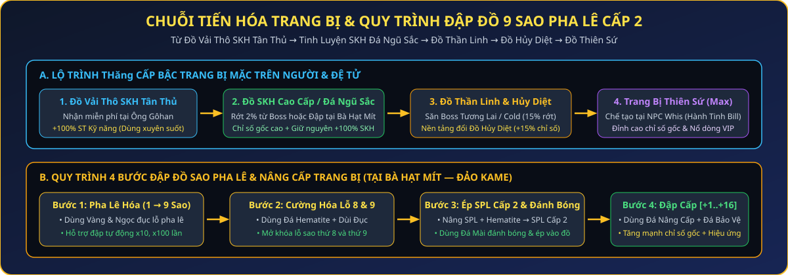

</div>

## 🎁 2.1. Khởi Đầu Tân Thủ & Phân Cấp Trang Bị Mặc

Ngay khi vào **Nhà** (`Nhà Gôhan` / `Nhà Moori` / `Nhà Broly`), hãy gặp **Ông Gôhan / Ông Moori / Ông Paragus** để nhận bộ hành trang khởi đầu miễn phí:

| Biểu Tượng | Phần Thưởng Tại NPC Ở Nhà | Chi Tiết Vật Phẩm | Cơ Chế Nhận |
| :---: | :--- | :--- | :--- |
|  | **Nhận Quà Tân Thủ** | **99 Thỏi Vàng** (`49.5 Tỷ Vàng`) + **1.000.000 Ngọc Xanh** | 1 lần / Tài khoản |
|  | **Rương SKH Tân Thủ** | Trọn bộ **5 món Đồ Vải Thô (Áo, Quần, Găng, Giày, Rada cấp 1)** có **Set Kích Hoạt tùy chọn** | **Mặc định mỗi người chơi có sẵn `5 Rương SKH`** (tự chọn **1 trong 4 Set Kích Hoạt** của hành tinh mỗi lần mở; có thể được Admin tặng thêm qua sự kiện) |
|  | **Nhận 200k Ngọc** | **+200.000 Ngọc Xanh** mỗi lượt bấm | **Nhận không giới hạn** |
|  | **Nhận Đậu 10 x99** | **x99 Đậu Thần Cấp 10** | **Nhận không giới hạn** |

### 🪜 5 Cấp Bậc Tiến Hóa Trang Bị Mặc Trong Game
1. **Bậc 1 — Đồ Vải Thô SKH Tân Thủ**: Nhận miễn phí tại Nhà, kích hoạt ngay **+100% sát thương kỹ năng**. Bạn nên đem bộ này đi **Pha Lê Hóa lên 7–9 Sao** ngay từ đầu để dùng xuyên suốt giai đoạn Tân Thủ & Trung Cấp.
2. **Bậc 2 — Trang Bị SKH Tầm Trung & Cao Cấp (Lưỡng Long, Jean, Zealot, Kaio, Tinh Ấn)**: Nhặt từ Boss (tỷ lệ `2%` từ Nappa trở đi) hoặc tự đập bằng **Đá Ngũ Sắc / Capsule Kích Hoạt** tại Bà Hạt Mít.
3. **Bậc 3 — Trang Bị Thần Linh (Level 13 — Áo/Quần/Găng/Giày/Nhẫn Thần)**: Rớt `7%` (luôn kèm sẵn **`3 – 7 Sao Pha Lê`**) khi tiêu diệt các Boss lớn có máu **`>= 400.000.000 HP`** ở Tương Lai, Cold & Ngục Tù. Có thể dùng để mặc cho Đệ tử, chuyển hóa SKH + Sao Pha Lê sang, tái chế tại Bà Hạt Mít, hoặc làm nguyên liệu đổi Đồ Hủy Diệt.
4. **Bậc 4 — Trang Bị Hủy Diệt (Level 14)**: Đổi tại **Bill (Hành Tinh Bill)** khi đang mặc đủ bộ Thần Linh kèm **x99 Thức Ăn** (*Pudding, Xúc xích, Kem dâu, Mì ly, Sushi*). Có cơ hội **nổ chỉ số ngẫu nhiên từ `+0%` đến `+15%`** so với gốc!
5. **Bậc 5 — Trang Bị Thiên Sứ (Level 15 — Tối Thượng)**: Chế tạo tại **Whis (Hành Tinh Bill)** bằng *Công thức Thiên Sứ + Mảnh Thiên Sứ + Đá Nâng Cấp + Đá May Mắn*.

---

## 💎 2.2. Quy Trình Đập Đồ Sao Pha Lê (1 → 9 Sao) & Tăng Cấp Trang Bị

Tất cả các thao tác đập đồ sao và nâng cấp đều thực hiện tại **Bà Hạt Mít (Đảo Kame)**:

| Bước Nâng Cấp | Chức Năng Tại Bà Hạt Mít | Nguyên Liệu Cần Thiết | Chi Tiết Cơ Chế & Mẹo Đập Đồ |
| :--- | :--- | :--- | :--- |
| **Bước 1** | **Pha Lê Hóa Trang Bị**<br>*(Đục lỗ 1 $\rightarrow$ 9 Sao)* | Trang bị + Vàng + Ngọc Xanh | • Đục lỗ pha lê cho Áo, Quần, Găng, Giày, Rada và **cả Cải Trang / Đeo Lưng**.<br>• Hỗ trợ chọn **Đập tự động x10, x100 lần** cực nhanh! |
| **Bước 2** | **Cường Hóa Lỗ Sao Pha Lê**<br>*(Mở khóa lỗ Sao thứ 8 & 9)* | Trang bị đã đạt 7 Sao + **Đá Hematite** + **Dùi Đục** | • Để ép được Sao Pha Lê vào **ô thứ 8 và ô thứ 9**, bạn bắt buộc phải **Cường hóa lỗ pha lê** tại Bà Hạt Mít. |
| **Bước 3** | **Nâng Cấp & Đánh Bóng Sao Pha Lê Cấp 2** | Sao Pha Lê thường + **Đá Hematite** $\rightarrow$ **Đá Mài** | • Nâng Sao Pha Lê thường lên **Sao Pha Lê Cấp 2** bằng Đá Hematite.<br>• Dùng **Đá Mài** để đánh bóng Sao Pha Lê Cấp 2 trước khi khảm vào trang bị để nhận chỉ số cao gấp bội! |
| **Bước 4** | **Ép Sao Pha Lê Vào Đồ** | Trang bị có lỗ trống + Sao Pha Lê (Cấp 1 / Cấp 2) / Ngọc Rồng | • Khảm chỉ số theo nhánh Build của bạn: **+% Sức Đánh (SPL Đỏ / Tím)**, **+% HP (SPL Hồng)**, **+% KI (SPL Xanh)**. |
| **Bước 5** | **Nâng Cấp Trang Bị**<br>*(Đập cấp `[+1]` $\rightarrow$ `[+16]`)* | Trang bị (Áo/Quần/Găng/Giày/Rada) + **Đá Nâng Cấp** + **Đá Bảo Vệ** | • Tăng mạnh chỉ số gốc của trang bị (Giáp, HP, Sức đánh, KI, Chí mạng) và tạo hiệu ứng hào quang trang bị theo từng mốc `+4, +8, +12, +16`. |

---

## ⚡ 2.3. Chuyển Hóa (Giữ Cả SKH & SPL), Đập Đồ SKH Theo Phôi, Xóa SKH & Tái Chế Đồ Thần

Tại **Bà Hạt Mít (Đảo Kame)**, hệ thống chế tác và chuyển hóa trang bị được thiết kế khép kín giúp bạn không bao giờ lãng phí bất kỳ món đồ hay viên Sao Pha Lê nào:

```mermaid
flowchart LR
    A["Đồ Cũ Đã Đập [+1..+16]\nCó 7–9 Sao Pha Lê & Dòng SKH"] -->|Chuyển Hóa Trang Bị\n(Vàng / Ngọc)| B["Đồ Mới (Cấp Cao Hơn)\nGiữ Nguyên [+], Toàn Bộ SPL & Cả Dòng SKH!"]
    C["3 Món Đồ KH Bất Kỳ\n+ 1 Đồ Phôi (Thần Linh / Hủy Diệt)"] -->|Đập Đồ Kích Hoạt\n(40% - Bảo Toàn Phôi)| D["1 Đồ SKH Đúng Theo Phôi\n(VD: Găng Thần Linh SKH)"]
    E["Đồ Thần Linh Dư Thừa\nHoặc Đồ Sao (1s - 9s)"] -->|Tái Chế Đồ Thần /\nPhân Rã Đồ Sao| F["Vàng + Hồng Ngọc + Đá Ngũ Sắc\n+ Khoáng Tái Chế + Thức Ăn Hủy Diệt"]
```

| Chức Năng Tại Bà Hạt Mít | Nguyên Liệu Yêu Cầu | Kết Quả Nhận Được & Ưu Điểm Vượt Trội |
| :--- | :--- | :--- |
| **1. Chuyển Hóa Trang Bị**<br>*(Bằng Vàng hoặc Ngọc)* | **1 Trang bị gốc** *(từ cấp `[+4]` trở lên)* + **1 Trang bị mới** *(cùng loại, cùng hành tinh, cấp độ yêu cầu $\ge$ đồ gốc, chưa đập cấp/chưa ép sao)* | • **Chuyển trọn vẹn 3 trong 1**: Chuyển toàn bộ **Cấp nâng cấp `[+1..+16]`**, **toàn bộ số lỗ & dòng chỉ số Sao Pha Lê (`1–9 Sao`, kể cả lỗ cường hóa 8–9)** **VÀ chuyển luôn cả dòng Set Kích Hoạt (SKH)** từ đồ cũ sang đồ mới! |
| **2. Đập Đồ Kích Hoạt**<br>*(Theo Đồ Phôi Tương Ứng)* | **3 món Đồ Kích Hoạt bất kỳ** + **1 món Đồ Phôi** (*VD: Găng Thần Linh, Áo Hủy Diệt...*) + **Vàng theo bậc Phôi** (*Đồ thường `200Tr`, Thần Linh `500Tr`, Hủy Diệt `1 Tỷ`, Thiên Sứ `2 Tỷ`*) | • **Tỷ lệ thành công `40%` — Thất bại BẢO TOÀN 100% ĐỒ PHÔI** (*chỉ tiêu hao 3 món đồ KH phụ và vàng*)!<br>• Thành công tạo ra **1 món Đồ Kích Hoạt đúng theo món Đồ Phôi** (*giữ nguyên chỉ số gốc của Đồ Phôi*). |
| **3. Xóa Thuộc Tính SKH**<br>*(Làm Sạch Phôi Trang Bị)* | **1 Trang bị đang có dòng Set Kích Hoạt (SKH)** + **200 Triệu Vàng** | • **Tỷ lệ thành công `100%`**: Xóa sạch các dòng Set Kích Hoạt (SKH) trên trang bị nhưng **giữ nguyên 100% cấp nâng cấp `[+]`, chỉ số gốc và toàn bộ Sao Pha Lê**! Rất tiện khi bạn muốn xóa bộ SKH lệch hệ để đem đi Chuyển hóa hoặc Đập lại SKH mới. |
| **4. Tái Chế Đồ Thần Linh** | **1 Trang bị Thần Linh bất kỳ** (*Áo/Quần/Găng/Giày/Nhẫn Thần Linh*) | • **Miễn phí 100%**: Thu hồi ngay **`200 – 400 Triệu Vàng`**, **`50 – 100 Hồng Ngọc`** (), **`x3 – x5 Đá Ngũ Sắc`**, **`x1 – x2 Khoáng Tái Chế`** và **`x10 – x20 Thức Ăn Hủy Diệt`**! |
| **5. Phân Rã Đồ Sao (`1s – 9s`)** | Chọn **1 hoặc nhiều trang bị có Sao Pha Lê** (*Miễn phí*) | • Nhận **Đá Ngũ Sắc (`x1 – x5`)**, **Vàng (`20Tr – 500Tr`)**, **Hồng Ngọc (`5 – 200`)** và cơ hội nổ thêm **Sao Pha Lê, Đá Hematite, Capsule Kích Hoạt**. |
| **6. Tinh Luyện Đá Ngũ Sắc**<br>*(Đổi Quà / Tinh Luyện Trang Bị & Cải Trang)* | • **Cách 1**: `x10 Đá Ngũ Sắc + 100Tr Vàng`<br>• **Cách 2**: `1 Trang bị mặc / Cải trang vĩnh viễn + Đá Ngũ Sắc + Vàng` | • **Cách 1**: Đổi Ngọc Rồng Tím `5–7 Sao` (), Hồng Ngọc, SPL Cấp 2 hoặc Capsule Kích Hoạt.<br>• **Cách 2**: Tăng vĩnh viễn **`+1% ~ +2%` Sức Đánh, HP, KI** cho Cải trang (Tối đa **`45%`**) và tinh luyện dòng phụ `%HP` / `%KI` trên 5 món Trang bị mặc đạt tới **`36% / món`** ở bậc Truyền Thuyết (**`+180% HP/KI`** khi đủ 5 món)! |
| **7. Phân Rã & Tái Tạo Capsule KH** | Phân rã đồ KH lấy **Khoáng Tái Chế** $\rightarrow$ Ghép `3 Khoáng + 1 Capsule Vỡ` | • Nhận **1 Capsule Kích Hoạt tự chọn** (*Mở chọn Áo, Quần, Găng, Giày hoặc Rada SKH*). |

---

## 👼 2.4. Học Kỹ Năng Đặc Biệt (Tuyệt Kỹ Skill 9 — Xuyên %HP Boss), Sách Tuyệt Kỹ & Đồ Thiên Sứ (NPC Whis)

Tại **Hành Tinh Bill (Map 154)**, gặp NPC **Whis** để học **Kỹ Năng Đặc Biệt (Skill 9)** của 3 hành tinh, chế tạo **Sách Tuyệt Kỹ** và **Trang Bị Thiên Sứ**:

### 🔥 A. Kỹ Năng Đặc Biệt (Tuyệt Kỹ Skill 9) — Đánh Xuyên Giáp & Bỏ Qua Giới Hạn %HP Boss!
Mỗi hành tinh sở hữu 1 chiêu thức Tuyệt Kỹ tối thượng riêng biệt tại mục **"Tuyệt kỹ"** của NPC **Whis (Hành Tinh Bill)** với sát thương gốc **`1000% → 1600% Sức Đánh`** (Cấp 1 $\rightarrow$ Cấp 7):
-  **Trái Đất — Super Kamejoko**: *Chưởng Kamejoko siêu cấp sát thương cực đại (`1000% → 1600% SĐ`)*.
-  **Namek — Ma Phong Ba**: *Phong ấn mục tiêu vào bình và rút máu liên hoàn (`1000% → 1600% SĐ`)*.
-  **Xayda — Ca Đíc Liên Hoàn Chưởng**: *Mưa chưởng năng lượng liên hoàn diện rộng (`1000% → 1600% SĐ`)*.

> [!IMPORTANT]
> **Đặc Quyền Tối Thượng Của Chiêu Đặc Biệt (Skill 9) & Bộ 3 Chiêu Tất Sát**:
> - Khi bạn hoặc Đệ tử tung chiêu  **Super Kamejoko**,  **Ma Phong Ba**,  **Ca Đíc Liên Hoàn Chưởng** (cũng như 3 chiêu gồng  **Tự Phát Nổ**,  **Quả Cầu Kênh Khí**,  **Laze Makankosappo**), đòn đánh tự động kích hoạt trạng thái **Xuyên Phá (`Piercing 100%`)**: **Bỏ qua hoàn toàn Giáp gốc, Giáp `%`, Giáp Xên, Khiên Năng Lượng và Né đòn** của mục tiêu!
> - **Bỏ qua giới hạn sát thương theo `% HP` của Boss Broly / Super Broly**: Riêng 3 chiêu Tuyệt Kỹ **Skill 9** còn xuyên thủng hoàn toàn giới hạn nhận sát thương theo `% HP` của **Broly / Super Broly / Broly 18h**, gây **100% sát thương thực tế** để kết liễu Super Broly ngay lập tức!

| Giai Đoạn Học Tuyệt Kỹ | Nguyên Liệu Cần Thiết Tại NPC Whis | Tỷ Lệ Thành Công & Cách Kiếm Nguyên Liệu |
| :--- | :--- | :--- |
| **Mở Khóa Tuyệt Kỹ (Học Cấp 1)** | **x999 Bí Kíp Tuyệt Kỹ** + **10.000.000 Vàng** + **99 Ngọc Xanh** | • **Tỷ lệ thành công: `50%`** (Thất bại mất 50% số Bí kíp).<br>• **Cách cày Bí Kíp Tuyệt Kỹ (`ID 1229`)**: Mặc **Sách Tuyệt Kỹ** trên người và đánh quái tại **Hành Tinh Bill (Map 154)**. |
| **Nâng Cấp Tuyệt Kỹ (Cấp 2 $\rightarrow$ Cấp 7)** | **x99 Bí Kíp Tuyệt Kỹ** + **10.000.000 Vàng** + **99 Ngọc Xanh** | • **Tỷ lệ thành công: `20%`** mỗi bậc (Tối đa đạt **Cấp 7 — `1600% SĐ`**). |

### 📖 B. Hệ Thống Sách Tuyệt Kỹ & Chế Tạo Đồ Thiên Sứ
1. **Đổi & Nâng Cấp Sách Tuyệt Kỹ (Tại NPC Bà Hạt Mít - Đảo Kame / Vách Núi)**:
   - **Đóng Thành Cuốn Sách Cũ**: Dùng **x999 Trang Sách Cũ (`ID 1281`) + 1 Bìa Sách (`ID 1282`)** để chế tạo **1 Cuốn Sách Cũ (`ID 1283`)**.
   - **Đổi Sách Tuyệt Kỹ 1**: Dùng **10 Cuốn Sách Cũ (`ID 1283`) + 1 Kìm Bấm Giấy (`ID 1285`)** (có thể dùng thêm **Con Dấu (`ID 1794`)** để đạt tỷ lệ 100% và X5 cơ hội ra thêm dòng) để đóng thành **Sách Tuyệt Kỹ 1**.
   - **Giám Định & Tẩy Sách**: Dùng *Bùa Giám Định Sách* để mở khóa 5 dòng chỉ số ẩn, dùng *Bùa Tẩy Sách* để làm mới dòng chỉ số.
   - **Nâng Cấp Sách Tuyệt Kỹ 2**: Dùng *Sách Tuyệt Kỹ 1 + 10 Kìm Bấm Giấy + 100 Triệu Vàng + 500 Ngọc Xanh* để đột phá lên **Sách Tuyệt Kỹ 2** (cộng mạnh `% Sát thương Tuyệt kỹ`).
2. **Chế Tạo Trang Bị Thiên Sứ**:
   - Nguyên liệu: **1 Công thức Thiên Sứ (hoặc Công thức VIP) + 999 Mảnh Thiên Sứ + Đá Nâng Cấp (cấp 1–5) + Đá May Mắn (cấp 1–5)**.
   - Tác dụng: Đúc trang bị Thiên Sứ có chỉ số gốc cao nhất game, đá nâng cấp và đá may mắn càng cao thì tỷ lệ nổ dòng thưởng (`+20% ~ +35% chỉ số gốc` và dòng phụ) càng lớn.

---

## 💎 2.5. Quy Luật Vật Phẩm Mua Bằng Hồng Ngọc (100% Random Chỉ Số) & Đeo Lưng

> [!IMPORTANT]
> **Luật Cốt Lõi Khi Mua Vật Phẩm Bằng Hồng Ngọc ( `> 1.000 Hồng Ngọc`)**:
> Mọi vật phẩm trang bị mua bằng **Hồng Ngọc** trong máy chủ (bao gồm **Đeo Lưng Vĩnh Viễn** tại Quy Lão Kame và **Cải Trang Hành Tinh Tối Ưu** tại Santa) đều áp dụng cơ chế **Quay Ngẫu Nhiên Chỉ Số (Random Roll)** ngay thời điểm bấm mua! Chỉ số hiển thị trong cửa hàng là **ngưỡng trần tối đa**, khi mua hệ thống sẽ random chỉ số thực tế và thông báo trực tiếp kết quả bạn quay trúng lên màn hình.

| Cửa Hàng & NPC | Đơn Vị Mua | Thời Hạn Sử Dụng | Cơ Chế Random Chỉ Số Khi Mua |
| :--- | :--- | :---: | :--- |
| **Quy Lão Kame**<br>*(Shop Đeo Lưng Sự Kiện)* | **Điểm Sự Kiện**<br>*(150 – 600 điểm)* | **5 Ngày** | • Random `% Sức đánh`, `% HP`, `% KI` (`50% – 100%` mốc trần: `6–12%`, `8–16%`, `10–20%`, `12–25%`).<br>• Random thêm **1 – 3 dòng phụ** (*Chí mạng, SĐ Chí mạng, Hút HP/KI, Giáp, Né đòn, Xuyên giáp, TNSM*). |
| **Quy Lão Kame**<br>*(Shop Đeo Lưng Hồng Ngọc)* |  **Hồng Ngọc**<br>*(1.050 – 1.800 Hồng Ngọc)* | **VĨNH VIỄN** | • **Random ngẫu nhiên toàn bộ chỉ số** (`% SĐ, % HP, % KI` + `1–3 dòng phụ ngẫu nhiên`) giống hệt Đeo Lưng Sự Kiện nhưng sở hữu **Vĩnh Viễn**! |
| **Santa (Đảo Kame)**<br>*(CT Hành Tinh Hồng Ngọc)* |  **Hồng Ngọc**<br>*(1.250 – 2.600 Hồng Ngọc)* | **VĨNH VIỄN** | • Random `% Sức đánh` (`32–33%`), `% HP` (**`45% – 75%` cho Xayda Bom**, `45–55%` cho Xayda Cận chiến), `% KI` (**`45% – 75%` cho Namek Laze**, `45–50%` cho Namek Đánh tay).<br>• Random **2 – 3 dòng chỉ số bí ẩn** (`% Hút HP/KI`, `% SĐ Chí mạng`, `% Chí mạng`, `% Xuyên giáp`, `% Phản ST`).<br>• Random sát thương kỹ năng: **Chưởng Trái Đất (`50% – 150%`)**, **Nổ/Bom Xayda (`25% – 75%`)**, **Laze Namek (`25% – 75%`)**. |
| **Santa (Đảo Kame)**<br>*(CT Hỗ Trợ Đệ/Cold/PK & CT Android 19/20)* | **Ngọc Xanh**<br>*(50 Ngọc Xanh)* | **VĨNH VIỄN** | • Các Cải trang tiện ích chuyên dụng: Up Đệ Tử (`+30% TNSM Đệ`), Kháng Lạnh đi Map Cold, Hóa Đá, Biến Sôcôla, Võ Phục Yardrat.<br>• **Cải trang Android 19 (`ID 524`) & Android 20 (`ID 525`)**: Có dòng **Vô hiệu & Hấp thụ chưởng (`Option 96`)** giúp hấp thụ đòn chưởng của Boss/người chơi thành KI hồi phục **và vẫn phản sát thương (`PST`) đầy đủ lên Boss Broly** khi Broly bắn chưởng (rất lợi khi nuôi máu Broly lên `> 1 Triệu HP`). |
| **Phiếu Giảm Giá (ID 459)**<br>*(Dùng cho mọi Shop Hồng Ngọc)* | **Tự động kích hoạt khi mua đồ Hồng Ngọc** | **Giảm 50% Hồng Ngọc** | • Khi trong hành trang có **Phiếu Giảm Giá**, mua bất kỳ món đồ nào bán bằng **Hồng Ngọc** (Đeo Lưng Vĩnh Viễn tại Quy Lão Kame, Cải Trang Hồng Ngọc tại Santa...) sẽ tự động tiêu hao `1 Phiếu Giảm Giá` và **giảm ngay 50% giá Hồng Ngọc**! |

---

## 🎒 2.6. Các Tính Năng Hỗ Trợ Vật Phẩm: Hành Trang Đa Tab (`200–500 Ô`), Auto Săn Boss & Auto Lọc Đồ

<div align="center">

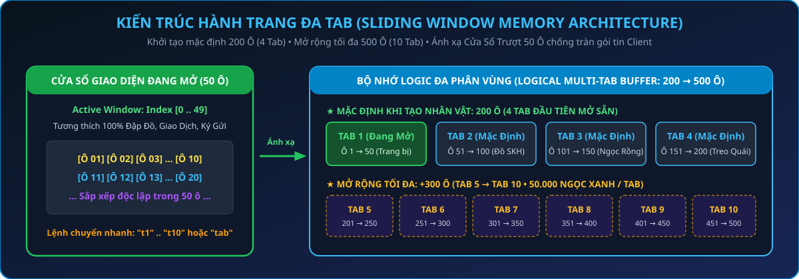

</div>

1. **Hành Trang Đa Tab (`200 Ô Mặc Định` $\rightarrow$ `Tối Đa 500 Ô`, `100 Ô / Tab`)**:
   - Tạo nhân vật có sẵn **200 ô (2 Tab × 100 ô)**, mở rộng tối đa lên **500 ô (5 Tab × 100 ô)** và **Rương đồ tối đa 120 ô**.
   - **2 Cách mở rộng Hành trang & Rương đồ**:
     - **Cách 1 (Tại NPC Santa — Đảo Kame)**: Mua vật phẩm **Mở rộng hành trang (ID 517)** hoặc **Mở rộng rương đồ (ID 518)** tại Cửa hàng Santa — mỗi lần mua mở rộng ngay **+10 ô** (mua được cả khi Tab hiện tại đang đầy).
     - **Cách 2 (Tại Menu Tiện Ích `auto`)**: Bấm **Nút Lá Cờ (`auto`) -> Tab Túi Đồ -> Mở thêm Tab (+100 ô / 50.000 Ngọc Xanh)**.
   - **Cách chuyển Tab nhanh**: Gõ `t1`, `t2`, `t3`, `t4`, `t5` (hoặc `tab 1` .. `tab 5`) vào khung chat, hoặc bấm **Nút Lá Cờ (`auto`) -> Tab Túi Đồ**.
   - **Tự động tràn Tab & Sắp xếp độc lập**: Khi Tab đang mở đầy `100/100 ô`, đồ nhặt mới sẽ tự động chảy sang các Tab còn trống tiếp theo; bấm *Sắp xếp* chỉ gom gọn trong từng Tab 100 ô để bạn thoải mái phân loại *Tab 1 (Đồ mặc/Đậu), Tab 2 (Bộ SKH phụ & Ngọc Rồng), Tab 3–5 (Đồ săn Boss & Treo quái)*.
2. **Auto Treo Quái & Tự Động Lọc Bán Đồ Rác (`treoquai` / `tq`)**:
   - Khi bật `treoquai`, nhân vật tự động lọc bán các trang bị thường lấy Vàng khi đầy túi, nhưng **khóa bảo vệ tuyệt đối 100%** đối với: *Đồ có dòng Set Kích Hoạt (SKH), Đồ Thần Linh, Đồ Hủy Diệt, Đồ Thiên Sứ, và mọi trang bị có lỗ Sao Pha Lê*.
3. **Auto Săn Boss & Auto Dọn Túi Đồ (`Menu Tiện Ích auto`)**:
   - **Tự động săn Boss**: Mở tại `auto -> Tự động săn Boss`, cho phép chọn **Săn tất cả Boss** hoặc **Chọn từng Boss theo danh sách** — nhân vật tự động bay tới bản đồ có Boss, tự đổi khu dò từ `Khu 1..N` và tự xoay tua kỹ năng tiêu diệt Boss.
   - **Tự động dọn túi đồ**: Tự động vứt bỏ các trang bị trắng/rác không có Sao Pha Lê và không có dòng SKH để hành trang luôn còn chỗ trống nhặt Đồ Thần Linh, Đồ SKH và Ngọc Rồng khi treo săn Boss.
4. **Vật Phẩm Sử Dụng Cộng Dồn Số Lượng & Cộng Dồn Thời Gian Hiệu Lực**:
   - **Cộng dồn trong Hành trang & Rương đồ**: Mọi vật phẩm tiêu hao, bổ trợ, đậu thần, ngọc rồng, đá nâng cấp, sao pha lê, sách kỹ năng đệ tử, capsule kích hoạt... đều tự động **xếp chồng gọn vào 1 ô** (lên tới `99.999` cái/ô).
   - **Cộng dồn thời gian khi sử dụng**: Khi bạn bấm dùng nhiều lần liên tiếp các vật phẩm bổ trợ ( *Cuồng Nộ*,  *Bổ Huyết*,  *Bổ Khí*,  *Giáp Xên*,  *Máy Dò Capsule*, *Ẩn Danh, Item Cấp 2, Cỏ 4 Lá, Nước Mía, Thức Ăn Hủy Diệt, Commeson, Nồi Cơm Điện, Đuôi Khỉ, Bùa Santa...*), **thời gian hiệu lực sẽ được cộng dồn nối tiếp** thay vì bị đếm lại từ đầu!

---

# 📂 03. HỆ THỐNG TĂNG TRƯỞNG SỨC MẠNH ĐA TẦNG

## 🚀 3.1. Lộ Trình Tăng Trưởng & Mở Giới Hạn Sức Mạnh (Sư Phụ & Đệ Tử)

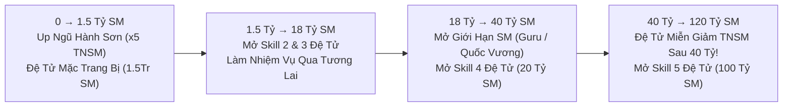

- **Mở Giới Hạn Sức Mạnh Bằng Ngọc Xanh**: Gặp **Trưởng Lão Guru (Đảo Guru - Namek)** hoặc **Quốc Vương** để mở khóa các mốc giới hạn sức mạnh tiếp theo cho cả Sư Phụ và Đệ Tử bằng Ngọc Xanh (tối đa **120 Tỷ SM**).
- **Đặc Quyền Đệ Tử — Hoàn Toàn Không Bị Giảm TNSM Sau Mốc 40 Tỷ SM**: Trong khi Sư phụ từ mốc `40 Tỷ – 120 Tỷ SM` áp dụng lộ trình giảm tốc độ nhận TNSM Endgame, **Đệ Tử (`isPet`) được miễn trừ 100% — giữ nguyên tốc độ nhận Tiềm năng & Sức mạnh sau 40 Tỷ SM**, giúp bạn cày Đệ tử lên `100 Tỷ SM` (mở Skill 5) và `120 Tỷ SM` nhanh vượt trội!

---

## 👶 3.2. Hệ Thống Tiến Hóa Đệ Tử 3 Cấp (Thường → Mabư → Broly)

Đệ tử là nguồn cộng thêm chỉ số khổng lồ khi **Hợp Thể** cùng Sư phụ. Máy chủ có chuỗi tiến hóa **3 cấp độ tuần tự**:

<div align="center">

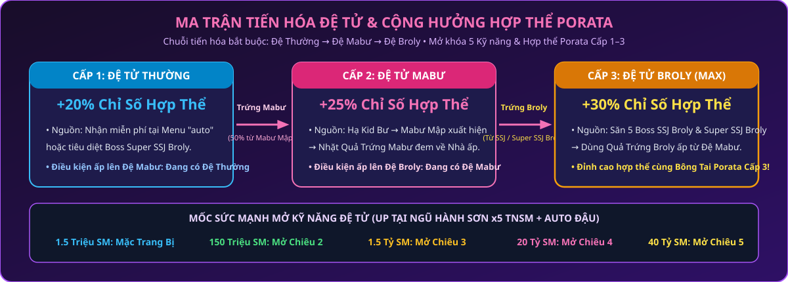

</div>

| Cấp Độ Đệ Tử | Biểu Tượng | Chỉ Số Gốc Max & Chỉ Số Cộng Khi Hợp Thể | Cách Săn Trứng & Điều Kiện Ấp Nở |
| :--- | :---: | :---: | :--- |
| **1. Đệ Tử Cấp 1 (Thường)** |  | **Cộng `100%` chỉ số đệ tử**<br>*(Chỉ cộng chỉ số đệ, không thêm % phụ)* | Nhận miễn phí tại **Menu Tiện Ích (`auto`) -> Quản lý Đệ tử -> Nhận Đệ tử Miễn phí** hoặc săn Boss **Super Broly**. |
| **2. Đệ Tử Cấp 2 (Mabư)** |  | **Chỉ số gốc giống Sư phụ (`575k` HP/KI max, `26k` SĐ max)**<br>**Hợp thể lấy `115%` chỉ số tổng của đệ tử** | • **Cách săn**: Tiêu diệt Boss **Kid Bư** (xuất hiện 5 con ở 3 hành tinh): nếu hạ khi **`HP >= 1.000.000`** sẽ **chắc chắn `100%`** gọi ra **Mabư Mập**; nếu kết liễu khi **`HP < 1.000.000`** sẽ có **tỷ lệ thấp (`5%`)** xuất hiện **Mabư Mập** ngay tại khu đó. Hạ **Mabư Mập** có **50% rơi Quả Trứng Mabư** (hoặc săn Boss Vegeta trong phó bản **Con Đường Rắn Độc**).<br>• **Điều kiện ấp**: Đang sở hữu **Đệ Tử Thường**. Bấm dùng Quả Trứng Mabư $\rightarrow$ Về **Nhà** bấm vào Quả Trứng chọn **Nở ngay (1 Tỷ Vàng)** hoặc chờ 24h. |
| **3. Đệ Tử Cấp 3 (Broly)**<br>*(Cấp Mạnh Nhất)* |   | **Chỉ số gốc giống Sư phụ (`575k` HP/KI max, `26k` SĐ max)**<br>**Hợp thể lấy `130%` chỉ số tổng của đệ tử** | • **Cách gọi Super SSJ Broly (`SSJ Broly`)**: Khi Boss Broly (nhánh SSJ) bị hạ gục đạt mốc máu **`> 10.000.000 HP` (hơn 10 Triệu HP)** sẽ **chắc chắn `100%`** biến hình thành **SSJ Broly** ngay tại khu đó; hoặc nếu kết liễu khi **`HP <= 10.000.000`** sẽ có **tỷ lệ ngẫu nhiên thấp (`5%`)** xuất hiện **SSJ Broly**!<br>• **Tỷ lệ rơi Trứng**: Hạ **SSJ Broly** rơi **`100%`  Quả Trứng Đệ Tử Broly (`ID 1826`)**!<br>• **Điều kiện ấp**: **Bắt buộc đang sở hữu Đệ Tử Mabư**. Bấm dùng Quả Trứng Broly $\rightarrow$ Về **Nhà** bấm vào Quả Trứng chọn hành tinh để nở thành **Đệ Tử Broly** (khởi đầu 1.5 Triệu SM, mặc được đồ ngay)! |

### ⚡ Cách Up Đệ Tử Nhanh Nhất & Mốc Mở 5 Kỹ Năng Cho Mọi Đệ Tử
1. **Cách Up Đệ Tử Thần Tốc**:
   - Mua **Bùa Đệ Tử 1 Tháng** tại Bà Hạt Mít + Bật **Auto Buff Đậu (`autodau`)**.
   - Mua **Cải trang Tôn Ngộ Không / Bát Giới / Sa Tăng Đệ Tử (`+30% TNSM Đệ`)** hoặc **Cải trang Thầy Giáo (`+40% TNSM, +30% TNSM Đệ`)** tại **Santa (giá 50 Ngọc Xanh)**.
   - Đưa Đệ tử lên **Ngũ Hành Sơn (Map 122–124, x5 TNSM)** và gõ `tan cong`.
2. **Các Mốc Sức Mạnh Mở Đủ 5 Kỹ Năng & Cơ Chế Sử Dụng Skill 5 Đệ Tử (Áp Dụng Cho Mọi Đệ Tử)**:
   - **1.5 Triệu SM**: Mặc được toàn bộ 9 ô Trang bị, Cải trang, **Đeo Lưng** & **Sách Tuyệt Kỹ** (bấm `auto -> Quản lý Đệ tử -> Mặc Sách Tuyệt Kỹ` hoặc gõ `sach tuyet ky`).
   - **150 Triệu SM**: Mở **Chiêu 2** (*Kamejoko / Masenko / Antomic*).
   - **1.5 Tỷ SM**: Mở **Chiêu 3** (*Thái Dương Hạ San / Kaioken / Tái Tạo Năng Lượng*).
   - **20 Tỷ SM**: Mở **Chiêu 4** (*Biến Khỉ / Đẻ Trứng / Khiên Năng Lượng*).
   - **100 Tỷ SM**: Mở **Chiêu 5** (*Super Kame / Ma Phong Ba / Liên Hoàn Chưởng* theo hệ của Đệ tử — mở khóa cho tất cả các loại Đệ tử!).
3. **Khi Nào Đệ Tử Sử Dụng Skill 5 & Cách Nâng Cấp Skill 5 Đệ Tử**:
   - **Điều kiện kích hoạt trong chiến đấu**: Khi Đệ tử ở chế độ **Tấn Công (`tan cong`)** hoặc **Bảo Vệ (`bao ve`)**, thứ tự ưu tiên tung chiêu của AI Đệ tử là: **Skill 4 $\rightarrow$ Skill 3 $\rightarrow$ Skill 5 $\rightarrow$ Skill 2 $\rightarrow$ Skill 1**. Ngay khi **Skill 4 và Skill 3 đang trong thời gian hồi chiêu (cooldown)** và Đệ tử **đủ KI (Mana)**, Đệ tử sẽ lập tức tung **Skill 5 (`Super Kame`, `Ma Phong Ba`, `Liên Hoàn Chưởng` — gây sát thương xuyên %HP Boss)**!
   - **Cách nâng cấp Skill 5 Đệ Tử lên Cấp 7**: Mua vật phẩm **Nâng kỹ năng 4 đệ tử (`ID 759` — giá 500 Ngọc Xanh tại Cửa hàng Santa)** và bấm sử dụng — sách này sẽ đồng thời nâng cấp cả **Skill 4 và Skill 5 của Đệ Tử** lên tối đa **Cấp 7** (giúp giảm thời gian hồi chiêu và tăng mạnh sát thương Skill 5)!
   - **Mẹo tối ưu**: Luôn bật **Auto Buff Đậu (`autodau`)** để Đệ tử không bị thiếu KI khi tung Skill 5.

---

## 👂 3.3. Nâng Cấp Bông Tai Porata Cấp 1 → Cấp 2 → Cấp 3 (Bà Hạt Mít)

| Cấp Bông Tai | Nguyên Liệu Nâng Cấp & Mở Chỉ Số | Tác Dụng Gia Tăng |
| :--- | :--- | :--- |
| **Bông Tai Porata Cấp 1** | Mua hoặc nhận cơ bản | Cho phép Hợp thể cơ bản với Đệ tử. |
| **Bông Tai Porata Cấp 2** | • **Nâng cấp**: Bông tai Cấp 1 + **x9999 Mảnh Vỡ Bông Tai**.<br>• **Mở chỉ số**: Bông tai Cấp 2 + **x99 Mảnh Hồn Bông Tai** + **1 Đá Xanh Lam**. | Cộng thêm dòng chỉ số ngẫu nhiên (**+% Sức Đánh / HP / KI / Chí Mạng / Giáp**) khi hợp thể. *(Mảnh vỡ & Mảnh hồn cày tại Map Khí Gas / Doanh Trại / Bản Đồ Kho Báu)*. |
| **Bông Tai Porata Cấp 3** | • **Nâng cấp & Mở chỉ số** từ Bông tai Cấp 2 tại **Bà Hạt Mít (Đảo Kame)**. | Đột phá giới hạn chỉ số hợp thể lên mức cao nhất! |

---

## 🌟 3.4. Nội Tại, Hào Quang Săn Boss 3 Cấp, Thẻ Sưu Tầm & Danh Hiệu

1. **Hào Quang Săn Boss 3 Cấp (Tại Quy Lão Kame — Đảo Kame)**:
   - Mỗi lần tiêu diệt bất kỳ Boss nào, bạn nhận được **+1 Điểm Săn Boss**. Đem điểm đến gặp **Quy Lão Kame -> Đổi điểm săn Boss** để kích hoạt **Hào Quang Vĩnh Viễn**:
     - **Hào Quang Cấp 1 (`100 Điểm Săn Boss`)**: Tăng vĩnh viễn **+3% Sức Đánh, +3% HP, +3% KI**.
     - **Hào Quang Cấp 2 (`1.000 Điểm Săn Boss`)**: Tăng vĩnh viễn **+5% Sức Đánh, +5% HP, +5% KI, +5% Hút HP, +5% Hút KI**.
     - **Hào Quang Cấp 3 (`10.000 Điểm Săn Boss`)**: Tăng vĩnh viễn **+10% Sức Đánh, +10% HP, +10% KI, +10% Hút HP, +10% Hút KI**.
2. **Hệ Thống Nội Tại Nhân Vật**:
   - Mở trong Menu chức năng bản thân bằng Vàng hoặc Ngọc để lấy dòng cộng **+% sát thương kỹ năng chủ lực** (*Kamejoko, Dịch Chuyển Tức Thời, Liên Hoàn, Makankosappo, Galick, Biến Khỉ, Tự Phát Nổ*).
3. **Bách Khoa Toàn Thư (Thẻ Sưu Tầm Radar) & Danh Hiệu**:
   - Thu thập các thẻ quái/Boss rơi ra khi cày cuốc, bấm sử dụng để nâng cấp sao trong **Bách Khoa Toàn Thư**, cộng thẳng **Sức Đánh, HP, KI gốc vĩnh viễn**!

---

# 📂 04. HỆ THỐNG BẢN ĐỒ (MAP), PHÓ BẢN & CƠ CHẾ DỊCH CHUYỂN

## 🗺️ 4.1. Phân Khu Hệ Thống Bản Đồ Theo Chức Năng

| Phân Khu Bản Đồ | Các Map Tiêu Biểu | Cách Di Chuyển Tới | Vai Trò & Đặc Điểm Quan Trọng |
| :--- | :--- | :--- | :--- |
| **1. Khu Vực Trung Tâm & NPC** | Nhà 3 Hành Tinh, Làng Aru/Moori/Kakarot, **Đảo Kame (Map 5)**, **Siêu Thị (Map 84)** | Capsule hoặc NPC Tàu Vũ Trụ | Nơi tập trung **Ông Gôhan**, **Quy Lão Kame**, **Bà Hạt Mít**, **Santa**, **Urôn**, **Bò Mộng** để nâng cấp đồ, nhận nhiệm vụ và mua sắm. |
| **2. Khu Vực Up Sức Mạnh Đặc Biệt (x5 TNSM)** | **Ngũ Hành Sơn**<br>*(Map 122, 123, 124)* | Gặp **Ông Gôhan / Moori / Paragus** tại Nhà chọn **"Đi Ngũ Hành Sơn"** | **Bản đồ cày Sức Mạnh & Up Đệ Tử số 1 máy chủ**: Toàn bộ quái tại đây nhân **x5 Tiềm Năng & Sức Mạnh**! |
| **3. Khu Vực Nhiệm Vụ Chính Tuyến** | Các Map Trái Đất, Namek, Xayda, Phố, Thành Phố, Võ Đài Xên | Chạy bộ qua Waypoint hoặc dùng Capsule | Nơi xuất hiện chuỗi Boss nhiệm vụ: *Kuku, Mập Đầu Đinh, Rambo, Tiểu Đội Sát Thủ, Fide Đại Ca, Android 19/20/13/14/15, Pic/Poc/King Kong, Xên Bọ Hung*. |
| **4. Khu Vực Tương Lai**<br>*(Map 92 – 103)* | Thành Phố Phía Đông, Phía Bắc, Cao Nguyên, Võ Đài Xên Tương Lai, Nhà Bunma (Map 102) | Qua NPC **Calích** (sau khi hoàn thành nhiệm vụ Xên) hoặc **Capsule "Về chỗ cũ"** | Đại bản doanh của các Boss lớn (`>= 400Tr HP`): **Black Goku, Super Black Goku, Zamasu, Xên Hoàn Thiện, Siêu Bọ Hung**. Rớt **7% Đồ Thần Linh (kèm 3–7 Sao)**, **75% Đồ Cấp 12 (3–7 Sao)** & **2% Đồ SKH**. |
| **5. Hành Tinh Cold**<br>*(Map 105 – 110)* | Cánh Đồng Tuyết, Rừng Tuyết, Núi Tuyết, Dòng Sông Băng, Hang Băng | Tàu Vũ Trụ Xayda / Capsule | Nơi săn **Cooler Cấp 1, Cooler Cấp 2**. *Lưu ý: Quái và khí lạnh tại Cold gây giảm 50% HP/SĐ nếu không mặc **Cải trang Kháng Lạnh** (mua tại Santa giá 50 Ngọc)*. |
| **6. Hành Tinh Bill & Ngục Tù**<br>*(Map 154, 155)* | Hành Tinh Bill, Hành Tinh Ngục Tù | Gặp **Thần Vũ Trụ / Whis** | Nơi gặp **Bill & Whis** để đổi **Đồ Hủy Diệt**, chế tạo **Đồ Thiên Sứ**, **Sách Tuyệt Kỹ** và săn Boss **Cumber / Super Cumber**. |

---

## 🏰 4.2. Hệ Thống Phó Bản & Hoạt Động Theo Giờ

| Tên Phó Bản / Hoạt Động | NPC Đăng Ký / Vị Trí | Phần Thưởng & Mục Đích Cày Cuốc |
| :--- | :--- | :--- |
| **Doanh Trại Độc Nhãn** | Lính Nhãn Cầu *(Rừng Bamboo - Map 27)* | Đi theo Bang hội: Vượt 10 map doanh trại, hạ Boss **Trung Úy Trắng** *(phải dụ vào gần Tấm Gương mới gây sát thương được)*, **Trung Úy Xanh Lam, Trung Úy Thép, Ninja Áo Tím, Robot Vệ Sĩ**. Thu thập **Cuốn chả giò, Chai Cuke 2 lít** làm nhiệm vụ **KOL**, rơi **Ngọc Rồng Thường,  Ngọc Rồng Tím (`1827–1833`)** & Mảnh vỡ bông tai. |
| **Bản Đồ Kho Báu Dưới Biển** | Quy Lão Kame *(Đảo Kame - Map 5)* | Đi theo Bang hội (cần *Bản đồ kho báu ID 611*, chọn cấp độ **1–110**). Hạ **Trung Úy Xanh Lơ** để mở Rương Báu nhận Rương Gỗ (mở tại Nhà). |
| **Con Đường Rắn Độc** | Thần Vũ Trụ *(Thần Điện Vũ Trụ - Map 48)* | Đi theo Bang hội (chọn cấp độ **1–110** tại Map 141–144). Hạ chuỗi Boss **Saibamen (Số 1–6) $\rightarrow$ Nappa $\rightarrow$ Vegeta**, có tỉ lệ rơi **Quả Trứng Đệ Tử Mabư**, Vàng & Sao Pha Lê. |
| **Khí Gas Hủy Diệt (Destron Gas)** | Mr. Pôpô *(Thần Điện)* | Chọn cấp độ (Cấp 70+ dùng để hoàn thành **Nhiệm vụ KOL số 3** nhận Đeo Lưng VIP) và săn Boss **Dr. Lychee $\rightarrow$ Hatchiyack**. |
| **Tầng Địa Ngục Majin Buu (12h)** | Osin *(Đảo Kame / Đại Hội Võ Thuật)* | Vượt qua các tầng **Pui Pui, Yacon, Drabura, Babidi, Mabư** để săn Ngọc Rồng 1–4 Sao, Đồ SKH và Trứng Mabư. |
| **Chiến Trường Ngọc Rồng Sao Đen** | Ốc Sên *(Trạm Tàu Vũ Trụ — 20h tối)* | Chiếm giữ Ngọc Rồng Sao Đen (1–7 Sao) mang lại phúc lợi tăng **+% Sức Đánh, +% HP, +% KI** cho toàn bộ thành viên Bang hội! |

---

## 🚀 4.3. Cơ Chế Khu Tự Động, Dịch Chuyển Boss (`Khu 0`), Capsule Khứ Hồi & Hồi Sinh Tại Chỗ (`5 Lần Miễn Phí`)

<div align="center">

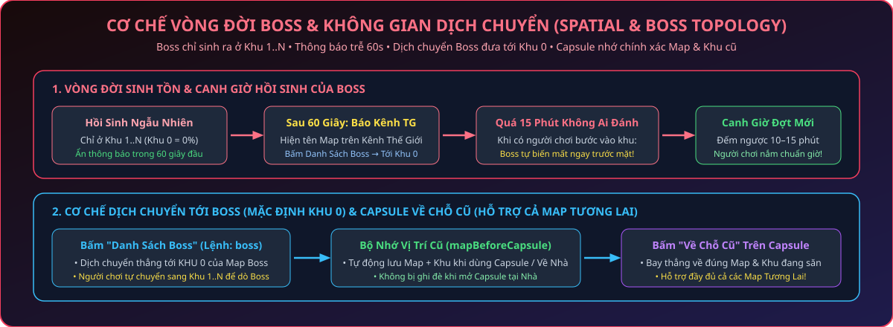

</div>

1. **Cơ Chế Tự Động Chọn Khu Khi Qua Map Mới**:
   - Khi bạn chạy bộ hoặc bay qua một bản đồ mới, hệ thống tự động đưa bạn vào **Khu 0**; nếu **Khu 0 đã có trên 7 người chơi**, hệ thống tự động chuyển bạn sang **Khu 1** để chống giật lag!
2. **Dịch Chuyển Tới Bản Đồ Có Boss (Mặc Định Đáp Xuống `Khu 0`)**:
   - **Cách 1 (Từ Danh Sách Boss `boss`)**: Gõ `boss` (hoặc bấm `auto -> Danh sách Boss`), bấm chọn một con Boss đang sống $\rightarrow$ Hệ thống dịch chuyển bạn thẳng tới **`Khu 0` của bản đồ Boss đó** (vượt qua cả rào cản nhiệm vụ map).
   - **Cách 2 (Từ Viên Capsule `193` / `194`)**: Khi mở **Viên Capsule**, toàn bộ các bản đồ đang có Boss xuất hiện sẽ tự động được liệt kê kèm dòng **`Boss: <Tên Boss>`** — bấm chọn bản đồ đó để bay thẳng tới **`Khu 0`**!
   - Vì Boss chỉ xuất hiện từ **Khu 1 trở đi**, sau khi đáp xuống `Khu 0`, bạn mở bảng Đổi Khu để tự dò tìm từ Khu 1..N một cách công bằng!
3. **Capsule `"Về Chỗ Cũ"` — Lưu Chuẩn Map & Khu (Mở Khóa Cả Map Tương Lai)**:
   - Hệ thống tự động lưu lại chính xác **Bản Đồ + Số Khu (`Khu X`)** trước khi bạn dùng Capsule, dịch chuyển tới Boss, hoặc khi **bị hạ gục phải hồi sinh về Nhà**.
   - Khi đứng ở Nhà bật Capsule, vị trí cũ **không bị ghi đè thành Nhà**, và bạn có thể bấm **"Về chỗ cũ: <Tên Map> (Khu X)"** để bay thẳng về lại đúng khu đang săn Boss — **hỗ trợ đầy đủ cả toàn bộ các Map Tương Lai (Map 92–103)**!
4. **Cơ Chế Hồi Sinh Tại Chỗ (`5 Lần Miễn Phí` — Reset Khi Về Nhà)**:
   - Mỗi người chơi được **miễn phí 5 lần Hồi sinh tại chỗ đầu tiên** (`0 Vàng, 0 Ngọc`).
   - Từ lần hồi sinh tại chỗ thứ 6 trở đi, chi phí cố định là **`1.000.000 Vàng / lần`** (hệ thống tự động báo số lượt miễn phí còn lại mỗi khi bạn hồi sinh).
   - Ngay khi nhân vật **Về Nhà** (bấm *Về nhà* lúc bị hạ gục, bay *Capsule* về nhà hoặc đi bộ về *Nhà Gôhan / Nhà Moori / Nhà Broly*), bộ đếm lập tức **reset lại đủ 5 lượt hồi sinh miễn phí**!

---

# 📂 05. HỆ THỐNG BOSS, QUY LUẬT HỒI SINH & MA TRẬN VẬT PHẨM RƠI

## ⏱️ 5.1. Cơ Chế Sát Thương Boss & 5 Quy Luật Săn Boss Chiến Thuật

1. **Gỡ Bỏ Giảm Sát Thương Ngầm Cho Toàn Bộ Boss Thường & Boss Lớn (`100% Sát Thương Thật`)**:
   - Toàn bộ các Boss nhiệm vụ, Boss sự kiện và Boss đại ca cuối game (*Black Goku, Super Black Goku, Zamasu, Xên Bọ Hung, Siêu Bọ Hung, Cooler, Cumber, Golden Frieza, 3 Sói Basil/Lavender/Bergamo, Baby, Mabư 12h/14h, Kid Bư, Mabư Mập, Tiểu Đội Bojack, Boss Doanh Trại...*) **đều đã được tắt hoàn toàn cơ chế giảm sát thương và giới hạn `%HP`**. Nhân vật của bạn có bao nhiêu Sức Đánh sẽ gây trọn vẹn **100% sát thương thực tế**!
   - **Riêng Boss `Broly` & `Super Broly` (`SSJ Broly`)**: Giữ cơ chế nhận sát thương tối đa theo `% HP` đối với đòn đánh thường để người chơi có thể nuôi máu Broly vượt mốc `10.000.000 HP` gọi Super SSJ Broly (**nhưng sẽ bị xuyên thủng 100% nếu bạn dùng Chiêu Đặc Biệt Skill 9**: `Super Kamejoko`, `Ma Phong Ba`, `Ca Đíc Liên Hoàn Chưởng`, đồng thời **vẫn nhận sát thương phản đòn `PST` khi bắn chưởng vào người mặc Cải trang Android 19/20**)!
2. **Tuyệt Đối Không Xuất Hiện Ở Khu 0**:
   - 100% Boss trên máy chủ khi hồi sinh đều chọn ngẫu nhiên từ **Khu 1 trở đi (`Khu 1 .. Khu N`)**. Khi đi dò Boss, bạn không bao giờ cần kiểm tra Khu 0.
3. **Thông Báo Boss Xuất Hiện Trễ 1 Phút (60 Giây)**:
   - Khi Boss vừa hồi sinh vào bản đồ, thông báo trên Kênh Thế Giới và Danh Sách Boss sẽ **hiển thị trễ 1 phút**, tạo lợi thế lớn cho những người chơi chăm chỉ đi tuần tra các bản đồ.
4. **Cơ Chế Tự Biến Mất Sau 10 Phút Khi Gặp Người Chơi (Canh Giờ Săn Boss)**:
   - Nếu một con Boss xuất hiện quá **10 phút** mà **không có bất kỳ ai tấn công**, ngay khoảnh khắc có 1 người chơi bước vào khu của nó, Boss sẽ **tự động biến mất ngay trước mặt người chơi đó** và bắt đầu đếm ngược thời gian hồi sinh lượt mới.
   - Cơ chế này giúp người chơi **biết chính xác thời điểm Boss biến mất** để canh chuẩn giờ Boss ra ở đợt tiếp theo!
5. **Thời Gian Hồi Sinh & Số Lượng Boss**:
   - **Các Boss Lớn** (*Black Goku, Zamasu, Cooler, Cumber, Xên Bọ Hung, Siêu Bọ Hung...*): Thời gian hồi sinh ngẫu nhiên từ **5 – 10 phút** và chỉ xuất hiện **1 con / loại tại 1 thời điểm** để nâng cao giá trị săn Boss.
   - **Boss Broly & Kid Bư**: Xuất hiện **5 con cùng lúc** rải đều ở 3 hành tinh.
   - **Boss Nhiệm Vụ Đầu (Kuku, Mập Đầu Đinh, Rambo)**: Xuất hiện **3 con mỗi loại** cùng lúc để người chơi làm nhiệm vụ nhanh chóng.

---

## 🎁 5.2. Ma Trận 5 Tầng Boss & Phân Tầng Vật Phẩm Rơi (`< 400Tr HP` vs `>= 400Tr HP`)

Mỗi khi hạ gục bất kỳ Boss nào, người kết liễu đều nhận ngay **+1 Điểm Săn Boss** và **+1 Điểm Sự Kiện**, kèm theo vật phẩm rơi được phân tầng rõ rệt theo mốc máu **`400.000.000 HP`** của Boss:

| Phân Tầng Boss | Danh Sách Boss Trong Nhóm | Ngọc Rồng Thường & Ngọc Rồng Tím | Trang Bị, Trứng Đệ & Tài Nguyên Rơi Thêm |
| :--- | :--- | :--- | :--- |
| **Tầng 1: Boss Nhiệm Vụ Đầu**<br>*(3 con / loại cùng lúc)* | **Kuku, Mập Đầu Đinh, Rambo** | Chỉ rơi **Ngọc Rồng 4 – 7 Sao** | Vàng, Hồng Ngọc, Đậu Thần *(Không rơi trang bị)* |
| **Tầng 2: Boss Đệ Tử Đặc Biệt**<br>*(5 con / loại ở 3 hành tinh)* | **Kid Bư $\rightarrow$ Mabư Mập**, **Broly Thường $\rightarrow$ Super Broly (`SSJ Broly`)** | Rơi Vàng, Hồng Ngọc | • **Quy luật gọi Mabư Mập**: Hạ **Kid Bư** khi **`HP >= 1.000.000`** chắc chắn **`100%`** ra **Mabư Mập** (hoặc **`5%`** tỷ lệ ngẫu nhiên khi chết dưới `1Tr HP`).<br>• **Quy luật gọi Super SSJ Broly (`SSJ Broly`)**: Hạ **Broly (nhánh SSJ)** khi đạt **`HP > 10.000.000` (hơn 10 Triệu HP)** sẽ **chắc chắn `100%`** xuất hiện **SSJ Broly**; hoặc có **tỷ lệ ngẫu nhiên thấp (`5%`)** xuất hiện khi chết ở mốc `<= 10Tr HP`!<br>• Hạ **Mabư Mập** có **`50%` rơi Quả Trứng Mabư**; hạ **SSJ Broly** rơi **`100%` Quả Trứng Đệ Tử Broly (`ID 1826`)**! |
| **Tầng 3: Boss Tiểu Đội & Hằng Ngày** | **Tiểu Đội Sát Thủ Namek, Tiểu Đội Bojack (Bujin, Kogu, Zangya, Bido, Bojack)** | Chỉ rơi **Ngọc Rồng Thường (1–3 Sao)** **HOẶC** **Ngọc Rồng Tím 6–7 Sao** | • Chuyên dùng cho tân thủ săn **Ngọc Rồng Thường (1–3 Sao)** & **Ngọc Rồng Tím 6–7 Sao**.<br>• Rơi **`5 – 8 Hồng Ngọc / con`** (đã giảm 75% lượng ngọc rơi để cân bằng kinh tế) *(Không rơi trang bị)*. |
| **Tầng 4: Boss Cấp Thấp & Trung Cấp (`< 400 Triệu HP`)**<br>*(Từ Nappa trở đi — 1 đội/lần)* | **Tiểu Đội Sát Thủ Nappa (Số 4, 3, 2, 1, Tiểu Đội Trưởng), Nappa, Vegeta, Fide Đại Ca (1, 2, 3), Android 19/20/13/14/15, Pic/Poc/King Kong, Pui Pui, Yacon, Drabura...** | Rơi **Ngọc Rồng 1 – 4 Sao** *(tuyệt đối không rơi 5–7 sao)* **HOẶC** **Ngọc Rồng Tím 6–7 Sao** | • **25% tỷ lệ rơi Trang bị thường**: Trong đó **`75%` đồ Cấp 10**, **`20%` đồ Cấp 11**, và **chỉ `5%` ra đồ cao cấp Cấp 12** (*Sao Pha Lê: 85% 1–2s, 13% 3–4s, 2% 5s*).<br>• **2% tỷ lệ rơi Trang Bị Kích Hoạt (SKH)** *(Không rơi Đồ Thần Linh)*.<br>• Rơi **5 cục Vàng lớn (1 Triệu Vàng/cục)** + **`5 – 20 Hồng Ngọc`**. |
| **Tầng 5: Boss Cao Cấp Cuối Game (`>= 400 Triệu HP`)**<br>*(Hồi sinh 5 – 10 phút)* | **Xên Bọ Hung, Xên Hoàn Thiện, Siêu Bọ Hung, Black Goku, Super Black Goku, Zamasu, Cooler, Golden Frieza, Cumber, Super Cumber, 3 Sói (Basil, Lavender, Bergamo), Mabư 14h** | Rơi **Ngọc Rồng 1 – 4 Sao** *(tỷ lệ 1–2 Sao cao)* **HOẶC** **Ngọc Rồng Tím 6–7 Sao** | • **7% tỷ lệ rơi Trang Bị Thần Linh (Level 13 — luôn kèm sẵn `3 – 7 Sao Pha Lê`)**!<br>• **50% tỷ lệ rơi Trang bị cao cấp**: Trong đó **`75%` là Đồ Cấp 12** (*Kaio, Lưỡng Long, Jean, Rada cấp 12*), `15%` Cấp 11, `10%` Cấp 10 — **100% có sẵn `3 – 7 Sao Pha Lê`**!<br>• **2% tỷ lệ rơi Trang Bị Kích Hoạt (SKH)** + nhiều **Vàng & Hồng Ngọc**. |

> [!NOTE]
> **Quy Tắc Loại Trừ Ngọc Rồng**: Trong mỗi lần hạ gục Boss, nếu Boss đã rơi **Ngọc Rồng Tím** thì lượt đó sẽ không rơi thêm Ngọc Rồng Thường và ngược lại.

---

# 📂 06. HỆ THỐNG RỒNG THẦN TRÁI ĐẤT & RỒNG THẦN TÍM (NGỌC RỒNG TÍM)

## 🔄 6.1. Cơ Chế Nhập Ngọc Rồng Nhanh Tại Bà Hạt Mít (Đảo Kame)
- Bạn có thể đem **Ngọc Rồng Thường (2 – 7 Sao)** hoặc **Ngọc Rồng Tím (2 – 7 Sao)** đến gặp **Bà Hạt Mít (Đảo Kame) -> Nhập Ngọc Rồng**:
- Cứ **7 viên Ngọc Rồng cấp dưới** sẽ hợp thành **1 viên Ngọc Rồng cấp trên liền kề** (`7s -> 6s -> 5s -> 4s -> 3s -> 2s -> 1s`), hỗ trợ ghép nhanh số lượng lớn!

## 🐲 6.2. Bảng So Sánh Rồng Thần Trái Đất & Rồng Thần Tím

| Hệ Thống Ngọc Rồng | Biểu Tượng | Chỉ Số Khi Ép Vào Trang Bị | Các Điều Ước Khi Triệu Hồi (Thời Gian Chờ 10 Giây) |
| :--- | :---: | :--- | :--- |
| **Ngọc Rồng Thường**<br>*(1 Sao – 7 Sao)* | 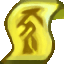   | Ép vào trang bị tăng chỉ số cơ bản theo từng sao (1 Sao: `+5% Sức đánh`, 2 Sao: `+5% HP`, 3 Sao: `+5% KI`...). | • Ước **20 Tỷ Vàng**.<br>• Ước **+2% Chí Mạng** gốc vĩnh viễn.<br>• Ước nâng cấp **Găng Tay đang mang** (của Sư Phụ hoặc Đệ Tử) lên **+1 cấp** (tối đa `[+7]`).<br>• Ước nâng cấp **Quần đang mang** (của Sư Phụ hoặc Đệ Tử) lên **+1 cấp** (tối đa `[+7]`).<br>• Ước đổi kỹ năng **Chiêu 2 & Chiêu 3 của Đệ Tử**.<br>• Ước Ngọc Xanh / Cải trang Đẹp Trai. |
| **Ngọc Rồng Tím**<br>*(1 Sao – 7 Sao)* |   | Chỉ số ép vào đồ **cao vượt trội so với Ngọc thường**:<br>• Các dòng `5%` tăng lên **`+7%`**.<br>• Các dòng `3%` tăng lên **`+4%`**. | • Thu thập từ `6–7 Sao Tím` khi săn Boss / Doanh Trại Độc Nhãn và ghép lên `1–7 Sao Tím`.<br>• Triệu hồi **Rồng Thần Tím (hồi chiêu gọi lại chỉ 10 giây)** để nhận các điều ước phúc lợi VIP và gia tăng chỉ số đặc biệt! |

---

# 📂 07. HỆ THỐNG KINH TẾ, NHIỆM VỤ HÀNG NGÀY, SỰ KIỆN & BẢNG LỆNH AUTO

## 💰 7.1. Hệ Thống Kinh Tế Vàng, Nhiệm Vụ Hàng Ngày & Thành Tích Bò Mộng
Để đảm bảo nền kinh tế Vàng ổn định (tỷ giá chuẩn **`1 Thỏi Vàng = 500.000.000 Vàng`** bán và mua tại **Santa**):
1. **Nhiệm Vụ Hàng Ngày Bò Mộng (Tại Thần Điện / Đảo Kame)**:
   - Mỗi ngày bạn có **20 lượt Nhiệm Vụ Bò Mộng** chia làm **5 cấp độ khó** (*Dễ, Thường, Khó, Rất Khó, Siêu Khó*).
   - Hoàn thành nhiệm vụ nhận trực tiếp **Vàng & Thỏi Vàng** theo độ khó, đồng thời tích lũy tiến độ mở khóa **Nhiệm Vụ KOL**!
2. **Phần Thưởng Thành Tích Bò Mộng (Thưởng Bằng Thỏi Vàng)**:
   - Gặp **Bò Mộng -> Thành tích** để nhận thưởng khi đạt đủ 20 cột mốc thành tích cày cuốc (*Đạt mốc Sức mạnh, Chưởng, Bay, Hạ quái, Hạ Boss, Dùng tuyệt kỹ...*).
   - Toàn bộ các mốc Thành Tích đều thưởng trực tiếp **Thỏi Vàng (`từ 5 đến 100 Thỏi Vàng / mốc`, tổng cộng `515 Thỏi Vàng` = `257.5 Tỷ Vàng`)** thẳng vào hành trang!
3. **Săn Boss & Auto Treo Quái (`treoquai`)**:
   - Săn Boss từ Nappa trở đi rơi trực tiếp các cục vàng triệu và Thỏi Vàng.
   - Bật `treoquai` vừa cày Tiềm năng vừa tự động lọc bán trang bị thường lấy Vàng liên tục.

---

## 🏆 7.2. Chuỗi Nhiệm Vụ KOL, KOL VIP & Hệ Thống 12 Sự Kiện Lễ Hội

### 🎯 A. Chuỗi Nhiệm Vụ KOL & KOL VIP (Tại Quy Lão Kame — Đảo Kame)
Gặp **Quy Lão Kame (Đảo Kame)** chọn **"Nhận quà KOL"** hoặc **"Nhận quà KOL VIP"** để thực hiện chuỗi 7 thử thách nhận Đeo Lưng / Pet VIP và Rương quà:

| Giai Đoạn | Nội Dung Thử Thách | Phần Thưởng Tiêu Biểu |
| :---: | :--- | :--- |
| **Nhiệm Vụ 1** | Thu thập **100 Cuốn chả giò** *(Đánh quái Doanh Trại Độc Nhãn)* | Rương quà đặc biệt |
| **Nhiệm Vụ 2** | Thu thập **10 Chai Cuke 2 lít** *(Hạ Boss Doanh Trại Độc Nhãn)* | Hộp quà & Rương sự kiện |
| **Nhiệm Vụ 3** | Hoàn thành phó bản **Khí Gas Hủy Diệt (Destron Gas) cấp 70+** đủ 20 lần | Vật phẩm đeo lưng / Pet tăng `+13% SĐ, HP, KI, +20% TNSM` |
| **Nhiệm Vụ 4** | Đánh bại **10 người chơi** trong Đại Hội Võ Thuật | Phụ kiện tăng `+16% SĐ, +15% HP/KI, Kháng lạnh` |
| **Nhiệm Vụ 5** | Hoàn thành **30 Nhiệm vụ Bò Mộng Siêu Khó** hàng ngày | Rương phần thưởng cấp cao |
| **Nhiệm Vụ 6** | Tham gia hạ gục **Boss Baby** đủ 5 lần | Vật phẩm VIP tăng `+25% SĐ, +30% KI` |
| **Nhiệm Vụ 7** | Hạ gục **100.000 Quái** bằng Tự Động Luyện Tập | Gói phần thưởng đại gia + x9999 Thức ăn Hủy Diệt |

### 🎉 B. Hệ Thống 12 Sự Kiện Lễ Hội (Mở Trực Tiếp Không Cần Bảo Trì)
Tùy theo từng đợt lễ hội được Admin kích hoạt trên máy chủ, đánh quái trên toàn bộ các bản đồ sẽ rơi các vật phẩm sự kiện đặc biệt:
- **🎃 Sự Kiện Halloween**: Đánh quái rơi **Bí Ngô 1–7 Sao** (thu thập đủ 7 quả gọi **Rồng Thần Halloween**) và săn **Boss Bí Ma, Ma Trơi, Dơi** nhặt Kẹo & Ngọc Halloween.
- **🎄 Sự Kiện Giáng Sinh (Noel)**: Đánh quái rơi **Tất Vớ, Hộp Quà Giáng Sinh** và săn **Boss Ông Già Noel**.
- **🧧 Sự Kiện Tết Nguyên Đán & Nấu Bánh**: Đánh quái rơi **Bao Lì Xì**, nguyên liệu **Cơm Nếp, Đậu Xanh, Thịt Tươi, Chả Lụa** nấu bánh tại **Nồi Bánh** và săn **Boss Lân Con**.
- **🥮 Sự Kiện Tết Trung Thu**: Đánh quái rơi **Hộp Quà Trung Thu** và săn **Boss Khỉ Đột, Nguyệt Thần**.
- **⚔️ Sự Kiện Giỗ Tổ Hùng Vương**: Đánh quái rơi **Ngà Voi, Cựa Gà, Hồng Mao, Dưa Hấu, Tem** dâng lễ **Vua Hùng** và săn **Boss Sơn Tinh – Thủy Tinh**.
- **🍹 Sự Kiện Mùa Hè & 🎈 Thiếu Nhi 1/6 & 🎆 Pháo Hoa & 🌹 Quốc Tế Phụ Nữ 8/3**: Đánh quái rơi **Khúc Mía, Nước Đá, Kem Trái Cây** (đua Top tại *Xe Nước Mía & ChiChi*), **Hộp Quà Thiếu Nhi**, **Pháo Bông VIP** và **Hoa Hồng**.

---

## ⌨️ 7.3. Bảng Điều Khiển Tiện Ích, Phím Di Chuyển `W A S D`, Lệnh Chat Nhanh & Bảo Trì Định Kỳ `08:00 Sáng`

Bạn có thể bấm trực tiếp vào **Nút Lá Cờ (Đổi Cờ)** ở góc trên màn hình hoặc gõ lệnh vào khung chat ở bất kỳ đâu:

| Lệnh Chat / Tiện Ích | Chức Năng Thực Thi |
| :--- | :--- |
| `auto` hoặc `menu` | Mở **Bảng Điều Khiển Tiện Ích Tổng Hợp** (Hành trang đa Tab, Auto Đậu, Auto Treo Quái, **Auto Săn Boss**, **Auto Dọn Túi Đồ**, Đệ Tử, Danh Sách Boss). |
| `tab` hoặc `tui` hoặc `hanhtrang` | Mở bảng **Quản Lý 5 Tab Hành Trang (100 ô / Tab, tối đa 500 ô)** & Mở rộng thêm Tab mới (`+100 ô`). |
| `t1` .. `t5` *(hoặc `tab 1` .. `tab 5`)* | Chuyển nhanh lập tức sang **Tab Hành Trang số 1 $\rightarrow$ số 5** (rất tiện để swap Set Cadic / Set Kakarot / Set Nappa). |
| `autodau` hoặc `ad` | Bật / Tắt **Auto Buff Đậu Thần** tự động hồi HP/KI cho cả Sư Phụ và Đệ Tử. |
| `treoquai` hoặc `tq` | Bật / Tắt **Auto Treo Quái & Tự Động Lọc Bán Đồ Rác** (giữ lại 100% Đồ SKH, Đồ Thần Linh, Đồ Sao). |
| `boss` hoặc `sanboss` | Mở **Danh Sách Boss Đang Sống** và bấm dịch chuyển nhanh tới **Khu 0** của bản đồ Boss. |
| `di theo` / `tan cong` / `bao ve` / `ve nha` | Điều khiển trạng thái chiến đấu của Đệ Tử nhanh không cần mở bảng. |
| `sach tuyet ky` | Tự động tìm và mặc **Sách Tuyệt Kỹ** trong hành trang cho Đệ Tử (mọi loại Đệ tử từ 1.5tr SM). |
| `bien hinh` | Cho Đệ Tử biến hình gia tăng chỉ số. |
| **Phím `W A S D` trên PC** | Chạy file **`Chay_Game_WASD.bat`** (hoặc **`Bat_Phim_WASD.bat`**) để di chuyển bằng cụm phím **`W` (Lên), `A` (Trái), `S` (Xuống), `D` (Phải)**; tự động nhường phím khi mở khung Chat `Enter` và tự tắt khi thoát game. |
| **Lịch Bảo Trì `08:00 Sáng`** | Máy chủ tự động đếm ngược 60 giây lưu dữ liệu và khởi động lại làm mới lúc **08:00 sáng hàng ngày** *(nếu trong ngày Admin đã cập nhật/khởi động lại Server trước 08:00 sáng thì hệ thống sẽ tự động bỏ qua bảo trì ngày hôm đó để không làm gián đoạn người chơi)*. |

---

<div align="center">

**🔥 Chúc các chiến binh mới làm chủ mọi cơ chế và bùng nổ sức mạnh tại NGỌC RỒNG VIAM! 🔥**

</div>
