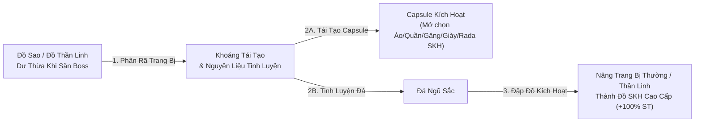
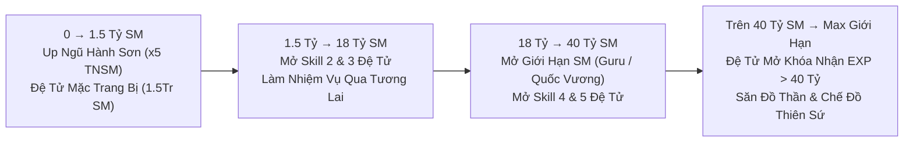

<div align="center">


# 🐉 NGỌC RỒNG VIAM — BÁCH KHOA TOÀN THƯ & KIẾN TRÚC HỆ THỐNG

**Cẩm nang hướng dẫn toàn diện từ Cơ Bản đến Đỉnh Cao • Phân tách theo cấu trúc thư mục chuyên đề: Định hướng Build 3 Hành Tinh, Trang Bị & Đập Đồ 9 Sao, Hệ Thống Tăng Trưởng, Bản Đồ, Săn Boss & Kinh Tế**

[-0284c7?style=for-the-badge)](#-26-các-tính-năng-hỗ-trợ-vật-phẩm-hành-trang-đa-tab-200500-ô--auto-lọc-đồ)
[](#-13-định-hướng-lối-chơi-build--chọn-set-kích-hoạt-theo-từng-hành-tinh)
[-7e22ce?style=for-the-badge)](#-32-hệ-thống-tiến-hóa-đệ-tử-3-cấp-thường--mabư--broly)
[](#-05-hệ-thống-boss-quy-luật-hồi-sinh--ma-trận-vật-phẩm-rơi)

</div>

---

## 📁 CẤU TRÚC THƯ MỤC CẨM NANG (DOCUMENTATION DIRECTORY TREE)

Tài liệu được phân tách thành **7 chuyên đề độc lập** theo cấu trúc thư mục từ nền tảng sức mạnh đến các cơ chế chuyên sâu:

```text
📦 NGOC-RONG-VIAM-HANDBOOK/
├── 📂 01-Tong-Quan-Suc-Manh-Va-Dinh-Huong-Hanh-Tinh/
│   ├── 📄 1.1. Kiến trúc 3 tầng sức mạnh & Công thức tính sát thương
│   ├── 📄 1.2. Cách nâng chỉ số gốc (Tiềm năng) theo từng giai đoạn
│   └── 📄 1.3. Định hướng lối chơi (Build) & Chọn Set Kích Hoạt cho Trái Đất, Namek, Xayda
├── 📂 02-He-Thong-Vat-Pham-Trang-Bi-Va-Dap-Do-Sao/
│   ├── 📄 2.1. Phân cấp trang bị mặc & Phúc lợi Rương SKH Vải Thô Tân Thủ
│   ├── 📄 2.2. Quy trình Đập Đồ Sao Pha Lê (1 → 9 Lỗ), SPL Cấp 2 & Đập Cấp [+1..+16]
│   ├── 📄 2.3. Tái tạo Trang Bị Kích Hoạt (SKH) & Tinh luyện Đá Ngũ Sắc
│   ├── 📄 2.4. Chế tạo Đồ Hủy Diệt, Đồ Thiên Sứ & Sách Tuyệt Kỹ (Hành Tinh Bill)
│   ├── 📄 2.5. Quy luật Vật phẩm Hồng Ngọc (100% Random chỉ số) & Đeo Lưng Sự Kiện
│   └── 📄 2.6. Tính năng hỗ trợ Vật phẩm: Hành Trang Đa Tab (200–500 Ô) & Auto Lọc Đồ
├── 📂 03-He-Thong-Tang-Truong-Suc-Manh/
│   ├── 📄 3.1. Lộ trình tăng trưởng & Mở Giới Hạn Sức Mạnh (Sư Phụ & Đệ Tử)
│   ├── 📄 3.2. Hệ thống Tiến Hóa Đệ Tử 3 Cấp (Thường → Mabư → Broly +30%)
│   ├── 📄 3.3. Nâng cấp Bông Tai Porata Cấp 1 → Cấp 2 → Cấp 3 & Mở chỉ số ẩn
│   └── 📄 3.4. Nội Tại, Hào Quang Săn Boss 3 Cấp, Bách Khoa Thẻ Sưu Tầm & Danh Hiệu
├── 📂 04-He-Thong-Ban-Do-Pho-Ban-Va-Di-Chuyen/
│   ├── 📄 4.1. Phân khu Bản Đồ (Map Up Đệ Ngũ Hành Sơn x5 TNSM, Tương Lai, Cold, Bill)
│   ├── 📄 4.2. Hệ thống Phó Bản & Hoạt Động (Doanh Trại, Kho Báu, Khí Gas, Rắn Độc)
│   └── 📄 4.3. Cơ chế Khu Tự Động, Dịch Chuyển Boss (Mặc định Khu 0) & Capsule Khứ Hồi
├── 📂 05-He-Thong-Boss-Va-Vat-Pham-Roi/
│   ├── 📄 5.1. Quy luật Boss (Khu 1..N, Báo trễ 60s, Tự hủy sau 15p gặp người, Hồi sinh 10–15p)
│   └── 📄 5.2. Ma trận 5 tầng Boss & Bảng tỷ lệ rơi Đồ Thần Linh (15%), SKH (2%), Ngọc Rồng
├── 📂 06-He-Thong-Rong-Than-Va-Ngoc-Rong-Tim/
│   ├── 📄 6.1. Cơ chế Nhập Ngọc Rồng nhanh tại Bà Hạt Mít
│   └── 📄 6.2. Điều ước Rồng Thần Trái Đất (20 Tỷ Vàng) & Rồng Thần Tím (Ngọc Rồng Tím)
└── 📂 07-He-Thong-Kinh-Te-Nhiem-Vu-Va-Lenh-Auto/
    ├── 📄 7.1. Kinh tế Vàng bền vững (Nhiệm vụ Bò Mộng 5 cấp độ, Chuẩn 500Tr/Thỏi Vàng)
    ├── 📄 7.2. Chuỗi Nhiệm vụ KOL & KOL VIP tại Quy Lão Kame
    └── 📄 7.3. Bảng điều khiển Menu Tiện Ích & Toàn bộ Lệnh Chat Nhanh
```

### 🔗 Nhảy Nhanh Đến Từng Thư Mục
- [📂 01. Tổng Quan Sức Mạnh, Cách Nâng Chỉ Số & Định Hướng 3 Hành Tinh](#-01-tổng-quan-sức-mạnh-cách-nâng-chỉ-số--định-hướng-lối-chơi-3-hành-tinh)
- [📂 02. Vật Phẩm, Đồ Mặc, Set Kích Hoạt & Đập Đồ Sao Tăng Cấp](#-02-hệ-thống-vật-phẩm-trang-bị-mặc-set-kích-hoạt--đập-đồ-sao-tăng-cấp)
- [📂 03. Hệ Thống Tăng Trưởng Sức Mạnh Đa Tầng](#-03-hệ-thống-tăng-trưởng-sức-mạnh-đa-tầng)
- [📂 04. Hệ Thống Bản Đồ (Map), Phó Bản & Cơ Chế Dịch Chuyển](#-04-hệ-thống-bản-đồ-map-phó-bản--cơ-chế-dịch-chuyển)
- [📂 05. Hệ Thống Boss, Quy Luật Hồi Sinh & Ma Trận Vật Phẩm Rơi](#-05-hệ-thống-boss-quy-luật-hồi-sinh--ma-trận-vật-phẩm-rơi)
- [📂 06. Hệ Thống Rồng Thần Trái Đất & Rồng Thần Tím](#-06-hệ-thống-rồng-thần-trái-đất--rồng-thần-tím-ngọc-rồng-tím)
- [📂 07. Hệ Thống Kinh Tế, Nhiệm Vụ Hàng Ngày & Bảng Lệnh Auto](#-07-hệ-thống-kinh-tế-nhiệm-vụ-hàng-ngày--bảng-lệnh-auto)

---

# 📂 01. TỔNG QUAN SỨC MẠNH, CÁCH NÂNG CHỈ SỐ & ĐỊNH HƯỚNG LỐI CHƠI 3 HÀNH TINH

## 📐 1.1. Kiến Trúc 3 Tầng Sức Mạnh & Công Thức Sát Thương Tổng Quát

Toàn bộ sự phát triển của nhân vật trong **Ngọc Rồng VIAM** tuân theo mô hình chuyển hóa 3 tầng: **Thu Thập Tài Nguyên (Tầng 1) $\rightarrow$ Lò Luyện Cơ Chế (Tầng 2) $\rightarrow$ Đột Phá Bản Thể (Tầng 3)**:

<div align="center">


</div>

Sát thương thực tế gây ra của nhân vật không chỉ phụ thuộc vào điểm Tiềm năng gốc, mà là **tích số nhân bội** giữa 6 hệ thống độc lập:

$$\text{Sát Thương Cuối} = \Big(\text{SĐ Gốc} + \text{SĐ Đệ Tử} \times K_{\text{Porata}}\Big) \times \Big(1 + \sum \%\,\text{Sao Pha Lê}\Big) \times \Big(1 + \%\,\text{Nội Tại}\Big) \times \Big(1 + \%\,\text{Set Kích Hoạt}\Big) \times \Big(1 + \%\,\text{Cải Trang Kỹ Năng}\Big) \times K_{\text{Chí Mạng}}$$

---

## 📊 1.2. Cách Nâng Chỉ Số Tiềm Năng Theo Từng Giai Đoạn

| Chỉ Số Gốc | Vai Trò Cốt Lõi | Cách Nâng Theo Giai Đoạn |
| :--- | :--- | :--- |
| **Sức Đánh (SĐ)** | Quyết định tốc độ farm quái, tốc độ ăn Boss và lượng HP/KI hút được mỗi đòn. | • **Tân thủ (0 – 15 Tỷ SM)**: Ưu tiên dồn **70% điểm Tiềm năng vào Sức Đánh** để tối ưu hóa tốc độ đánh quái tại Ngũ Hành Sơn và làm nhiệm vụ.<br>• **Trung & Cao cấp**: Nâng chạm mốc giới hạn của từng bậc Mở Giới Hạn Sức Mạnh. |
| **HP (Máu)** | Quyết định khả năng chống chịu trước Boss lớn và là **nguồn sát thương trực tiếp** của chiêu **Tự Phát Nổ (Xayda)** & **Kaioken (Trái Đất)**. | • **Tân thủ**: Giữ ở mức `20.000 – 100.000 HP` (đủ để Auto Đậu kịp hồi máu).<br>• **Khi chơi Xayda hệ Bom (HP)**: Dồn tối đa Tiềm năng vào **HP gốc** kết hợp Set Nappa (`+80% HP`) và Sao Pha Lê `% HP`. |
| **KI (Năng Lượng)** | Dùng để duy trì kỹ năng và là **nguồn sát thương trực tiếp** của chiêu **Makankosappo / Laze (Namek)** & **Quả Cầu Kênh Khi (Trái Đất)**. | • **Tân thủ**: Nâng khoảng `20.000 – 100.000 KI` để bắn chưởng không bị ngắt quãng.<br>• **Khi chơi Namek hệ Laze (KI)**: Dồn tối đa Tiềm năng vào **KI gốc** kết hợp Set Picolo (`+100% KI`) và Sao Pha Lê `% KI`. |
| **Chí Mạng & Giáp** | Chí mạng giúp **nhân đôi (x2) sát thương** đòn đánh thường & chưởng; Giáp giảm sát thương quái. | • **Chí mạng**: Nâng vừa đủ kết hợp Găng tay/Rada/Cải trang/Ước Rồng Thần (+2%) để đạt ngưỡng chí mạng ổn định.<br>• **Giáp**: Chỉ nâng 1 lượng nhỏ giai đoạn đầu, về sau dùng trang bị cấp cao. |

---

## 🧭 1.3. Định Hướng Lối Chơi (Build) & Chọn Set Kích Hoạt Theo Từng Hành Tinh

Mỗi hành tinh trong **Ngọc Rồng VIAM** đều sở hữu **4 Set Kích Hoạt (SKH)** tương ứng với **4 nhánh lối chơi (Build) chuyên biệt** (gồm **3 Set Cổ Điển** kích hoạt khi mặc đủ 5 món và **1 Set Cao Cấp Cộng Dồn từng món từ 1 đến 5 món**: **Set Thần Vũ Trụ Kaio**, **Set Chiến Binh Nail**, **Set Cadic M**). Hãy phối hợp đúng **Set Kích Hoạt + Cải Trang Hồng Ngọc + Sao Pha Lê + Nội Tại** theo sơ đồ và bảng phân tích dưới đây:

<div align="center">


</div>

### 🔥 A. HÀNH TINH XAYDA — 4 Nhánh Định Hướng Cách Chơi & Lợi Ích

| Nhánh Lối Chơi (Build) | Mặc Set Kích Hoạt Gì? & Cơ Chế Cộng Dồn | Cải Trang & Ép Sao Pha Lê Gì? | Nội Tại Ưu Tiên | Phân Tích Lợi Ích Thực Chiến |
| :--- | :--- | :--- | :--- | :--- |
| **1. Xayda Chơi Sức Đánh Cận Chiến**<br>*(Đấm Galick + Biến Khỉ)* | **Set Kakarot**<br>• **Đủ 5 món**: **`+100% sát thương Đấm Galick`**. | • **Cải trang**: *CT Broly, Cumber SSJ, Super Black Goku Rose, CT Gogeta* (`+SĐ`, `Hút 15–20% HP/KI`).<br>• **Sao Pha Lê**: Ép full 9 lỗ **+% Sức Đánh** (kèm 1–2 viên Hút HP/KI). | **Đấm Galick** hoặc **Biến Khỉ** | • **Sát thương cận chiến đơn mục tiêu tốc độ cao**: Khi bật **Biến Khỉ** (`Chí mạng 100%`), Sức Đánh tăng vọt kết hợp **+100% Galick** và **Hút máu/KI** giúp Xayda đứng đối kháng solo mọi Boss lớn cực nhanh! |
| **2. Xayda Sát Thủ Bom & Chí Mạng**<br>*(Set Cộng Dồn 1–5 Món)* | **Set Cadic M** *(Cộng dồn từ 1–5 món)*:<br>• **1–4 món**: Mỗi món `+10% HP`, `+15% SĐ`, `+10% Giáp` (*2 món*: `+200 tầm nổ`; *4 món*: `+20% HP nổ` & `+50% ST Tự Phát Nổ`).<br>• **Đủ 5 món**: **`+100% Sức Đánh`**, **`+50% HP`**, **`+50% Giáp`**, **`+50% SĐ Chí Mạng`**, **`+50% HP tối đa vào sát thương nổ`** & **`+100% ST Tự Phát Nổ`**. | • **Cải trang**: *Cađíc SSJ2 M* hoặc *Cađíc SSJ4* (`+34–36% HP` + **Random `25% – 75%` Sát thương Nổ**) hoặc *Broly / Gogeta*.<br>• **Sao Pha Lê**: Ép **+% HP** hoặc **+% Sức Đánh**. | **Tự Phát Nổ** hoặc **Đấm Galick** | • **Set SKH toàn diện và bùng nổ nhất của Xayda**: Vừa tăng gấp đôi Sức Đánh (`+100% SĐ`) kèm `+50% SĐ Chí Mạng` để đánh tay cực rát, vừa cường hóa **Tự Phát Nổ** thêm tầm xa, cộng thẳng `+50% HP tối đa` và nhân đôi sát thương nổ! |
| **3. Xayda Chơi Siêu Máu (Tank / Bom HP)**<br>*(Thuần HP Tối Đa)* | **Set Nappa**<br>• **Đủ 5 món**: **`+80% HP tối đa`**. | • **Cải trang**: *Cađíc SSJ2 M / SSJ4* (`+34–36% HP`, `+25–75% ST Nổ`).<br>• **Sao Pha Lê**: Ép full 9 lỗ **+% HP** trên cả 6 món đồ + Đeo Lưng `% HP`. | **Tự Phát Nổ** hoặc **Biến Khỉ** | • **Đẩy lượng HP tối đa lên ngưỡng cực đại**: Phối hợp **Biến Khỉ** + **Huýt Sáo** + **Set Nappa (+80% HP)** + **Full SPL %HP** giúp bạn có lượng máu khổng lồ để chống chịu hoặc ôm bom cảm tử. |
| **4. Xayda Duy Trì Khỉ Khổng Lồ**<br>*(Chiến thuật Swap Đồ Tab 2)* | **Set Cadic**<br>• **Đủ 5 món**: **`x5 thời gian Biến Khỉ`**. | • Cất sẵn bộ **Set Cadic** ở **Tab 2 Hành Trang (`t2`)**.<br>• Khi cần biến khỉ: Bấm `t2` mặc Set Cadic $\rightarrow$ Bật **Biến Khỉ** $\rightarrow$ Bấm `t1` mặc lại **Set Kakarot / Set Cadic M / Set Nappa**. | **Biến Khỉ** | • Tận dụng được **thời gian hóa Khỉ gấp 5 lần** mà vẫn hưởng trọn vẹn sức mạnh của **Set Kakarot**, **Set Cadic M** hoặc **Set Nappa** trong suốt thời gian giao tranh! |

---

### 🌏 B. HÀNH TINH TRÁI ĐẤT — 4 Nhánh Định Hướng Cách Chơi & Lợi Ích

| Nhánh Lối Chơi (Build) | Mặc Set Kích Hoạt Gì? & Cơ Chế Cộng Dồn | Cải Trang & Ép Sao Pha Lê Gì? | Nội Tại Ưu Tiên | Phân Tích Lợi Ích Thực Chiến |
| :--- | :--- | :--- | :--- | :--- |
| **1. Trái Đất Chơi Sức Đánh Chưởng**<br>*(Sốc Sát Thương Kamejoko)* | **Set Songoku**<br>• **Đủ 5 món**: **`+100% sát thương Kamejoko`**. | • **Cải trang**: *Quy Lão Kamê* hoặc *Jacky Chun* (**Random `50% – 150%` Sát thương Chưởng** + Kháng TDHS).<br>• **Sao Pha Lê**: Ép full 9 lỗ **+% Sức Đánh**. | **Dịch Chuyển Tức Thời (DCTT)** hoặc **Kamejoko** | • **Đỉnh cao sốc sát thương tầm xa (Burst Damage)**: Combo **Dịch Chuyển Tức Thời** (chí mạng 100% + làm choáng) kết hợp **Kamejoko** cộng hưởng từ **Set Songoku (+100%) + Cải trang Quy Lão (+50~150%)** kết liễu mục tiêu chỉ trong 1 chưởng! |
| **2. Trái Đất Đánh Tay Kaioken**<br>*(Set Cộng Dồn 1–5 Món)* | **Set Thần Vũ Trụ Kaio** *(Cộng dồn từ 1–5 món)*:<br>• **1–4 món**: Mỗi món `+10% HP`, `+10% SĐ`, `+10% Giáp`, `+5% Chí mạng` (*4 món*: giảm hao máu Kaioken từ `10%` xuống `5% HP`).<br>• **Đủ 5 món**: **`+60% HP`**, **`+60% Sức Đánh`**, **`+60% Giáp`**, **`+25% Chí mạng`**, **Giảm `20%` sát thương nhận vào**, **Kaioken chỉ tốn `3% HP`** & **`+100% sát thương Kaioken`**. | • **Cải trang**: *CT Goku SSJ4* hoặc *CT Goku SSJ Blue* (`+32–33% SĐ`, **Hút `15% – 20%` HP/KI**, Xuyên giáp).<br>• **Sao Pha Lê**: Ép full 9 lỗ **+% Sức Đánh** (hoặc pha **+% HP**). | **Kaioken** hoặc **Dịch Chuyển Tức Thời** | • **Set SKH trấn phái cận chiến của Trái Đất**: Xóa bỏ hoàn toàn nhược điểm tự tụt `10% HP` của Kaioken (xuống chỉ còn `3% HP/đòn`), đồng thời tăng toàn diện `+60% HP/SĐ/Giáp`, `+25% Chí mạng`, giảm `20%` sát thương nhận và nhân đôi sát thương Kaioken! |
| **3. Trái Đất Sát Thương Diện Rộng**<br>*(Quả Cầu Kênh Khi)* | **Set Krillin (`Kirin`)**<br>• **Đủ 5 món**: **`+100% sát thương Quả Cầu Kênh Khi`**. | • **Cải trang**: *CT Goku SSJ4 / SSJ Blue* hoặc *Quy Lão Kamê*.<br>• **Sao Pha Lê**: Ép **+% Sức Đánh**. | **Quả Cầu Kênh Khi** | • Sát thương Quả Cầu Kênh Khi tính theo **`10x Sức Đánh + 10% tổng HP hiện tại của toàn bộ quái & người chơi xung quanh`**, nhân đôi (`x2`) nhờ Set Krillin giúp cấu máu Boss máu trâu và dọn quái diện rộng cực mạnh. |
| **4. Trái Đất Chơi Khống Chế PK**<br>*(Hỗ Trợ & Võ Đài)* | **Set Thiên Xin Hăng**<br>• **Đủ 5 món**: **`x2 thời gian làm choáng Thái Dương Hạ San`**. | • **Cải trang**: *Jacky Chun / Thỏ Đại Ca* (Kháng TDHS) hoặc *Xinbatô* (+Né đòn).<br>• **Sao Pha Lê**: Ép **+% HP** và **+% KI / Né đòn**. | **Thái Dương Hạ San** | • Làm mù đối phương và Boss với **thời gian choáng gấp đôi**, nối chuỗi cùng **Thôi Miên** và **Dịch Chuyển Tức Thời** khiến đối thủ không thể tung chiêu. |

---

### 🟢 C. HÀNH TINH NAMEK — 4 Nhánh Định Hướng Cách Chơi & Lợi Ích

| Nhánh Lối Chơi (Build) | Mặc Set Kích Hoạt Gì? & Cơ Chế Cộng Dồn | Cải Trang & Ép Sao Pha Lê Gì? | Nội Tại Ưu Tiên | Phân Tích Lợi Ích Thực Chiến |
| :--- | :--- | :--- | :--- | :--- |
| **1. Namek Chơi Sức Đánh Liên Hoàn**<br>*(DPS Cận Chiến Chủ Lực)* | **Set Ốc Tiêu**<br>• **Đủ 5 món**: **`+100% sát thương Liên Hoàn`**. | • **Cải trang**: *Cải trang Zamasu* hoặc *Cải trang Super Píc* (`+32–33% SĐ`, **Hút `15% – 20%` HP/KI**, Xuyên giáp).<br>• **Sao Pha Lê**: Ép full 9 lỗ **+% Sức Đánh**. | **Liên Hoàn** | • Chiêu **Liên Hoàn** có tốc độ ra đòn nhanh nhất trò chơi và hồi chiêu cực ngắn.<br>• Khi kết hợp **Set Ốc Tiêu (+100% ST Liên Hoàn)** + **Nội tại Liên Hoàn** + **Hút 20% HP/KI**, Namek trở thành cỗ máy bào máu Boss liên tục không bao giờ ngã xuống! |
| **2. Namek Pháo Đài Chưởng Masenko**<br>*(Set Cộng Dồn 1–5 Món)* | **Set Chiến Binh Nail** *(Cộng dồn từ 1–5 món)*:<br>• **1–4 món**: Mỗi món `+15% HP`, `+5% SĐ`, `+15% Giáp` (*từ 2 món*: cộng thêm `+10% SĐ Chí Mạng`).<br>• **Đủ 5 món**: **`+100% HP`**, **`+30% Sức Đánh`**, **`+100% Giáp`**, **`+10% SĐ Chí Mạng`**, **Giảm `30%` sát thương nhận vào** & **`+100% sát thương Masenko`**. | • **Cải trang**: *Super Píc / Zamasu* hoặc Cải trang cộng `% Sát thương Chưởng`.<br>• **Sao Pha Lê**: Ép **+% HP** kết hợp **+% Sức Đánh**. | **Masenko** | • **Pháo đài bất tử của máy chủ**: Tăng gấp đôi máu (`+100% HP`), gấp đôi giáp (`+100% Giáp`) và giảm trực tiếp `30%` sát thương nhận vào sau khi trừ giáp, đồng thời bắn **Masenko (+100% ST)** liên thanh từ xa! |
| **3. Namek Chơi Chuyên KI**<br>*(Bắn Laze Makankosappo)* | **Set Picolo**<br>• **Đủ 5 món**: **`+50% sát thương Laze (Makankosappo)`**. | • **Cải trang**: *Dr. Lychee* hoặc *CT Frieren* (`+34–36% KI` + **Random `25% – 75%` Sát thương Laze** + Xuyên giáp chưởng).<br>• **Sao Pha Lê**: Ép full 9 lỗ **+% KI** trên toàn bộ trang bị. | **Makankosappo (Laze)** | • **Biến toàn bộ thanh KI thành sát thương xuyên giáp**: Sát thương gốc của Laze tính theo tổng KI tối đa, sau đó được nhân thêm **+50% từ Set Picolo** và **+25~75% từ Cải trang Frieren/Lychee**, giúp 1 tia Laze rút lượng máu khổng lồ của Boss! |
| **4. Namek Triệu Hồi Cymbal Vĩnh Viễn**<br>*(Đẻ Trứng & Hỗ Trợ)* | **Set Pikkoro Daimao**<br>• **Đủ 5 món**: **`x4 sát thương Đẻ Trứng (Cymbal)`**, **Cymbal tồn tại vĩnh viễn (không hết giờ)** & **có thể kết liễu mục tiêu**. | • **Cải trang**: *Super Píc* hoặc *Đôrêmon* (Hồi HP/KI đồng đội).<br>• **Sao Pha Lê**: Ép **+% Sức Đánh** & **+% HP**. | **Đẻ Trứng** | • Đệ Cymbal được nhân **gấp 4 lần sát thương**, đi theo chủ nhân vĩnh viễn không tự biến mất và có thể đánh chết đối thủ PK/quái, cực kỳ nhàn khi treo máy hoặc đi săn cùng bang hội! |

> [!TIP]
> **Bộ Ấn Phụ Trợ Đa Hành Tinh (Mặc đủ 5 món có Ấn):** Ngoài 12 Set Kích Hoạt trên, trang bị còn có thể mang **Set Tinh Ấn (`Option 34`)** giúp tăng **`+15% Sức Đánh`**, **Set Nguyệt Ấn (`Option 35`)** giúp tăng **`+15% KI tối đa`**, hoặc **Set Nhật Ấn (`Option 36`)** giúp tăng **`+15% HP tối đa`**.

---

# 📂 02. HỆ THỐNG VẬT PHẨM, TRANG BỊ MẶC, SET KÍCH HOẠT & ĐẬP ĐỒ SAO TĂNG CẤP

<div align="center">


</div>

## 🎁 2.1. Khởi Đầu Tân Thủ & Phân Cấp Trang Bị Mặc

Ngay khi vào **Nhà** (`Nhà Gôhan` / `Nhà Moori` / `Nhà Broly`), hãy gặp **Ông Gôhan / Ông Moori / Ông Paragus** để nhận bộ hành trang khởi đầu miễn phí:

| Biểu Tượng | Phần Thưởng Tại NPC Ở Nhà | Chi Tiết Vật Phẩm | Cơ Chế Nhận |
| :---: | :--- | :--- | :--- |
|  | **Nhận Quà Tân Thủ** | **99 Thỏi Vàng** (`49.5 Tỷ Vàng`) + **1.000.000 Ngọc Xanh** | 1 lần / Tài khoản |
|  | **Rương SKH Tân Thủ** | Trọn bộ **5 món Đồ Vải Thô (Áo, Quần, Găng, Giày, Rada cấp 1)** có **Set Kích Hoạt tùy chọn** | Tự chọn **1 trong 4 Set Kích Hoạt** của hành tinh theo định hướng ở **Mục 1.3** (1 lần / Tài khoản) |
|  | **Nhận 200k Ngọc** | **+200.000 Ngọc Xanh** mỗi lượt bấm | **Nhận không giới hạn** |
|  | **Nhận Đậu 10 x99** | **x99 Đậu Thần Cấp 10** | **Nhận không giới hạn** |

### 🪜 5 Cấp Bậc Tiến Hóa Trang Bị Mặc Trong Game
1. **Bậc 1 — Đồ Vải Thô SKH Tân Thủ**: Nhận miễn phí tại Nhà, kích hoạt ngay **+100% sát thương kỹ năng**. Bạn nên đem bộ này đi **Pha Lê Hóa lên 7–9 Sao** ngay từ đầu để dùng xuyên suốt giai đoạn Tân Thủ & Trung Cấp.
2. **Bậc 2 — Trang Bị SKH Tầm Trung & Cao Cấp (Lưỡng Long, Jean, Zealot, Kaio, Tinh Ấn)**: Nhặt từ Boss (tỷ lệ `2%` từ Nappa trở đi) hoặc tự đập bằng **Đá Ngũ Sắc / Capsule Kích Hoạt** tại Bà Hạt Mít.
3. **Bậc 3 — Trang Bị Thần Linh (Level 13 — Áo/Quần/Găng/Giày/Nhẫn Thần)**: Rớt `15%` khi tiêu diệt các Boss lớn ở Tương Lai & Cold. Có thể dùng để mặc cho Đệ tử, phân rã lấy Khoáng Tái Tạo, tinh luyện SKH, hoặc làm nguyên liệu đổi Đồ Hủy Diệt.
4. **Bậc 4 — Trang Bị Hủy Diệt (Level 14)**: Đổi tại **Bill (Hành Tinh Bill)** khi đang mặc đủ bộ Thần Linh kèm **x99 Thức Ăn** (*Pudding, Xúc xích, Kem dâu, Mì ly, Sushi*). Có cơ hội **nổ chỉ số ngẫu nhiên từ `+0%` đến `+15%`** so với gốc!
5. **Bậc 5 — Trang Bị Thiên Sứ (Level 15 — Tối Thượng)**: Chế tạo tại **Whis (Hành Tinh Bill)** bằng *Công thức Thiên Sứ + Mảnh Thiên Sứ + Đá Nâng Cấp + Đá May Mắn*.

---

## 💎 2.2. Quy Trình Đập Đồ Sao Pha Lê (1 → 9 Sao) & Tăng Cấp Trang Bị

Tất cả các thao tác đập đồ sao và nâng cấp đều thực hiện tại **Bà Hạt Mít (Đảo Kame)**:

| Bước Nâng Cấp | Chức Năng Tại Bà Hạt Mít | Nguyên Liệu Cần Thiết | Chi Tiết Cơ Chế & Mẹo Đập Đồ |
| :--- | :--- | :--- | :--- |
| **Bước 1** | **Pha Lê Hóa Trang Bị**<br>*(Đục lỗ 1 $\rightarrow$ 9 Sao)* | Trang bị + Vàng + Ngọc Xanh | • Đục lỗ pha lê cho Áo, Quần, Găng, Giày, Rada và **cả Cải Trang / Đeo Lưng**.<br>• Hỗ trợ chọn **Đập tự động x10, x100 lần** cực nhanh! |
| **Bước 2** | **Cường Hóa Lỗ Sao Pha Lê**<br>*(Mở khóa lỗ Sao thứ 8 & 9)* | Trang bị đã đạt 7 Sao + **Đá Hematite** + **Dùi Đục** | • Để ép được Sao Pha Lê vào **ô thứ 8 và ô thứ 9**, bạn bắt buộc phải **Cường hóa lỗ pha lê** tại Bà Hạt Mít. |
| **Bước 3** | **Nâng Cấp & Đánh Bóng Sao Pha Lê Cấp 2** | Sao Pha Lê thường + **Đá Hematite** $\rightarrow$ **Đá Mài** | • Nâng Sao Pha Lê thường lên **Sao Pha Lê Cấp 2** bằng Đá Hematite.<br>• Dùng **Đá Mài** để đánh bóng Sao Pha Lê Cấp 2 trước khi khảm vào trang bị để nhận chỉ số cao gấp bội! |
| **Bước 4** | **Ép Sao Pha Lê Vào Đồ** | Trang bị có lỗ trống + Sao Pha Lê (Cấp 1 / Cấp 2) / Ngọc Rồng | • Khảm chỉ số theo nhánh Build của bạn: **+% Sức Đánh (SPL Đỏ / Tím)**, **+% HP (SPL Hồng)**, **+% KI (SPL Xanh)**. |
| **Bước 5** | **Nâng Cấp Trang Bị**<br>*(Đập cấp `[+1]` $\rightarrow$ `[+16]`)* | Trang bị (Áo/Quần/Găng/Giày/Rada) + **Đá Nâng Cấp** + **Đá Bảo Vệ** | • Tăng mạnh chỉ số gốc của trang bị (Giáp, HP, Sức đánh, KI, Chí mạng) và tạo hiệu ứng hào quang trang bị theo từng mốc `+4, +8, +12, +16`. |

---

## ⚡ 2.3. Tái Tạo Trang Bị Kích Hoạt (SKH) & Tinh Luyện Đá Ngũ Sắc

Để người chơi không bị lãng phí các món **Đồ Sao** hoặc **Đồ Thần Linh** nhặt được từ Boss, **Bà Hạt Mít (Đảo Kame)** cung cấp dây chuyền chuyển hóa khép kín tại mục **Trang Bị Kích Hoạt**:



---

## 👼 2.4. Chế Tạo Trang Bị Thiên Sứ & Sách Tuyệt Kỹ (Hành Tinh Bill)

Tại **Hành Tinh Bill**, gặp NPC **Whis** để mở khóa 2 hệ thống trang bị cuối game:
1. **Chế Tạo Trang Bị Thiên Sứ**:
   - Nguyên liệu: **1 Công thức Thiên Sứ (hoặc Công thức VIP) + 999 Mảnh Thiên Sứ + Đá Nâng Cấp (cấp 1–5) + Đá May Mắn (cấp 1–5)**.
   - Tác dụng: Đúc trang bị Thiên Sứ có chỉ số gốc cao nhất game, đá nâng cấp và đá may mắn càng cao thì tỷ lệ nổ dòng thưởng (`+20% ~ +35% chỉ số gốc` và dòng phụ) càng lớn.
2. **Hệ Thống Sách Tuyệt Kỹ**:
   - **Đổi Sách Tuyệt Kỹ**: Dùng *Bìa Sách + Kìm Bấm* để đóng thành Sách Tuyệt Kỹ 1.
   - **Giám Định & Tẩy Sách**: Mở khóa các dòng chỉ số ẩn trên Sách Tuyệt Kỹ.
   - **Nâng Cấp Sách Tuyệt Kỹ 2**: Mở khóa kỹ năng tối thượng (**Super Kamejoko, Ma Phong Ba, Liên Hoàn Chưởng**) cho cả Sư Phụ và Đệ Tử!

---

## 💎 2.5. Quy Luật Vật Phẩm Mua Bằng Hồng Ngọc (100% Random Chỉ Số) & Đeo Lưng

> [!IMPORTANT]
> **Luật Cốt Lõi Khi Mua Vật Phẩm Bằng Hồng Ngọc (`> 1.000 Hồng Ngọc`)**:
> Mọi vật phẩm trang bị mua bằng **Hồng Ngọc** trong máy chủ (bao gồm **Đeo Lưng Vĩnh Viễn** tại Quy Lão Kame và **Cải Trang Hành Tinh Tối Ưu** tại Santa) đều áp dụng cơ chế **Quay Ngẫu Nhiên Chỉ Số (Random Roll)** ngay thời điểm bấm mua! Chỉ số hiển thị trong cửa hàng là **ngưỡng trần tối đa**, khi mua hệ thống sẽ random chỉ số thực tế và thông báo trực tiếp kết quả bạn quay trúng lên màn hình.

| Cửa Hàng & NPC | Đơn Vị Mua | Thời Hạn Sử Dụng | Cơ Chế Random Chỉ Số Khi Mua |
| :--- | :--- | :---: | :--- |
| **Quy Lão Kame**<br>*(Shop Đeo Lưng Sự Kiện)* | **Điểm Sự Kiện**<br>*(150 – 600 điểm)* | **5 Ngày** | • Random `% Sức đánh`, `% HP`, `% KI` (`50% – 100%` mốc trần: `6–12%`, `8–16%`, `10–20%`, `12–25%`).<br>• Random thêm **1 – 3 dòng phụ** (*Chí mạng, SĐ Chí mạng, Hút HP/KI, Giáp, Né đòn, Xuyên giáp, TNSM*). |
| **Quy Lão Kame**<br>*(Shop Đeo Lưng Hồng Ngọc)* | **Hồng Ngọc**<br>*(1.050 – 1.800 Hồng Ngọc)* | **VĨNH VIỄN** | • **Random ngẫu nhiên toàn bộ chỉ số** (`% SĐ, % HP, % KI` + `1–3 dòng phụ ngẫu nhiên`) giống hệt Đeo Lưng Sự Kiện nhưng sở hữu **Vĩnh Viễn**! |
| **Santa (Đảo Kame)**<br>*(CT Hành Tinh Hồng Ngọc)* | **Hồng Ngọc**<br>*(1.250 – 2.600 Hồng Ngọc)* | **VĨNH VIỄN** | • Random `% Sức đánh`, `% HP`, `% KI` (`70% – 100%` mốc trần của từng Cải trang).<br>• Random toàn bộ các dòng phụ (`% Hút HP/KI`, `% SĐ Chí mạng`, `% Chí mạng`, `% Xuyên giáp`, `% Phản ST`).<br>• Random sát thương kỹ năng: **Chưởng Trái Đất (`50% – 150%`)**, **Nổ/Bom Xayda (`25% – 75%`)**, **Laze Namek (`25% – 75%`)**. |
| **Santa (Đảo Kame)**<br>*(CT Hỗ Trợ Đệ/Cold/PK)* | **Ngọc Xanh**<br>*(50 Ngọc Xanh)* | **VĨNH VIỄN** | Các Cải trang tiện ích chuyên dụng: Up Đệ Tử (`+30% TNSM Đệ`), Kháng Lạnh đi Map Cold, Hóa Đá, Biến Sôcôla, Võ Phục Yardrat. |
| **Phiếu Giảm Giá (ID 459)**<br>*(Dùng cho mọi Shop Hồng Ngọc)* | **Tự động kích hoạt khi mua đồ Hồng Ngọc** | **Giảm 50% Hồng Ngọc** | • Khi trong hành trang có **Phiếu Giảm Giá**, mua bất kỳ món đồ nào bán bằng **Hồng Ngọc** (Đeo Lưng Vĩnh Viễn tại Quy Lão Kame, Cải Trang Hồng Ngọc tại Santa...) sẽ tự động tiêu hao `1 Phiếu Giảm Giá` và **giảm ngay 50% giá Hồng Ngọc**! |

---

## 🎒 2.6. Các Tính Năng Hỗ Trợ Vật Phẩm: Hành Trang Đa Tab (`200–500 Ô`) & Auto Lọc Đồ

<div align="center">


</div>

1. **Hành Trang Đa Tab (`200 Ô Mặc Định` $\rightarrow$ `Tối Đa 500 Ô`, `100 Ô / Tab`)**:
   - Tạo nhân vật có sẵn **200 ô (2 Tab × 100 ô)**, mở rộng tối đa lên **500 ô (5 Tab × 100 ô)** và **Rương đồ tối đa 120 ô**.
   - **2 Cách mở rộng Hành trang & Rương đồ**:
     - **Cách 1 (Tại NPC Santa — Đảo Kame)**: Mua vật phẩm **Mở rộng hành trang (ID 517)** hoặc **Mở rộng rương đồ (ID 518)** tại Cửa hàng Santa — mỗi lần mua mở rộng ngay **+10 ô** (mua được cả khi Tab hiện tại đang đầy).
     - **Cách 2 (Tại Menu Tiện Ích `auto`)**: Bấm **Nút Lá Cờ (`auto`) -> Tab Túi Đồ -> Mở thêm Tab (+100 ô / 50.000 Ngọc Xanh)**.
   - **Cách chuyển Tab nhanh**: Gõ `t1`, `t2`, `t3`, `t4`, `t5` (hoặc `tab 1` .. `tab 5`) vào khung chat, hoặc bấm **Nút Lá Cờ (`auto`) -> Tab Túi Đồ**.
   - **Tự động tràn Tab & Sắp xếp độc lập**: Khi Tab đang mở đầy `100/100 ô`, đồ nhặt mới sẽ tự động chảy sang các Tab còn trống tiếp theo; bấm *Sắp xếp* chỉ gom gọn trong từng Tab 100 ô để bạn thoải mái phân loại *Tab 1 (Đồ mặc/Đậu), Tab 2 (Bộ SKH phụ & Ngọc Rồng), Tab 3–5 (Đồ săn Boss & Treo quái)*.
2. **Auto Treo Quái & Tự Động Lọc Bán Đồ Rác (`treoquai` / `tq`)**:
   - Khi bật `treoquai`, nhân vật tự động lọc bán các trang bị thường lấy Vàng khi đầy túi, nhưng **khóa bảo vệ tuyệt đối 100%** đối với: *Đồ có dòng Set Kích Hoạt (SKH), Đồ Thần Linh, Đồ Hủy Diệt, Đồ Thiên Sứ, và mọi trang bị có lỗ Sao Pha Lê*.

---

# 📂 03. HỆ THỐNG TĂNG TRƯỞNG SỨC MẠNH ĐA TẦNG

## 🚀 3.1. Lộ Trình Tăng Trưởng & Mở Giới Hạn Sức Mạnh (Sư Phụ & Đệ Tử)



- **Mở Giới Hạn Sức Mạnh Bằng Ngọc Xanh**: Gặp **Trưởng Lão Guru (Đảo Guru - Namek)** hoặc **Quốc Vương** để mở khóa các mốc giới hạn sức mạnh tiếp theo cho cả Sư Phụ và Đệ Tử bằng Ngọc Xanh.
- **Đệ Tử Không Bị Khóa EXP Ở 40 Tỷ**: Đệ tử sau khi đạt 40 Tỷ SM vẫn tiếp tục nhận Tiềm năng & Sức mạnh bình thường để vươn tới mốc giới hạn cuối cùng!

---

## 👶 3.2. Hệ Thống Tiến Hóa Đệ Tử 3 Cấp (Thường → Mabư → Broly)

Đệ tử là nguồn cộng thêm chỉ số khổng lồ khi **Hợp Thể** cùng Sư phụ. Máy chủ có chuỗi tiến hóa **3 cấp độ tuần tự**:

<div align="center">


</div>

| Cấp Độ Đệ Tử | Biểu Tượng | Chỉ Số Cộng Khi Hợp Thể | Cách Săn Trứng & Điều Kiện Ấp Nở |
| :--- | :---: | :---: | :--- |
| **1. Đệ Tử Thường** |  | **+20% HP / KI / Sức Đánh** | Nhận miễn phí tại **Menu Tiện Ích (`auto`) -> Quản lý Đệ tử -> Nhận Đệ tử Miễn phí** hoặc săn Boss **Super SSJ Broly**. |
| **2. Đệ Tử Mabư** |  | **+25% HP / KI / Sức Đánh**<br>*(Có kỹ năng Biến Sôcôla)* | • **Cách săn**: Tiêu diệt Boss **Kid Bư** (xuất hiện 5 con ở 3 hành tinh) $\rightarrow$ Boss **Mabư Mập** xuất hiện ngay tại khu đó. Hạ **Mabư Mập** có **50% rơi Quả Trứng Mabư** (hoặc săn Boss Vegeta trong phó bản **Con Đường Rắn Độc**).<br>• **Điều kiện ấp**: Đang sở hữu **Đệ Tử Thường**. Bấm dùng Quả Trứng Mabư $\rightarrow$ Về **Nhà** bấm vào Quả Trứng chọn **Nở ngay (1 Tỷ Vàng)** hoặc chờ 24h. |
| **3. Đệ Tử Broly**<br>*(Cấp Mạnh Nhất)* |  | **+30% HP / KI / Sức Đánh**<br>*(Đỉnh cao hợp thể)* | • **Cách săn**: Tiêu diệt Boss **SSJ Broly** (xuất hiện 5 con ở 3 hành tinh) hoặc **Super SSJ Broly** có `10%` rơi **Quả Trứng Đệ Tử Broly**.<br>• **Điều kiện ấp**: **Bắt buộc đang sở hữu Đệ Tử Mabư**. Bấm dùng Quả Trứng Broly $\rightarrow$ Về **Nhà** bấm vào Quả Trứng chọn hành tinh để nở thành **Đệ Tử Broly** (khởi đầu 1.5 Triệu SM, mặc được đồ ngay)! |

### ⚡ Cách Up Đệ Tử Nhanh Nhất & Mốc Mở 5 Kỹ Năng Cho Mọi Đệ Tử
1. **Cách Up Đệ Tử Thần Tốc**:
   - Mua **Bùa Đệ Tử 1 Tháng** tại Bà Hạt Mít + Bật **Auto Buff Đậu (`autodau`)**.
   - Mua **Cải trang Tôn Ngộ Không / Bát Giới / Sa Tăng Đệ Tử (`+30% TNSM Đệ`)** hoặc **Cải trang Thầy Giáo (`+40% TNSM, +30% TNSM Đệ`)** tại **Santa (giá 50 Ngọc Xanh)**.
   - Đưa Đệ tử lên **Ngũ Hành Sơn (Map 122–124, x5 TNSM)** và gõ `tan cong`.
2. **Các Mốc Sức Mạnh Mở Đủ 5 Kỹ Năng (Áp Dụng Cho Mọi Loại Đệ Tử: Thường, Mabư, Broly...)**:
   - **1.5 Triệu SM**: Mặc được toàn bộ 9 ô Trang bị, Cải trang, **Đeo Lưng** & **Sách Tuyệt Kỹ** (bấm `auto -> Quản lý Đệ tử -> Mặc Sách Tuyệt Kỹ` hoặc gõ `sach tuyet ky`).
   - **150 Triệu SM**: Mở **Chiêu 2** (*Kamejoko / Masenko / Antomic*).
   - **1.5 Tỷ SM**: Mở **Chiêu 3** (*Thái Dương Hạ San / Kaioken / Tái Tạo Năng Lượng*).
   - **20 Tỷ SM**: Mở **Chiêu 4** (*Biến Khỉ / Đẻ Trứng / Khiên Năng Lượng*).
   - **40 Tỷ SM**: Mở **Chiêu 5** (*Super Kame / Ma Phong Ba / Liên Hoàn Chưởng* theo hệ của Đệ tử — mở khóa cho tất cả các loại Đệ tử!).

---

## 👂 3.3. Nâng Cấp Bông Tai Porata Cấp 1 → Cấp 2 → Cấp 3 (Bà Hạt Mít)

| Cấp Bông Tai | Nguyên Liệu Nâng Cấp & Mở Chỉ Số | Tác Dụng Gia Tăng |
| :--- | :--- | :--- |
| **Bông Tai Porata Cấp 1** | Mua hoặc nhận cơ bản | Cho phép Hợp thể cơ bản với Đệ tử. |
| **Bông Tai Porata Cấp 2** | • **Nâng cấp**: Bông tai Cấp 1 + **x9999 Mảnh Vỡ Bông Tai**.<br>• **Mở chỉ số**: Bông tai Cấp 2 + **x99 Mảnh Hồn Bông Tai** + **1 Đá Xanh Lam**. | Cộng thêm dòng chỉ số ngẫu nhiên (**+% Sức Đánh / HP / KI / Chí Mạng / Giáp**) khi hợp thể. *(Mảnh vỡ & Mảnh hồn cày tại Map Khí Gas / Doanh Trại / Bản Đồ Kho Báu)*. |
| **Bông Tai Porata Cấp 3** | • **Nâng cấp & Mở chỉ số** từ Bông tai Cấp 2 tại **Bà Hạt Mít (Đảo Kame)**. | Đột phá giới hạn chỉ số hợp thể lên mức cao nhất! |

---

## 🌟 3.4. Nội Tại, Hào Quang Săn Boss 3 Cấp, Thẻ Sưu Tầm & Danh Hiệu

1. **Hào Quang Săn Boss 3 Cấp (Tại Quy Lão Kame — Đảo Kame)**:
   - Mỗi lần tiêu diệt bất kỳ Boss nào, bạn nhận được **+1 Điểm Săn Boss**. Đem điểm đến gặp **Quy Lão Kame -> Đổi điểm săn Boss** để kích hoạt **Hào Quang Vĩnh Viễn**:
     - **Hào Quang Cấp 1 (`100 Điểm Săn Boss`)**: Tăng vĩnh viễn **+3% Sức Đánh, +3% HP, +3% KI**.
     - **Hào Quang Cấp 2 (`1.000 Điểm Săn Boss`)**: Tăng vĩnh viễn **+5% Sức Đánh, +5% HP, +5% KI, +5% Hút HP, +5% Hút KI**.
     - **Hào Quang Cấp 3 (`10.000 Điểm Săn Boss`)**: Tăng vĩnh viễn **+10% Sức Đánh, +10% HP, +10% KI, +10% Hút HP, +10% Hút KI**.
2. **Hệ Thống Nội Tại Nhân Vật**:
   - Mở trong Menu chức năng bản thân bằng Vàng hoặc Ngọc để lấy dòng cộng **+% sát thương kỹ năng chủ lực** (*Kamejoko, Dịch Chuyển Tức Thời, Liên Hoàn, Makankosappo, Galick, Biến Khỉ, Tự Phát Nổ*).
3. **Bách Khoa Toàn Thư (Thẻ Sưu Tầm Radar) & Danh Hiệu**:
   - Thu thập các thẻ quái/Boss rơi ra khi cày cuốc, bấm sử dụng để nâng cấp sao trong **Bách Khoa Toàn Thư**, cộng thẳng **Sức Đánh, HP, KI gốc vĩnh viễn**!

---

# 📂 04. HỆ THỐNG BẢN ĐỒ (MAP), PHÓ BẢN & CƠ CHẾ DỊCH CHUYỂN

## 🗺️ 4.1. Phân Khu Hệ Thống Bản Đồ Theo Chức Năng

| Phân Khu Bản Đồ | Các Map Tiêu Biểu | Cách Di Chuyển Tới | Vai Trò & Đặc Điểm Quan Trọng |
| :--- | :--- | :--- | :--- |
| **1. Khu Vực Trung Tâm & NPC** | Nhà 3 Hành Tinh, Làng Aru/Moori/Kakarot, **Đảo Kame (Map 5)**, **Siêu Thị (Map 84)** | Capsule hoặc NPC Tàu Vũ Trụ | Nơi tập trung **Ông Gôhan**, **Quy Lão Kame**, **Bà Hạt Mít**, **Santa**, **Urôn**, **Bò Mộng** để nâng cấp đồ, nhận nhiệm vụ và mua sắm. |
| **2. Khu Vực Up Sức Mạnh Đặc Biệt (x5 TNSM)** | **Ngũ Hành Sơn**<br>*(Map 122, 123, 124)* | Gặp **Ông Gôhan / Moori / Paragus** tại Nhà chọn **"Đi Ngũ Hành Sơn"** | **Bản đồ cày Sức Mạnh & Up Đệ Tử số 1 máy chủ**: Toàn bộ quái tại đây nhân **x5 Tiềm Năng & Sức Mạnh**! |
| **3. Khu Vực Nhiệm Vụ Chính Tuyến** | Các Map Trái Đất, Namek, Xayda, Phố, Thành Phố, Võ Đài Xên | Chạy bộ qua Waypoint hoặc dùng Capsule | Nơi xuất hiện chuỗi Boss nhiệm vụ: *Kuku, Mập Đầu Đinh, Rambo, Tiểu Đội Sát Thủ, Fide Đại Ca, Android 19/20/13/14/15, Pic/Poc/King Kong, Xên Bọ Hung*. |
| **4. Khu Vực Tương Lai**<br>*(Map 92 – 103)* | Thành Phố Phía Đông, Phía Bắc, Cao Nguyên, Võ Đài Xên Tương Lai, Nhà Bunma (Map 102) | Qua NPC **Calích** (sau khi hoàn thành nhiệm vụ Xên) hoặc **Capsule "Về chỗ cũ"** | Đại bản doanh của các Boss lớn: **Black Goku, Super Black Goku, Zamasu, Xên Hoàn Thiện, Siêu Bọ Hung**. Rớt **15% Đồ Thần Linh** & **2% Đồ SKH**. |
| **5. Hành Tinh Cold**<br>*(Map 105 – 110)* | Cánh Đồng Tuyết, Rừng Tuyết, Núi Tuyết, Dòng Sông Băng, Hang Băng | Tàu Vũ Trụ Xayda / Capsule | Nơi săn **Cooler Cấp 1, Cooler Cấp 2**. *Lưu ý: Quái và khí lạnh tại Cold gây giảm 50% HP/SĐ nếu không mặc **Cải trang Kháng Lạnh** (mua tại Santa giá 50 Ngọc)*. |
| **6. Hành Tinh Bill & Ngục Tù**<br>*(Map 154, 155)* | Hành Tinh Bill, Hành Tinh Ngục Tù | Gặp **Thần Vũ Trụ / Whis** | Nơi gặp **Bill & Whis** để đổi **Đồ Hủy Diệt**, chế tạo **Đồ Thiên Sứ**, **Sách Tuyệt Kỹ** và săn Boss **Cumber / Super Cumber**. |

---

## 🏰 4.2. Hệ Thống Phó Bản & Hoạt Động Theo Giờ

| Tên Phó Bản / Hoạt Động | NPC Đăng Ký / Vị Trí | Phần Thưởng & Mục Đích Cày Cuốc |
| :--- | :--- | :--- |
| **Doanh Trại Độc Nhãn** | Lính Nhãn Cầu *(Rừng Bamboo - Map 27)* | Đi theo Bang hội: Vượt 10 map doanh trại, hạ Boss **Trung Úy Trắng** *(phải dụ vào gần Tấm Gương mới gây sát thương được)*, **Trung Úy Xanh Lam, Trung Úy Thép, Ninja Áo Tím, Robot Vệ Sĩ**. Thu thập **Cuốn chả giò, Chai Cuke 2 lít** làm nhiệm vụ **KOL**, rơi Ngọc Rồng & Mảnh vỡ bông tai. |
| **Bản Đồ Kho Báu Dưới Biển** | Quy Lão Kame *(Đảo Kame - Map 5)* | Đi theo Bang hội (cần *Bản đồ kho báu ID 611*, chọn cấp độ **1–110**). Hạ **Trung Úy Xanh Lơ** để mở Rương Báu nhận Rương Gỗ (mở tại Nhà). |
| **Con Đường Rắn Độc** | Thần Vũ Trụ *(Thần Điện Vũ Trụ - Map 48)* | Đi theo Bang hội (chọn cấp độ **1–110** tại Map 141–144). Hạ chuỗi Boss **Saibamen (Số 1–6) $\rightarrow$ Nappa $\rightarrow$ Vegeta**, có tỉ lệ rơi **Quả Trứng Đệ Tử Mabư**, Vàng & Sao Pha Lê. |
| **Khí Gas Hủy Diệt (Destron Gas)** | Mr. Pôpô *(Thần Điện)* | Chọn cấp độ (Cấp 70+ dùng để hoàn thành **Nhiệm vụ KOL số 3** nhận Đeo Lưng VIP) và săn Boss **Dr. Lychee $\rightarrow$ Hatchiyack**. |
| **Tầng Địa Ngục Majin Buu (12h)** | Osin *(Đảo Kame / Đại Hội Võ Thuật)* | Vượt qua các tầng **Pui Pui, Yacon, Drabura, Babidi, Mabư** để săn Ngọc Rồng 1–4 Sao, Đồ SKH và Trứng Mabư. |
| **Chiến Trường Ngọc Rồng Sao Đen** | Ốc Sên *(Trạm Tàu Vũ Trụ — 20h tối)* | Chiếm giữ Ngọc Rồng Sao Đen (1–7 Sao) mang lại phúc lợi tăng **+% Sức Đánh, +% HP, +% KI** cho toàn bộ thành viên Bang hội! |

---

## 🚀 4.3. Cơ Chế Khu Tự Động, Dịch Chuyển Boss (`Khu 0`) & Capsule Khứ Hồi

<div align="center">


</div>

1. **Cơ Chế Tự Động Chọn Khu Khi Qua Map Mới**:
   - Khi bạn chạy bộ hoặc bay qua một bản đồ mới, hệ thống tự động đưa bạn vào **Khu 0**; nếu **Khu 0 đã có trên 7 người chơi**, hệ thống tự động chuyển bạn sang **Khu 1** để chống giật lag!
2. **Dịch Chuyển Tới Bản Đồ Có Boss (Mặc Định Đáp Xuống `Khu 0`)**:
   - **Cách 1 (Từ Danh Sách Boss `boss`)**: Gõ `boss` (hoặc bấm `auto -> Danh sách Boss`), bấm chọn một con Boss đang sống $\rightarrow$ Hệ thống dịch chuyển bạn thẳng tới **`Khu 0` của bản đồ Boss đó** (vượt qua cả rào cản nhiệm vụ map).
   - **Cách 2 (Từ Viên Capsule `193` / `194`)**: Khi mở **Viên Capsule**, toàn bộ các bản đồ đang có Boss xuất hiện sẽ tự động được liệt kê kèm dòng **`Boss: <Tên Boss>`** — bấm chọn bản đồ đó để bay thẳng tới **`Khu 0`**!
   - Vì Boss chỉ xuất hiện từ **Khu 1 trở đi**, sau khi đáp xuống `Khu 0`, bạn mở bảng Đổi Khu để tự dò tìm từ Khu 1..N một cách công bằng!
3. **Capsule `"Về Chỗ Cũ"` — Lưu Chuẩn Map & Khu (Mở Khóa Cả Map Tương Lai)**:
   - Hệ thống tự động lưu lại chính xác **Bản Đồ + Số Khu (`Khu X`)** trước khi bạn dùng Capsule, dịch chuyển tới Boss, hoặc khi **bị hạ gục phải hồi sinh về Nhà**.
   - Khi đứng ở Nhà bật Capsule, vị trí cũ **không bị ghi đè thành Nhà**, và bạn có thể bấm **"Về chỗ cũ: <Tên Map> (Khu X)"** để bay thẳng về lại đúng khu đang săn Boss — **hỗ trợ đầy đủ cả toàn bộ các Map Tương Lai (Map 92–103)**!

---

# 📂 05. HỆ THỐNG BOSS, QUY LUẬT HỒI SINH & MA TRẬN VẬT PHẨM RƠI

## ⏱️ 5.1. 4 Quy Luật Săn Boss & Canh Giờ Chiến Thuật

1. **Tuyệt Đối Không Xuất Hiện Ở Khu 0**:
   - 100% Boss trên máy chủ khi hồi sinh đều chọn ngẫu nhiên từ **Khu 1 trở đi (`Khu 1 .. Khu N`)**. Khi đi dò Boss, bạn không bao giờ cần kiểm tra Khu 0.
2. **Thông Báo Boss Xuất Hiện Trễ 1 Phút (60 Giây)**:
   - Khi Boss vừa hồi sinh vào bản đồ, thông báo trên Kênh Thế Giới và Danh Sách Boss sẽ **hiển thị trễ 1 phút**, tạo lợi thế lớn cho những người chơi chăm chỉ đi tuần tra các bản đồ.
3. **Cơ Chế Tự Biến Mất Sau 15 Phút Khi Gặp Người Chơi (Canh Giờ Săn Boss)**:
   - Nếu một con Boss xuất hiện quá **15 phút** mà **không có bất kỳ ai tấn công**, ngay khoảnh khắc có 1 người chơi bước vào khu của nó, Boss sẽ **tự động biến mất ngay trước mặt người chơi đó** và bắt đầu đếm ngược thời gian hồi sinh lượt mới.
   - Cơ chế này giúp người chơi **biết chính xác thời điểm Boss biến mất** để canh chuẩn giờ Boss ra ở đợt tiếp theo!
4. **Thời Gian Hồi Sinh & Số Lượng Boss**:
   - **Các Boss Lớn** (*Black Goku, Zamasu, Cooler, Cumber, Xên Bọ Hung, Siêu Bọ Hung...*): Thời gian hồi sinh từ **10 – 15 phút** và chỉ xuất hiện **1 con / loại tại 1 thời điểm** để nâng cao giá trị săn Boss.
   - **Boss SSJ Broly & Kid Bư**: Xuất hiện **5 con cùng lúc** rải đều ở 3 hành tinh.
   - **Boss Nhiệm Vụ Đầu (Kuku, Mập Đầu Đinh, Rambo)**: Xuất hiện **3 con mỗi loại** cùng lúc để người chơi làm nhiệm vụ nhanh chóng.

---

## 🎁 5.2. Ma Trận 5 Tầng Boss & Bảng Vật Phẩm Rơi Chi Tiết

Mỗi khi hạ gục bất kỳ Boss nào, người kết liễu đều nhận ngay **+1 Điểm Săn Boss** và **+1 Điểm Sự Kiện**, kèm theo vật phẩm rơi theo 5 phân tầng:

| Phân Tầng Boss | Danh Sách Boss Trong Nhóm | Ngọc Rồng Thường & Ngọc Rồng Tím | Trang Bị, Trứng Đệ & Tài Nguyên Rơi Thêm |
| :--- | :--- | :--- | :--- |
| **Tầng 1: Boss Nhiệm Vụ Đầu**<br>*(3 con / loại cùng lúc)* | **Kuku, Mập Đầu Đinh, Rambo** | Chỉ rơi **Ngọc Rồng 4 – 7 Sao** | Vàng, Hồng Ngọc, Đậu Thần *(Không rơi trang bị)* |
| **Tầng 2: Boss Đệ Tử Đặc Biệt**<br>*(5 con / loại ở 3 hành tinh)* | **Kid Bư $\rightarrow$ Mabư Mập**, **SSJ Broly $\rightarrow$ Super SSJ Broly** | Rơi Vàng, Hồng Ngọc | • Hạ **Kid Bư** gọi ra **Mabư Mập** $\rightarrow$ **50% rơi Quả Trứng Mabư** (đánh tối đa 5% HP/đòn).<br>• Hạ **SSJ Broly** rơi **10% Quả Trứng Đệ Tử Broly** + Gọi ra **Super SSJ Broly** (cũng có `10%` rơi Trứng Broly & tặng Đệ tử Thường nếu chưa có đệ)! |
| **Tầng 3: Boss Tiểu Đội & Hằng Ngày** | **Tiểu Đội Sát Thủ Namek, Tiểu Đội Bojack (Bujin, Kogu, Zangya, Bido, Bojack)** | Chỉ rơi **Ngọc Rồng Thường** *(có tỷ lệ 1–2 Sao)* **HOẶC** **Ngọc Rồng Tím 6–7 Sao** | • Tiểu đội Bojack máu `10.000 HP`, đánh theo % máu, không trói, TTNL nhiều lần $\rightarrow$ Cực kỳ phù hợp cho cả tân thủ săn **Ngọc Rồng Tím 6–7 Sao** & Hồng Ngọc *(Không rơi đồ)*. |
| **Tầng 4: Boss Trung Cấp**<br>*(Từ Nappa trở đi — 1 đội/lần)* | **Tiểu Đội Sát Thủ Nappa (Số 4, 3, 2, 1, Tiểu Đội Trưởng), Nappa, Vegeta, Fide Đại Ca (1, 2, 3), Android 19/20/13/14/15, Pic/Poc/King Kong, Pui Pui, Yacon, Drabura** | Rơi **Ngọc Rồng 1 – 4 Sao** *(tuyệt đối không rơi 5–7 sao)* **HOẶC** **Ngọc Rồng Tím 6–7 Sao** | • **2% tỷ lệ rơi Trang Bị Kích Hoạt (SKH)**.<br>• Rơi **5 cục Vàng lớn (1 Triệu Vàng/cục)** + **Hồng Ngọc**. |
| **Tầng 5: Boss Đại Ca Cuối Game**<br>*(Hồi sinh 10 – 15 phút)* | **Xên Bọ Hung, Xên Hoàn Thiện, Siêu Bọ Hung, Black Goku, Super Black Goku, Zamasu, Cooler, Golden Frieza, Cumber, Super Cumber, 3 Sói (Basil, Lavender, Bergamo), Mabư 14h** | Rơi **Ngọc Rồng 1 – 4 Sao** *(tỷ lệ 1–2 Sao cao)* **HOẶC** **Ngọc Rồng Tím 6–7 Sao** | • **15% tỷ lệ rơi Trang Bị Thần Linh (Level 13)**.<br>• **2% tỷ lệ rơi Trang Bị Kích Hoạt (SKH)**.<br>• Rơi nhiều **Thỏi Vàng, Hồng Ngọc, Sao Pha Lê**. |

> [!NOTE]
> **Quy Tắc Loại Trừ Ngọc Rồng**: Trong mỗi lần hạ gục Boss, nếu Boss đã rơi **Ngọc Rồng Tím** thì lượt đó sẽ không rơi thêm Ngọc Rồng Thường và ngược lại.

---

# 📂 06. HỆ THỐNG RỒNG THẦN TRÁI ĐẤT & RỒNG THẦN TÍM (NGỌC RỒNG TÍM)

## 🔄 6.1. Cơ Chế Nhập Ngọc Rồng Nhanh Tại Bà Hạt Mít (Đảo Kame)
- Bạn có thể đem **Ngọc Rồng Thường (2 – 7 Sao)** hoặc **Ngọc Rồng Tím (2 – 7 Sao)** đến gặp **Bà Hạt Mít (Đảo Kame) -> Nhập Ngọc Rồng**:
- Cứ **7 viên Ngọc Rồng cấp dưới** sẽ hợp thành **1 viên Ngọc Rồng cấp trên liền kề** (`7s -> 6s -> 5s -> 4s -> 3s -> 2s -> 1s`), hỗ trợ ghép nhanh số lượng lớn!

## 🐲 6.2. Bảng So Sánh Rồng Thần Trái Đất & Rồng Thần Tím

| Hệ Thống Ngọc Rồng | Biểu Tượng | Chỉ Số Khi Ép Vào Trang Bị | Các Điều Ước Khi Triệu Hồi (Thời Gian Chờ 10 Giây) |
| :--- | :---: | :--- | :--- |
| **Ngọc Rồng Thường**<br>*(1 Sao – 7 Sao)* |    | Ép vào trang bị tăng chỉ số cơ bản theo từng sao (1 Sao: `+5% Sức đánh`, 2 Sao: `+5% HP`, 3 Sao: `+5% KI`...). | • Ước **20 Tỷ Vàng**.<br>• Ước **+2% Chí Mạng** gốc vĩnh viễn.<br>• Ước nâng cấp **Găng Tay** đang mang lên 1 cấp.<br>• Ước đổi kỹ năng **Chiêu 2 & Chiêu 3 của Đệ Tử**.<br>• Ước Ngọc Xanh / Cải trang Đẹp Trai. |
| **Ngọc Rồng Tím**<br>*(1 Sao – 7 Sao)* |  | Chỉ số ép vào đồ **cao vượt trội so với Ngọc thường**:<br>• Các dòng `5%` tăng lên **`+7%`**.<br>• Các dòng `3%` tăng lên **`+4%`**. | • Thu thập từ `6–7 Sao Tím` khi săn Boss và ghép lên `1–7 Sao Tím`.<br>• Triệu hồi **Rồng Thần Tím (hồi chiêu gọi lại chỉ 10 giây)** để nhận các điều ước phúc lợi VIP và gia tăng chỉ số đặc biệt! |

---

# 📂 07. HỆ THỐNG KINH TẾ, NHIỆM VỤ HÀNG NGÀY & BẢNG LỆNH AUTO

## 💰 7.1. Hệ Thống Kinh Tế Vàng & Nhiệm Vụ Bò Mộng Hàng Ngày
Để đảm bảo nền kinh tế Vàng ổn định (tỷ giá chuẩn **`1 Thỏi Vàng = 500.000.000 Vàng`** bán và mua tại **Santa**):
1. **Nhiệm Vụ Hàng Ngày Bò Mộng (Tại Thần Điện / Đảo Kame)**:
   - Mỗi ngày bạn có **20 lượt Nhiệm Vụ Bò Mộng** chia làm **5 cấp độ khó** (*Dễ, Thường, Khó, Rất Khó, Siêu Khó*).
   - Hoàn thành nhiệm vụ nhận trực tiếp **Vàng & Thỏi Vàng** theo độ khó, đồng thời tích lũy tiến độ mở khóa **Nhiệm Vụ KOL**!
2. **Săn Boss & Auto Treo Quái (`treoquai`)**:
   - Săn Boss từ Nappa trở đi rơi trực tiếp các cục vàng triệu và Thỏi Vàng.
   - Bật `treoquai` vừa cày Tiềm năng vừa tự động lọc bán trang bị thường lấy Vàng liên tục.

---

## 🏆 7.2. Chuỗi Nhiệm Vụ KOL & KOL VIP (Tại Quy Lão Kame — Đảo Kame)

Gặp **Quy Lão Kame (Đảo Kame)** chọn **"Nhận quà KOL"** hoặc **"Nhận quà KOL VIP"** để thực hiện chuỗi 7 thử thách nhận Đeo Lưng / Pet VIP và Rương quà:

| Giai Đoạn | Nội Dung Thử Thách | Phần Thưởng Tiêu Biểu |
| :---: | :--- | :--- |
| **Nhiệm Vụ 1** | Thu thập **100 Cuốn chả giò** *(Đánh quái Doanh Trại Độc Nhãn)* | Rương quà đặc biệt |
| **Nhiệm Vụ 2** | Thu thập **10 Chai Cuke 2 lít** *(Hạ Boss Doanh Trại Độc Nhãn)* | Hộp quà & Rương sự kiện |
| **Nhiệm Vụ 3** | Hoàn thành phó bản **Khí Gas Hủy Diệt (Destron Gas) cấp 70+** đủ 20 lần | Vật phẩm đeo lưng / Pet tăng `+13% SĐ, HP, KI, +20% TNSM` |
| **Nhiệm Vụ 4** | Đánh bại **10 người chơi** trong Đại Hội Võ Thuật | Phụ kiện tăng `+16% SĐ, +15% HP/KI, Kháng lạnh` |
| **Nhiệm Vụ 5** | Hoàn thành **30 Nhiệm vụ Bò Mộng Siêu Khó** hàng ngày | Rương phần thưởng cấp cao |
| **Nhiệm Vụ 6** | Tham gia hạ gục **Boss Baby** đủ 5 lần | Vật phẩm VIP tăng `+25% SĐ, +30% KI` |
| **Nhiệm Vụ 7** | Hạ gục **100.000 Quái** bằng Tự Động Luyện Tập | Gói phần thưởng đại gia + x9999 Thức ăn Hủy Diệt |

---

## ⌨️ 7.3. Bảng Điều Khiển Tiện Ích & Toàn Bộ Lệnh Chat Nhanh

Bạn có thể bấm trực tiếp vào **Nút Lá Cờ (Đổi Cờ)** ở góc trên màn hình hoặc gõ lệnh vào khung chat ở bất kỳ đâu:

| Lệnh Chat Nhanh | Chức Năng Thực Thi |
| :--- | :--- |
| `auto` hoặc `menu` | Mở **Bảng Điều Khiển Tiện Ích Tổng Hợp** (Hành trang đa Tab, Auto Đậu, Auto Treo Quái, Đệ Tử, Danh Sách Boss). |
| `tab` hoặc `tui` hoặc `hanhtrang` | Mở bảng **Quản Lý 5 Tab Hành Trang (100 ô / Tab, tối đa 500 ô)** & Mở rộng thêm Tab mới (`+100 ô`). |
| `t1` .. `t5` *(hoặc `tab 1` .. `tab 5`)* | Chuyển nhanh lập tức sang **Tab Hành Trang số 1 $\rightarrow$ số 5** (rất tiện để swap Set Cadic / Set Kakarot / Set Nappa). |
| `autodau` hoặc `ad` | Bật / Tắt **Auto Buff Đậu Thần** tự động hồi HP/KI cho cả Sư Phụ và Đệ Tử. |
| `treoquai` hoặc `tq` | Bật / Tắt **Auto Treo Quái & Tự Động Lọc Bán Đồ Rác** (giữ lại 100% Đồ SKH, Đồ Thần Linh, Đồ Sao). |
| `boss` hoặc `sanboss` | Mở **Danh Sách Boss Đang Sống** và bấm dịch chuyển nhanh tới **Khu 0** của bản đồ Boss. |
| `di theo` / `tan cong` / `bao ve` / `ve nha` | Điều khiển trạng thái chiến đấu của Đệ Tử nhanh không cần mở bảng. |
| `sach tuyet ky` | Tự động tìm và mặc **Sách Tuyệt Kỹ** trong hành trang cho Đệ Tử (mọi loại Đệ tử từ 1.5tr SM). |
| `bien hinh` | Cho Đệ Tử biến hình gia tăng chỉ số. |

---

<div align="center">

**🔥 Chúc các chiến binh lựa chọn đúng hướng Build và bùng nổ sức mạnh tại NGỌC RỒNG VIAM! 🔥**

</div>
