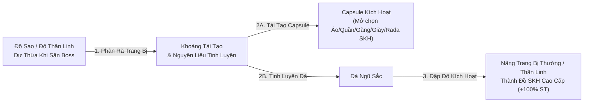

# 📂 02. HỆ THỐNG VẬT PHẨM, TRANG BỊ MẶC, SET KÍCH HOẠT & ĐẬP ĐỒ SAO TĂNG CẤP

## 🎁 2.1. Khởi Đầu Tân Thủ & Phân Cấp Trang Bị Mặc

Ngay khi vào **Nhà** (`Nhà Gôhan` / `Nhà Moori` / `Nhà Broly`), hãy gặp **Ông Gôhan / Ông Moori / Ông Paragus** để nhận bộ hành trang khởi đầu miễn phí:

| Biểu Tượng | Phần Thưởng Tại NPC Ở Nhà | Chi Tiết Vật Phẩm | Cơ Chế Nhận |
| :---: | :--- | :--- | :--- |
|  | **Nhận Quà Tân Thủ** | **99 Thỏi Vàng** (`49.5 Tỷ Vàng`) + **1.000.000 Ngọc Xanh** | 1 lần / Tài khoản |
|  | **Rương SKH Tân Thủ** | Trọn bộ **5 món Đồ Vải Thô (Áo, Quần, Găng, Giày, Rada cấp 1)** có **Set Kích Hoạt tùy chọn (+100% sát thương)** | Tự chọn 1 trong 3 Set theo định hướng ở **Mục 1.3** (1 lần / Tài khoản) |
|  | **Nhận 200k Ngọc** | **+200.000 Ngọc Xanh** mỗi lượt bấm | **Nhận không giới hạn** |
|  | **Nhận Đậu 10 x99** | **x99 Đậu Thần Cấp 10** | **Nhận không giới hạn** |

### 🪜 5 Cấp Bậc Tiến Hóa Trang Bị Mặc Trong Game
1. **Bậc 1 — Đồ Vải Thô SKH Tân Thủ**: Nhận miễn phí tại Nhà, kích hoạt ngay **+100% sát thương kỹ năng**. Bạn nên đem bộ này đi **Pha Lê Hóa lên 7–9 Sao** ngay từ đầu để dùng xuyên suốt giai đoạn Tân Thủ & Trung Cấp.
2. **Bậc 2 — Trang Bị SKH Tầm Trung & Cao Cấp (Lưỡng Long, Jean, Zealot, Kaio, Tinh Ấn)**: Nhặt từ Boss (tỷ lệ `2%` từ Nappa trở đi) hoặc tự đập bằng **Đá Ngũ Sắc / Capsule Kích Hoạt** tại Bà Hạt Mít.
3. **Bậc 3 — Trang Bị Thần Linh (Level 13 — Áo/Quần/Găng/Giày/Nhẫn Thần)**: Rớt `15%` khi tiêu diệt các Boss lớn ở Tương Lai & Cold. Có thể dùng để mặc cho Đệ tử, phân rã lấy Khoáng Tái Tạo, tinh luyện SKH, hoặc làm nguyên liệu đổi Đồ Hủy Diệt.
4. **Bậc 4 — Trang Bị Hủy Diệt (Level 14)**: Đổi tại **Bill (Hành Tinh Bill)** khi đang mặc đủ bộ Thần Linh kèm **x99 Thức Ăn** (*Pudding, Xúc xích, Kem dâu, Mì ly, Sushi*). Có cơ hội **nổ chỉ số ngẫu nhiên từ `+0%` đến `+15%`** so với gốc!
5. **Bậc 5 — Trang Bị Thiên Sứ (Level 15 — Tối Thượng)**: Chế tạo tại **Whis (Hành Tinh Bill)** bằng *Công thức Thiên Sứ + Mảnh Thiên Sứ + Đá Nâng Cấp + Đá May Mắn*.

---

## 💎 2.2. Quy Trình Đập Đồ Sao Pha Lê (1 → 9 Sao) & Tăng Cấp Trang Bị

Tất cả các thao tác đập đồ sao và nâng cấp đều thực hiện tại **Bà Hạt Mít (Đảo Kame)**:

| Bước Nâng Cấp | Chức Năng Tại Bà Hạt Mít | Nguyên Liệu Cần Thiết | Chi Tiết Cơ Chế & Mẹo Đập Đồ |
| :--- | :--- | :--- | :--- |
| **Bước 1** | **Pha Lê Hóa Trang Bị** *(Đục lỗ 1 $\rightarrow$ 9 Sao)* | Trang bị + Vàng + Ngọc Xanh | • Đục lỗ pha lê cho Áo, Quần, Găng, Giày, Rada và **cả Cải Trang / Đeo Lưng**. • Hỗ trợ chọn **Đập tự động x10, x100 lần** cực nhanh! |
| **Bước 2** | **Cường Hóa Lỗ Sao Pha Lê** *(Mở khóa lỗ Sao thứ 8 & 9)* | Trang bị đã đạt 7 Sao + **Đá Hematite** + **Dùi Đục** | • Để ép được Sao Pha Lê vào **ô thứ 8 và ô thứ 9**, bạn bắt buộc phải **Cường hóa lỗ pha lê** tại Bà Hạt Mít. |
| **Bước 3** | **Nâng Cấp & Đánh Bóng Sao Pha Lê Cấp 2** | Sao Pha Lê thường + **Đá Hematite** $\rightarrow$ **Đá Mài** | • Nâng Sao Pha Lê thường lên **Sao Pha Lê Cấp 2** bằng Đá Hematite. • Dùng **Đá Mài** để đánh bóng Sao Pha Lê Cấp 2 trước khi khảm vào trang bị để nhận chỉ số cao gấp bội! |
| **Bước 4** | **Ép Sao Pha Lê Vào Đồ** | Trang bị có lỗ trống + Sao Pha Lê (Cấp 1 / Cấp 2) / Ngọc Rồng | • Khảm chỉ số theo nhánh Build của bạn: **+% Sức Đánh (SPL Đỏ / Tím)**, **+% HP (SPL Hồng)**, **+% KI (SPL Xanh)**. |
| **Bước 5** | **Nâng Cấp Trang Bị** *(Đập cấp `[+1]` $\rightarrow$ `[+16]`)* | Trang bị (Áo/Quần/Găng/Giày/Rada) + **Đá Nâng Cấp** + **Đá Bảo Vệ** | • Tăng mạnh chỉ số gốc của trang bị (Giáp, HP, Sức đánh, KI, Chí mạng) và tạo hiệu ứng hào quang trang bị theo từng mốc `+4, +8, +12, +16`. |

---

## ⚡ 2.3. Tái Tạo Trang Bị Kích Hoạt (SKH) & Tinh Luyện Đá Ngũ Sắc

Để người chơi không bị lãng phí các món **Đồ Sao** hoặc **Đồ Thần Linh** nhặt được từ Boss, **Bà Hạt Mít (Đảo Kame)** cung cấp dây chuyền chuyển hóa khép kín tại mục **Trang Bị Kích Hoạt**:

---

## 👼 2.4. Chế Tạo Trang Bị Thiên Sứ & Sách Tuyệt Kỹ (Hành Tinh Bill)

Tại **Hành Tinh Bill**, gặp NPC **Whis** để mở khóa 2 hệ thống trang bị cuối game:
1. **Chế Tạo Trang Bị Thiên Sứ**:
   - Nguyên liệu: **1 Công thức Thiên Sứ (hoặc Công thức VIP) + 999 Mảnh Thiên Sứ + Đá Nâng Cấp (cấp 1–5) + Đá May Mắn (cấp 1–5)**.
   - Tác dụng: Đúc trang bị Thiên Sứ có chỉ số gốc cao nhất game, đá nâng cấp và đá may mắn càng cao thì tỷ lệ nổ dòng thưởng (`+20% ~ +35% chỉ số gốc` và dòng phụ) càng lớn.
2. **Hệ Thống Sách Tuyệt Kỹ**:
   - **Đổi Sách Tuyệt Kỹ**: Dùng *Bìa Sách + Kìm Bấm* để đóng thành Sách Tuyệt Kỹ 1.
   - **Giám Định & Tẩy Sách**: Mở khóa các dòng chỉ số ẩn trên Sách Tuyệt Kỹ.
   - **Nâng Cấp Sách Tuyệt Kỹ 2**: Mở khóa kỹ năng tối thượng (**Super Kamejoko, Ma Phong Ba, Liên Hoàn Chưởng**) cho cả Sư Phụ và Đệ Tử!

---

## 💎 2.5. Quy Luật Vật Phẩm Mua Bằng Hồng Ngọc (100% Random Chỉ Số) & Đeo Lưng

> [!IMPORTANT]
> **Luật Cốt Lõi Khi Mua Vật Phẩm Bằng Hồng Ngọc (`> 1.000 Hồng Ngọc`)**:
> Mọi vật phẩm trang bị mua bằng **Hồng Ngọc** trong máy chủ (bao gồm **Đeo Lưng Vĩnh Viễn** tại Quy Lão Kame và **Cải Trang Hành Tinh Tối Ưu** tại Santa) đều áp dụng cơ chế **Quay Ngẫu Nhiên Chỉ Số (Random Roll)** ngay thời điểm bấm mua! Chỉ số hiển thị trong cửa hàng là **ngưỡng trần tối đa**, khi mua hệ thống sẽ random chỉ số thực tế và thông báo trực tiếp kết quả bạn quay trúng lên màn hình.

| Cửa Hàng & NPC | Đơn Vị Mua | Thời Hạn Sử Dụng | Cơ Chế Random Chỉ Số Khi Mua |
| :--- | :--- | :---: | :--- |
| **Quy Lão Kame** *(Shop Đeo Lưng Sự Kiện)* | **Điểm Sự Kiện** *(150 – 600 điểm)* | **5 Ngày** | • Random `% Sức đánh`, `% HP`, `% KI` (`50% – 100%` mốc trần: `6–12%`, `8–16%`, `10–20%`, `12–25%`). • Random thêm **1 – 3 dòng phụ** (*Chí mạng, SĐ Chí mạng, Hút HP/KI, Giáp, Né đòn, Xuyên giáp, TNSM*). |
| **Quy Lão Kame** *(Shop Đeo Lưng Hồng Ngọc)* | **Hồng Ngọc** *(1.050 – 1.800 Hồng Ngọc)* | **VĨNH VIỄN** | • **Random ngẫu nhiên toàn bộ chỉ số** (`% SĐ, % HP, % KI` + `1–3 dòng phụ ngẫu nhiên`) giống hệt Đeo Lưng Sự Kiện nhưng sở hữu **Vĩnh Viễn**! |
| **Santa (Đảo Kame)** *(CT Hành Tinh Hồng Ngọc)* | **Hồng Ngọc** *(1.250 – 2.600 Hồng Ngọc)* | **VĨNH VIỄN** | • Random `% Sức đánh`, `% HP`, `% KI` (`70% – 100%` mốc trần của từng Cải trang). • Random toàn bộ các dòng phụ (`% Hút HP/KI`, `% SĐ Chí mạng`, `% Chí mạng`, `% Xuyên giáp`, `% Phản ST`). • Random sát thương kỹ năng: **Chưởng Trái Đất (`50% – 150%`)**, **Nổ/Bom Xayda (`25% – 75%`)**, **Laze Namek (`25% – 75%`)**. |
| **Santa (Đảo Kame)** *(CT Hỗ Trợ Đệ/Cold/PK)* | **Ngọc Xanh** *(50 Ngọc Xanh)* | **VĨNH VIỄN** | Các Cải trang tiện ích chuyên dụng: Up Đệ Tử (`+30% TNSM Đệ`), Kháng Lạnh đi Map Cold, Hóa Đá, Biến Sôcôla, Võ Phục Yardrat. |

---

## 🎒 2.6. Các Tính Năng Hỗ Trợ Vật Phẩm: Hành Trang Đa Tab (`200–500 Ô`) & Auto Lọc Đồ

1. **Hành Trang Đa Tab (`200 Ô Mặc Định` $\rightarrow$ `Tối Đa 500 Ô`, `50 Ô / Tab`)**:
   - Tạo nhân vật có sẵn **200 ô (4 Tab × 50 ô)**, mở rộng tối đa lên **500 ô (10 Tab × 50 ô)** với giá `50.000 Ngọc Xanh / Tab (+50 ô)`.
   - **Cách chuyển Tab nhanh**: Gõ `t1`, `t2`, `t3` .. `t10` (hoặc `tab 1` .. `tab 10`) vào khung chat, hoặc bấm **Nút Lá Cờ (`auto`) -> Tab Túi Đồ**.
   - **Tự động tràn Tab & Sắp xếp độc lập**: Khi Tab đang mở đầy `50/50 ô`, đồ nhặt mới sẽ tự động chảy sang các Tab còn trống tiếp theo; bấm *Sắp xếp* chỉ gom gọn trong từng Tab 50 ô để bạn thoải mái phân loại *Tab 1 (Đồ mặc/Đậu), Tab 2 (Bộ SKH phụ), Tab 3 (Ngọc Rồng & SPL), Tab 4+ (Đồ treo quái)*.
2. **Auto Treo Quái & Tự Động Lọc Bán Đồ Rác (`treoquai` / `tq`)**:
   - Khi bật `treoquai`, nhân vật tự động lọc bán các trang bị thường lấy Vàng khi đầy túi, nhưng **khóa bảo vệ tuyệt đối 100%** đối với: *Đồ có dòng Set Kích Hoạt (SKH), Đồ Thần Linh, Đồ Hủy Diệt, Đồ Thiên Sứ, và mọi trang bị có lỗ Sao Pha Lê*.

---

