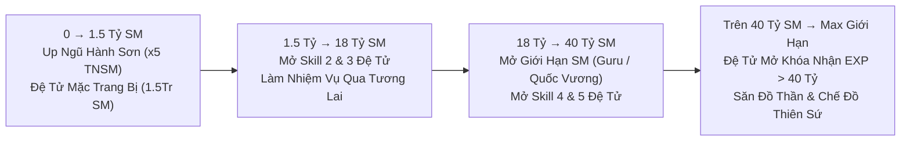

# 📂 03. HỆ THỐNG TĂNG TRƯỞNG SỨC MẠNH ĐA TẦNG

## 🚀 3.1. Lộ Trình Tăng Trưởng & Mở Giới Hạn Sức Mạnh (Sư Phụ & Đệ Tử)

- **Mở Giới Hạn Sức Mạnh Bằng Ngọc Xanh**: Gặp **Trưởng Lão Guru (Đảo Guru - Namek)** hoặc **Quốc Vương** để mở khóa các mốc giới hạn sức mạnh tiếp theo cho cả Sư Phụ và Đệ Tử bằng Ngọc Xanh.
- **Đệ Tử Không Bị Khóa EXP Ở 40 Tỷ**: Đệ tử sau khi đạt 40 Tỷ SM vẫn tiếp tục nhận Tiềm năng & Sức mạnh bình thường để vươn tới mốc giới hạn cuối cùng!

---

## 👶 3.2. Hệ Thống Tiến Hóa Đệ Tử 3 Cấp (Thường → Mabư → Broly)

Đệ tử là nguồn cộng thêm chỉ số khổng lồ khi **Hợp Thể** cùng Sư phụ. Máy chủ có chuỗi tiến hóa **3 cấp độ tuần tự**:

| Cấp Độ Đệ Tử | Biểu Tượng | Chỉ Số Cộng Khi Hợp Thể | Cách Săn Trứng & Điều Kiện Ấp Nở |
| :--- | :---: | :---: | :--- |
| **1. Đệ Tử Thường** |  | **+20% HP / KI / Sức Đánh** | Nhận miễn phí tại **Menu Tiện Ích (`auto`) -> Quản lý Đệ tử -> Nhận Đệ tử Miễn phí** hoặc săn Boss **Super Broly**. |
| **2. Đệ Tử Mabư** |  | **+25% HP / KI / Sức Đánh** *(Có kỹ năng Biến Sôcôla)* | • **Cách săn**: Tiêu diệt Boss **Kid Bư** (xuất hiện 5 con ở 3 hành tinh) $\rightarrow$ Boss **Mabư Mập** xuất hiện ngay tại khu đó. Hạ **Mabư Mập** có **50% rơi Quả Trứng Mabư**. • **Điều kiện ấp**: Đang sở hữu **Đệ Tử Thường**. Bấm dùng Quả Trứng Mabư $\rightarrow$ Về **Nhà** bấm vào Quả Trứng chọn **Nở ngay (1 Tỷ Vàng)** hoặc chờ 24h. |
| **3. Đệ Tử Broly** *(Cấp Mạnh Nhất)* |  | **+30% HP / KI / Sức Đánh** *(Đỉnh cao hợp thể)* | • **Cách săn**: Tiêu diệt Boss **Broly** (xuất hiện 5 con ở 3 hành tinh) có `10%` rơi **Quả Trứng Đệ Tử Broly**. • **Điều kiện ấp**: **Bắt buộc đang sở hữu Đệ Tử Mabư**. Bấm dùng Quả Trứng Broly $\rightarrow$ Về **Nhà** bấm vào Quả Trứng chọn hành tinh để nở thành **Đệ Tử Broly** (khởi đầu 1.5 Triệu SM, mặc được đồ ngay)! |

### ⚡ Cách Up Đệ Tử Nhanh Nhất & Mốc Mở Kỹ Năng
1. **Cách Up Đệ Tử Thần Tốc**:
   - Mua **Bùa Đệ Tử 1 Tháng** tại Bà Hạt Mít + Bật **Auto Buff Đậu (`autodau`)**.
   - Mua **Cải trang Tôn Ngộ Không / Bát Giới / Sa Tăng Đệ Tử (`+30% TNSM Đệ`)** hoặc **Cải trang Thầy Giáo (`+40% TNSM, +30% TNSM Đệ`)** tại **Santa (giá 50 Ngọc Xanh)**.
   - Đưa Đệ tử lên **Ngũ Hành Sơn (Map 122–124, x5 TNSM)** và gõ `tan cong`.
2. **Các Mốc Sức Mạnh Mở Kỹ Năng Đệ Tử**:
   - **1.5 Triệu SM**: Mặc được toàn bộ Trang bị & Cải trang.
   - **150 Triệu SM**: Mở **Chiêu 2** (*Kamejoko / Masenko / Antomic*).
   - **1.5 Tỷ SM**: Mở **Chiêu 3** (*Thái Dương Hạ San / Khiên Năng Lượng / Tái Tạo Năng Lượng*).
   - **20 Tỷ SM**: Mở **Chiêu 4** (*Biến Khỉ / Đẻ Trứng / Khiên Năng Lượng*).
   - **40 Tỷ SM**: Mở **Chiêu 5** (*Super Kame / Ma Phong Ba / Liên Hoàn Chưởng*).

---

## 👂 3.3. Nâng Cấp Bông Tai Porata Cấp 1 → Cấp 2 → Cấp 3 (Bà Hạt Mít)

| Cấp Bông Tai | Nguyên Liệu Nâng Cấp & Mở Chỉ Số | Tác Dụng Gia Tăng |
| :--- | :--- | :--- |
| **Bông Tai Porata Cấp 1** | Mua hoặc nhận cơ bản | Cho phép Hợp thể cơ bản với Đệ tử. |
| **Bông Tai Porata Cấp 2** | • **Nâng cấp**: Bông tai Cấp 1 + **x9999 Mảnh Vỡ Bông Tai**. • **Mở chỉ số**: Bông tai Cấp 2 + **x99 Mảnh Hồn Bông Tai** + **1 Đá Xanh Lam**. | Cộng thêm dòng chỉ số ngẫu nhiên (**+% Sức Đánh / HP / KI / Chí Mạng / Giáp**) khi hợp thể. *(Mảnh vỡ & Mảnh hồn cày tại Map Khí Gas / Doanh Trại / Bản Đồ Kho Báu)*. |
| **Bông Tai Porata Cấp 3** | • **Nâng cấp & Mở chỉ số** từ Bông tai Cấp 2 tại **Bà Hạt Mít (Đảo Kame)**. | Đột phá giới hạn chỉ số hợp thể lên mức cao nhất! |

---

## 🌟 3.4. Nội Tại, Hào Quang Săn Boss 3 Cấp, Thẻ Sưu Tầm & Danh Hiệu

1. **Hào Quang Săn Boss 3 Cấp (Tại Quy Lão Kame — Đảo Kame)**:
   - Mỗi lần tiêu diệt bất kỳ Boss nào, bạn nhận được **+1 Điểm Săn Boss**. Đem điểm đến gặp **Quy Lão Kame -> Đổi điểm săn Boss** để kích hoạt **Hào Quang Vĩnh Viễn**:
     - **Hào Quang Cấp 1 (`100 Điểm Săn Boss`)**: Tăng vĩnh viễn **+3% Sức Đánh, +3% HP, +3% KI**.
     - **Hào Quang Cấp 2 (`1.000 Điểm Săn Boss`)**: Tăng vĩnh viễn **+5% Sức Đánh, +5% HP, +5% KI, +5% Hút HP, +5% Hút KI**.
     - **Hào Quang Cấp 3 (`10.000 Điểm Săn Boss`)**: Tăng vĩnh viễn **+10% Sức Đánh, +10% HP, +10% KI, +10% Hút HP, +10% Hút KI**.
2. **Hệ Thống Nội Tại Nhân Vật**:
   - Mở trong Menu chức năng bản thân bằng Vàng hoặc Ngọc để lấy dòng cộng **+% sát thương kỹ năng chủ lực** (*Kamejoko, Dịch Chuyển Tức Thời, Liên Hoàn, Makankosappo, Galick, Biến Khỉ, Tự Phát Nổ*).
3. **Bách Khoa Toàn Thư (Thẻ Sưu Tầm Radar) & Danh Hiệu**:
   - Thu thập các thẻ quái/Boss rơi ra khi cày cuốc, bấm sử dụng để nâng cấp sao trong **Bách Khoa Toàn Thư**, cộng thẳng **Sức Đánh, HP, KI gốc vĩnh viễn**!

---

